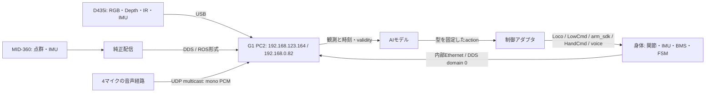

# Unitree G1 入出力・データ仕様調査 — End-to-End AIモデル向け

調査日: 2026-10-14（JST）  
対象実機: `unitree@192.168.0.82`、開発用PCの内部Ethernet `192.168.123.164`  
保存先: `sodai@sodai-ubuntu:/home/sodai/dev/G1_Hackason/e2e_nn/G1_IO_SPECIFICATION.md`

本文は入力（2〜7章）、出力（8〜13章）、NN向けデータ契約（14章）に分かれる。付録Aは関節対応とURDF、Bは全camera modeと個体校正、Cは型の全フィールド、Dは受信観測、E/Fは全ROS/DDS一覧。

## 1. 調査範囲と確認レベル

本資料での「入力」は **G1からAIモデルが受け取れる観測・状態・メタデータ**、「出力」は **AIモデル側からG1へ渡せる制御指令・表示・音声・関連設定** を指す。

公開SDKのG1向けインターフェース、接続した個体のセンサー列挙、実際のDDS/ROS 2グラフ、読み取り専用の状態取得、既存ブリッジのソースを照合した。付録には、今回検出した全ROSトピックと全DDSエンドポイント名・型・方向を収録する。OSの任意ファイルやSSHシェルそのものをNNの入出力には数えない。

| 表記 | 意味 |
|---|---|
| 実機受信確認 | 当日の観測時間内にデータを受信した |
| 実機列挙確認 | デバイス、対応モード、DDSエンドポイント、API一覧の存在を確認した。データの受信・制御動作の成功とは別 |
| 公開仕様 | メーカー資料、公式SDK/IDL/サンプルに記載がある |
| 推定 | 実測値から解釈した。根拠と未確認事項を併記する |
| 未確認 | 機体への搭載、利用条件、単位、上限、動作等が確定していない |

**「全て」の到達範囲:** 公開SDKで定義されたG1用I/Oと、今回の個体・稼働環境で発見可能だったI/Oを網羅した。非公開ファームウェア内の全API、未接続のオプション機器、あらゆるファームウェア版の機能を保証する一覧ではない。仕様が公開されていないサービスは、名称・通信型までを記録し、API IDやペイロードの意味を推測して補完していない。

調査では、既存配信への購読、デバイス/プロファイル列挙、状態GET APIだけを使用した。歩行・関節・ハンド・TTS・LED・音量変更、制御権切替、サービス停止、カメラのストリーム開始/設定変更、LiDAR設定変更は実施していない。そのため、**出力の実機動作・限界値・停止挙動は未検証**である。

### 1.1 対象個体と版

| 項目 | 確認結果 |
|---|---|
| 開発用PC | NVIDIA Orin NX Developer Kit、aarch64、Linux `5.10.104-tegra` |
| Wi-Fi / 内部Ethernet | `wlan0=192.168.0.82/24` / `eth0=192.168.123.164/24` |
| 内部制御PC | `192.168.123.161` から状態・マイク音声を受信 |
| 身体 | `LowState.motor_state` は35スロット。今回、0〜28の29スロットで `mode=1` を確認 |
| 身体状態の識別値 | `mode_machine=5`、`mode_pr=0`。`mode_machine` の数値の意味を独自に一般化しない |
| 状態GET | `GetFsmId → 501`、`CheckMode → {form:"0", name:"ai"}`。時点依存の値 |
| カメラ | Intel RealSense D435I、USB descriptor `3.2`、FW `5.15.1.55` |
| 実機Python SDK | `/home/unitree/unitree_sdk2_python`、commit `65691c8a8bc53b98d3976dba4dbf9d5d20b2e7f5` |
| 実機で使う新しいC++ SDKソース | `/home/unitree/work/unitree_sdk2`、commit `9754cd153af3da471b0fe5f3aa535e426fb11db3` |
| 比較した公式C++ SDK | commit `63096d0ac0c5d2dec9d6e0c22cd5233410ca2f36` |
| 比較した公式Python SDK | commit `814556d15970dd2ecf1c9984e845ca02ab07e206` |
| 比較した公式URDF | `unitree_ros` commit `5994d4faef0a9cadd3287f8de0199a67eeb2a259` |
| sportサーバAPI版 | GETで `1.0.0.0` を確認。arm/voiceのサーバ版GETはエラーで未確定 |
| 古いC++ SDKとの混在 | `/usr/local/include/unitree/idl` と `/home/unitree/unitree_sdk2-main` はG1向けhg/locoヘッダーが揃わない。上記 `/home/unitree/work/unitree_sdk2` と区別する |

G1製品群には23関節、29関節、ハンド込み43関節等の構成差がある。**今回の身体の入力・出力の基本長は29であり、35を物理関節数として扱わない。ハンド追加の14関節も搭載確認なしに加算しない。** [G1製品仕様](https://www.unitree.com/g1/)

## 2. 入力一覧

Hzは別途「メーカー公称」「SDKサンプル周期」「今回の受信観測」を区別する。受信観測は約6〜8秒の短時間測定で、Python処理・同時購読・QoS・ネットワーク・キューの影響を含み、センサーの保証最大値ではない。

| 入力 | 形式・概略形状 | 取得経路 | 当日の状態 |
|---|---|---|---|
| RGB画像 | `uint8[H,W,3]`、RGB/BGR等 | D435i USB / librealsense / V4L2 | デバイスと全プロファイル列挙。撮像・fps測定は未実施 |
| 深度画像 | `uint16[H,W]` Z16 + depth scale | D435i USB / librealsense | 列挙確認、scale約`0.001 m/unit` |
| 左右赤外画像 | Y8/Y16、各`[H,W]`、stream index 1/2 | D435i stereo module | 列挙確認 |
| カメラ内蔵加速度 | `float32[3]`、m/s² | D435i motion stream | 100/200 Hzプロファイル列挙。受信未検証 |
| カメラ内蔵角速度 | `float32[3]`、rad/s | D435i motion stream | 200/400 Hzプロファイル列挙。受信未検証 |
| カメラ校正・取得メタデータ | intrinsics/extrinsics、depth scale、timestamp等 | librealsense | intrinsics/extrinsics/scaleを読み取り確認 |
| LiDAR点群 | 可変長PointCloud2、XYZ/intensity/ring/time | `rt/utlidar/cloud_livox_mid360` | 受信確認。約20,064点/フレーム、22 B/点、観測8.71 Hz、公称10 Hz |
| LiDAR内蔵IMU | ROS Imu、gyro/acceleration | `rt/utlidar/imu_livox_mid360` | 受信確認、観測197.29 Hz。加速度単位に注意 |
| LiDAR付随距離・状態 | PointStamped / ベンダー診断 | `rt/utlidar/range_info` 等 | エンドポイント確認、フィールド意味・値の受信は未確定 |
| 身体関節状態 | MotorState×35、身体の有効スロット29 | `rt/lowstate`、`rt/lf/lowstate` | 受信確認。最初の観測955.92 Hz / 17.70 Hz |
| 身体主IMU | quaternion、gyro、acceleration、rpy、temperature | `LowState.imu_state` | 受信確認 |
| 身体追加IMU | 同じIMUState形式 | `rt/secondary_imu`、`rt/lf/secondary_imu` | 受信確認、最初の観測710.14 / 17.21 Hz |
| 身体IMUのROS表現 | ROS Imu | `rt/dog_imu_raw` | 受信確認、観測694.15 Hz |
| 脚/機体の推定オドメトリ | nav_msgs/Odometry | `rt/dog_odom` | 受信確認、観測692.02 Hz、`odom→robot_center` |
| SDK互換オドメトリ状態 | unitree_go/SportModeState | `rt/odommodestate`、`rt/lf/odommodestate` | 受信確認。位置/速度は非ゼロ、複数の互換フィールドはゼロ |
| G1動作FSM・タスク状態 | hg/SportModeState、uint32×3 + float32 | `rt/sportmodestate`、低頻度版 | 別の6秒観測で603件 / 90件。約100 / 15 Hz相当 |
| 生リモコン情報 | 40 B | `LowState.wireless_remote` | 受信確認。今回のサンプルはスティック・ボタンゼロ |
| 整形済みリモコン情報 | lx/ly/rx/ry + uint16 keys | `rt/wirelesscontroller` | publisher存在、最初の8秒では0件 |
| バッテリー/BMS | cell voltage、SOC/SOH、電流、温度、状態等 | `rt/lf/bmsstate` | 受信確認、観測17.79 Hz |
| メインボード健全性 | fan/temp/value/state各6要素 | `rt/lf/mainboardstate` | 受信確認、観測17.28 Hz |
| ハンド関節/手内IMU/電源 | HandState、motor_stateは可変長 | `rt/dex3/{left,right}/state`、低頻度版 | publisher存在、8秒で左右とも0件。搭載・有効性未確定 |
| ハンド触覚 | press_sensor_state、pressure/temp各12要素/モジュール | 同上 | 今回未受信。オプション装備 |
| マイク音声 | mono PCM、16 kHz、signed 16-bit | UDP `239.168.123.161:5555`、内部eth0 | 6.05秒で194,560 B受信。5120 B/packet、38 packet |
| ASR/音声イベント | std_msgs/String、可変長文字列 | `rt/audio_msg`、`rt/audio_msg/filter` | `audio_msg`を1件受信。固定JSON契約は未公開 |
| 音声/動画の別配信 | AudioData / Go2FrontVideoData | `rt/audiosender` / `rt/frontvideostream` | 型・エンドポイント確認。payloadの実デコード未検証 |
| SLAM位置・点群・地図 | Odometry / PointCloud2 / OccupancyGrid / GridMap | `rt/unitree/slam_*`、`rt/global_map`等 | mapping odom/pointsを受信。他は配信状況別 |
| 異常・停止・診断・サービス状態 | Error / String / ROS diagnostics / API response | emergency_stop、battery_alarm、selftest等 | グラフ存在を記録。全てが周期配信とは限らない |
| ナビゲーション・独自ブリッジのデータ | costmap、path、status、TF、command等 | 現在稼働中のROS 2ノード | 後述。純正センサーと派生値を区別する |

### 2.1 通信経路



当日のMacからはWi-Fi経由でPC2にSSH接続できるが、**内部DDS multicastやUSBセンサーがそのままWi-Fi側に公開されることは意味しない**。実機での購読はPC2上の `eth0`、DDS domain `0` で行った。外部PCには目的に合うブリッジを設ける。SDKの `rt/foo` はROSグラフ上では通常 `/foo` として見える。

## 3. カメラ入力と仕様

### 3.1 搭載確認と能力

実機USB productは `Intel(R) RealSense(TM) Depth Camera 435i`。`/dev/video0`〜`/dev/video5` はこの1台の複数インターフェースであり、6台の独立カメラではない。動画・深度・IR・モーションの区別はlibrealsenseのstream typeとindexを使う。

| 項目 | 仕様・確認値 |
|---|---|
| 深度方式 | active stereo。左右IR画像から深度を生成 |
| 通常の深度モード | 最大1280×720@30、848×480や640×480では90 fps対応を実機列挙 |
| 小さなROI | 848×100で100/300 fps、256×144 depthで90/300 fpsをSDKが列挙。通常画像の90 fps公称と区別 |
| RGB | 1920×1080@30を列挙。960×540以下の多くのモードでは60 fpsも列挙 |
| 深度FOV | メーカー仕様87°×58°。RGBとは異なる |
| 深度の代表作動範囲 | メーカー表記約0.3〜3 m。材質・照明・解像度等に依存し、ハードな切断距離ではない |
| IMU | 加速度100/200 Hz、角速度200/400 Hz。3成分float32 |
| 深度単位 | 当日の `get_depth_scale()` は `0.0010000000475 m/unit`。`depth_m = z16 * depth_scale` |
| 無効深度 | Z16の0は無効距離。0 mの観測として学習させない |
| RGB-D整列 | カラーと深度は別の光学中心・intrinsics・FOV。校正に基づくalignまたは座標投影が必要 |
| 姿勢 | D435iのIMUから直接6DoF位置や絶対姿勢が得られるとは限らない。VIO等は別の推定処理 |

公開仕様は [Intel D435i仕様](https://www.intel.com/content/www/us/en/products/sku/190004/intel-realsense-depth-camera-d435i/specifications.html)、深度の単位と投影は [RealSenseの投影仕様](https://github.com/realsenseai/librealsense/wiki/Projection-in-RealSense-SDK-2.0)を参照。**対応プロファイルの列挙は、全てのモードを同時に動かせる保証ではない**。本調査はカメラを開始しておらず、実際に選択する組合せのfps・帯域・同期は未検証。

### 3.2 データ契約

| データ | 型/形状 | 座標・単位・補助情報 |
|---|---|---|
| Color | RGB8/BGR8等`[H,W,3]` | channel orderを記録。SDKの変換済み形式とセンサーnative形式を混同しない |
| Depth | Z16 `uint16[H,W]` | その時点のdepth_scale、valid mask、歪み・intrinsicsを付随 |
| IR1 / IR2 | Y8またはY16 `[H,W]` | 同じStereo Moduleのindex 1/2。左右画像をRGB画像と誤認しない |
| Accelerometer | `float32[3]` | m/s²。重力を含むspecific forceとして扱い、カメラ座標系を保持 |
| Gyroscope | `float32[3]` | rad/s。カメラのmotion座標系 |
| Frame metadata | timestamp、timestamp domain、frame number、露光等 | フレームごとに対応APIで取得。ホスト受信時刻も別に保存 |
| Calibration | fx/fy/cx/cy、歪み係数、extrinsics | 解像度・crop/resize・個体・校正版と関連付けて保存 |

RealSenseの光学座標は一般にx右、y下、z前で、ロボットのbase座標（x前、y左、z上）と同じではない。[RealSense投影・座標仕様](https://github.com/realsenseai/librealsense/wiki/Projection-in-RealSense-SDK-2.0)

### 3.3 既存の画像配信経路

実機の `/home/unitree/lerobot/src/lerobot/robots/unitree_g1/run_g1_server.py` と `lerobot/cameras/zmq/image_server.py` を読み取り確認した。

| 項目 | 既存実装の仕様 |
|---|---|
| カメラdeviceの既定 | `/dev/video4`相当（`--camera-device=4`） |
| 既定画像サイズ・周期 | 640×480、30 fps設定 |
| ZMQポート | TCP 5555（設定可能） |
| ペイロード | JSONの `timestamps` と `images`。imagesの値はbase64 JPEG |
| 深度・IR | このImageServer経路には含まれない |
| 空フレーム | 新しいフレームが無いと `images={}` になる可能性がある |
| 現在の稼働 | 当日のTCP listen一覧に5555は無く、この配信の稼働は確認していない |

このサーバを画像閲覧目的でそのまま開始すると、`run_g1_server.py` の初期化が `MotionSwitcherClient.ReleaseMode()` を呼ぶ。カメラ取得と制御権の変更を分離した実装が必要であり、本調査では開始していない。UDPマイクの5555とZMQ/TCPの5555は別プロトコル・別データである。

## 4. LiDAR入力と仕様

### 4.1 MID-360の機器仕様

| 項目 | メーカー仕様 |
|---|---|
| 種別 | Livox MID-360、3D LiDAR、non-repetitive scanning |
| 視野 | 水平360°、垂直−7°〜52° |
| 距離 | 40 m@反射率10%、70 m@反射率80%（100 klx条件） |
| 近距離 | blind zone 0.1 m。0.1〜0.2 mは精度保証条件に注意 |
| 点数 | 200,000 points/s、first return |
| 代表フレーム周期 | 10 Hz。約20,000 points/frame |
| 距離精度 | ≤2 cm@10 m、≤3 cm@0.2 m（メーカー指定条件） |
| 角度精度 | <0.15°（1σ） |
| 内蔵IMU | ICM40609 |
| インターフェース | 100BASE-TX Ethernet / UDP |
| 同期 | PTPv2 / GPS時刻同期対応。GPS受信機の搭載を意味しない |

[Livox MID-360仕様](https://www.livoxtech.com/jp/mid-360/specs)、[MID-360 FAQ](https://www.livoxtech.com/mid-360/faq)。機体の頭部・身体・取付状態で遮蔽されるため、製品FOVが全方向の実効観測を保証するわけではない。

### 4.2 当日の点群ワイヤ形式

Topic: `rt/utlidar/cloud_livox_mid360` / ROS `/utlidar/cloud_livox_mid360`  
Type: `sensor_msgs::msg::dds_::PointCloud2_` / `sensor_msgs/msg/PointCloud2`

実機では `height=1`、`width=20064`、`point_step=22`、`row_step=441408`、little-endian、`frame_id=livox_frame` を確認した。点数はフレームごとに変わり得る。以下は**この配信経路の実測レイアウト**であり、Livox raw UDPや他のROS driverのstructではない。

| フィールド | offset B | 型 | 解釈 |
|---|---:|---|---|
| x | 0 | float32 | m、LiDARフレーム |
| y | 4 | float32 | m、LiDARフレーム |
| z | 8 | float32 | m、LiDARフレーム |
| intensity | 12 | float32 | 反射強度。観測フレームでは0〜210。輝度・距離とは別 |
| ring | 16 | uint16 | 当日の値0〜3。機械式LiDARの固定ビーム番号と同じ意味と決めつけない |
| time | 18 | float32 | 点ごとの時刻offset。下記の実測解釈を参照 |

`time` は観測フレームで `5000, 10000, 15000, ... 100320000`。5,000ごとの増分、20,064点で100,320,000という値は **ns単位の相対offset（約0.10032秒）** と200k points/sに整合する。したがって本個体では `offset_s = time * 1e-9` と解釈する根拠がある。ただしこのROS変換ドライバーのソース・基準点時刻の定義は未確認で、ファームウェアや経路変更後にも同じ意味を仮定しない。`header.stamp ± offset` の符号・基準が確定するまでは両者の生値を保持する。

22 B/点なので、点群payloadは約 `200000 * 22 = 4.4 MB/s`（DDS等のオーバーヘッド除外）。これは可変長点群で、通常の画像のような固定`H×W`格子にはならない。[PointCloud2メッセージ仕様](https://github.com/ros2/common_interfaces/blob/humble/sensor_msgs/msg/PointCloud2.msg)

### 4.3 LiDAR IMU — 実機の単位上の注意

Topic: `rt/utlidar/imu_livox_mid360`、type `sensor_msgs/msg/Imu`、frame `livox_frame`。

Livox raw protocolのgyroはrad/s、accelerometerは **g**。ROS Imu標準のaccelerometerはm/s²だが、今回の配信サンプルは `(0.262, 0.156, -1.006)` で、ノルム約1.05。この配信はg相当の値を維持していると強く推定される。身体IMUの約9〜10とは、そのまま結合できない。

収集時は生値と単位ラベルを保存する。m/s²に正規化する場合は、この経路の変換仕様を確認した上で `a_mps2 = a_g * 9.80665` を適用する。既にSI変換済みの別driverでは二重に掛けない。

当日のorientationは `(x,y,z,w)=(0,0,0,0)`、covarianceもゼロだった。**このorientationは有効な回転を表さず、姿勢観測として使用しない。** gyro/accelerationから姿勢を推定する処理は別に必要。[Livox IMU単位](https://livox-wiki-en.readthedocs.io/en/latest/tutorials/new_product/mid360/livox_eth_protocol_mid360.html)、[ROS Imu契約](https://github.com/ros2/common_interfaces/blob/humble/sensor_msgs/msg/Imu.msg)

### 4.4 Livox raw UDPという別経路

純正DDS配信を使う方法と、LiDARに直接Livox SDK2で接続する方法は別である。データ送信先や動作モードの変更は既存配信に影響し得るため、本調査では直接設定・再初期化をしていない。LiDAR自身のIPも今回確定していない。

| MID-360 raw通信 | LiDAR側UDPポート | Host側既定/推奨ポート |
|---|---:|---:|
| デバイス検索 | 56000 | 任意 |
| 制御コマンド | 56100 | 56101推奨 |
| 情報push | 56200 | 56201既定 |
| 点群 | 56300 | 56301既定 |
| IMU | 56400 | 56401既定 |
| ログ | 56500 | 56501推奨 |

Raw点群はヘッダーにdata_type/time_type/timestamp(ns)/dot_num/CRCを含む。Cartesian32形式はXYZ=int32 mm、reflectivity=uint8、tag=uint8。Cartesian16形式はXYZ=int16で10 mm単位。これらを、前節のROS float32 m・22 Bレイアウトで読まない。[Livox通信仕様](https://livox-wiki-en.readthedocs.io/en/latest/tutorials/new_product/mid360/livox_eth_protocol_mid360.html)

## 5. 身体・関節・IMU・リモコンの入力

### 5.1 LowStateの全フィールド

`rt/lowstate` と `rt/lf/lowstate` は `unitree_hg::msg::dds_::LowState_`。低頻度版は別topicであり、別センサーではない。

| フィールド | 型・長さ | 仕様/用途 |
|---|---|---|
| version | uint32[2] | 版関連の値。今回 `[0,0]`。意味・packingは公開IDLだけでは確定しない |
| mode_pr | uint8 | PR/AB座標モード。今回0（PR） |
| mode_machine | uint8 | 機体構成/制御に使う識別値。今回5。送信側も受信値との整合が必要 |
| tick | uint32 | 機体tick。追加観測で1秒当たり約1000.04増分、**本個体ではms相当**と確認。UTC時刻ではない |
| imu_state | IMUState | 主IMUの姿勢・角速度・加速度・温度 |
| motor_state | MotorState[35] | 後述。身体の今回有効スロット0〜28 |
| wireless_remote | uint8[40] | リモコンのバイナリ状態 |
| reserve | uint32[4] | 予約。今回ゼロ。NN用意味を割り当てない |
| crc | uint32 | Unitree指定のCRC検証値 |

SDKのCRC計算用のC互換メモリレイアウトではLowStateは2092 B。これはCDRヘッダー・RTPS/UDP等を含むネットワークpacketのサイズとは異なる。tickがms単位ならuint32のwrapは約49.7日で起こり得るので、機体再起動・wrapをUTCの巻き戻りとして扱わない。[LowState IDL](https://github.com/unitreerobotics/unitree_sdk2_python/blob/814556d15970dd2ecf1c9984e845ca02ab07e206/unitree_sdk2py/idl/unitree_hg/msg/dds_/_LowState_.py)、[CRC実装](https://github.com/unitreerobotics/unitree_sdk2_python/blob/814556d15970dd2ecf1c9984e845ca02ab07e206/unitree_sdk2py/utils/crc.py)

### 5.2 MotorStateの全フィールド

| フィールド | 型・長さ | 単位・意味・確認上の制約 |
|---|---|---|
| mode | uint8 | モーター状態。今回0〜28で1。予約スロットの値を関節として利用しない |
| q | float32 | 関節位置rad |
| dq | float32 | 関節角速度rad/s |
| ddq | float32 | 関節角加速度用フィールド、rad/s²の意味が想定される。今回のサンプルでは0。実測値が常に有効とは未確認 |
| tau_est | float32 | 推定関節トルクN·m。外力を直接測った6軸力覚値ではない |
| temperature | int16[2] | `[0]=casing`, `[1]=winding`、°C。公式保護関数の解釈 |
| vol | float32 | モーター電圧V。今回例51.0 |
| sensor | uint32[2] | 生センサー領域。dual encoder製品仕様はあるが、IDLだけではこの領域のtick/角度換算は未確定。今回例ゼロ |
| motorstate | uint32 | 状態/エラー領域。bit意味は未確定。今回例0 |
| reserve | uint32[4] | 予約領域。今回非ゼロ値もあるが、意味を独自に決めない |

基本proprioceptionは `q[29]`、`dq[29]`、`tau_est[29]`。温度・電圧・モード・エラーを別の健全性入力/制御ゲートとして保持する。全zeroを有効観測と仮定しない。

[MotorState IDL](https://github.com/unitreerobotics/unitree_sdk2_python/blob/814556d15970dd2ecf1c9984e845ca02ab07e206/unitree_sdk2py/idl/unitree_hg/msg/dds_/_MotorState_.py)、[温度等の公式解釈](https://github.com/unitreerobotics/unitree_sdk2/blob/63096d0ac0c5d2dec9d6e0c22cd5233410ca2f36/include/unitree/robot/g1/common/terminations.hpp)

### 5.3 IMUStateの全フィールド

| フィールド | 型 | 単位・規約 |
|---|---|---|
| quaternion | float32[4] | **SDKでは`[w,x,y,z]`**。ROS geometry Quaternionの`[x,y,z,w]`と入れ替えが必要 |
| gyroscope | float32[3] | rad/s、センサー/機体座標での角速度 |
| accelerometer | float32[3] | 身体配信ではm/s²相当。重力を含む値。今回の例でz約9.23 |
| rpy | float32[3] | roll/pitch/yaw、rad。quaternionとの重複表現 |
| temperature | int16 | 温度。センサーの具体型式・レンジ・精度は今回未確定 |

同じ構造が身体主IMUと `secondary_imu` に使われる。**両者の具体的な搭載位置・固定回転・yaw原点は未確定**。今回、主IMUとsecondaryのyawが異なるサンプルを受信しており、単純平均・同一姿勢としての連結はしない。取付外部パラメータを確定してから融合する。

`rt/dog_imu_raw` はROS Imuで `frame_id=dog_imu_link`。こちらの四元数はROS順。covarianceがゼロなら「ノイズが完全にゼロ」という意味ではなく、未記載の可能性がある。[IMUState IDL](https://github.com/unitreerobotics/unitree_sdk2_python/blob/814556d15970dd2ecf1c9984e845ca02ab07e206/unitree_sdk2py/idl/unitree_hg/msg/dds_/_IMUState_.py)、[wxyzの公式利用例](https://github.com/unitreerobotics/unitree_sdk2/blob/63096d0ac0c5d2dec9d6e0c22cd5233410ca2f36/include/unitree/robot/g1/common/terminations.hpp)

追加の `rt/lowstate_doubleimu`（`unitree_hg_doubleimu/msg/doubleIMUState`）、`rt/loco_sdk`（hg/LowState）もgraphに存在する。前者は今回参照した公開SDKに対応IDLがなく、後者も通常のLowStateと同じ型名があるだけでデータの追加意味は未確定。これらを未知の独立センサーとして数えたり、主/secondary IMUのschemaを推測してdecodeしたりしていない。

### 5.4 リモコン

`LowState.wireless_remote` は40 Bの生領域。既存の公式Joystick decoderではbytes 2/3がボタン、4〜7がlx、8〜11がrx、12〜15がry、20〜23がlyのfloat32として読まれる。byte orderを固定し、decoderの版も保存する。ボタンはL/Rトリガー・肩ボタン、start/back、ABXY、方向キー等を含む。[公式decoder](https://github.com/unitreerobotics/unitree_sdk2_python/blob/814556d15970dd2ecf1c9984e845ca02ab07e206/unitree_sdk2py/utils/joystick.py)

別topic `rt/wirelesscontroller` は `unitree_go::msg::dds_::WirelessController_`:

| フィールド | 型 |
|---|---|
| lx, ly, rx, ry | 各float32 |
| keys | uint16 |

今回のこの別topicはpublisherが存在したが0件受信だった。生40 BはLowState内で受信できた。リモコン値は人間の意図/overrideの入力候補であり、受信したスティック値をそのまま速度m/sと解釈しない。

## 6. 位置推定・FSM・電源・診断・音声の入力

### 6.1 身体odometryと互換SportModeState

| Topic / 型 | 内容 | 実機で確認した注意点 |
|---|---|---|
| `rt/dog_odom` / nav_msgs/Odometry | pose、twist、共分散、stamp、frame | `frame_id=odom`、`child_frame_id=robot_center`。位置/速度の推定値で、絶対位置ground truthではない |
| `rt/odommodestate` / **unitree_go** SportModeState | 位置3、速度3、yaw_speed、姿勢等 | timestampは今回0。位置/速度は非ゼロ。foot_force等は全ゼロ |
| `rt/sportmodestate` / **unitree_hg** SportModeState | FSM/タスクの状態 | 同名に近いが**別の小さな型**。Go2互換型をこのtopicに当てない |

G1用hg SportModeStateは `fsm_id:uint32, fsm_mode:uint32, task_id:uint32, task_time:float32`。今回は `501,0,4,0.0` を受信した。task_timeはタスク時間の領域だが、全タスクで有効な経過秒かは未検証。[G1 SportModeState IDL](https://github.com/unitreerobotics/unitree_sdk2/blob/63096d0ac0c5d2dec9d6e0c22cd5233410ca2f36/include/unitree/idl/hg/SportModeState_.hpp)

Go2互換SportModeStateには、`stamp, error_code, imu_state, mode, progress, gait_type, foot_raise_height, position[3], body_height, velocity[3], yaw_speed, range_obstacle[4], foot_force[4], foot_position_body[12], foot_speed_body[12], path_point[10]` がある。**型にfoot_forceがあることは、G1の足底力センサーが利用できる証拠ではない。** 本個体ではこれらの複数領域がゼロで、四足用の4要素領域をG1の左右足に独自対応させない。[互換型IDL](https://github.com/unitreerobotics/unitree_sdk2_python/blob/814556d15970dd2ecf1c9984e845ca02ab07e206/unitree_sdk2py/idl/unitree_go/msg/dds_/_SportModeState_.py)

Odometryのposeはheader.frame_id、twistはchild_frame_idを基準とするROS契約に従うが、純正/独自publisherが正しく実装しているかは個別確認する。[ROS Odometry仕様](https://github.com/ros2/common_interfaces/blob/humble/nav_msgs/msg/Odometry.msg)

### 6.2 バッテリーBmsStateの全フィールド

`rt/lf/bmsstate`、`unitree_hg::msg::dds_::BmsState_`。

| フィールド | 型・長さ | 仕様/単位/観測 |
|---|---|---|
| version_high, version_low | uint8各1 | 今回1,6 |
| fn | uint8 | 制御/状態領域。詳細未確定 |
| cell_vol | uint16[40] | 今回13セル相当が3896〜3916、残りゼロ。mVに整合するがIDLに単位注釈は無い |
| bmsvoltage | uint32[3] | 今回`[50754,50800,0]`。mVに整合、各要素の意味は未確定 |
| current | int32 | 今回−3906。mA候補だがスケール・符号を公式契約としては未確定 |
| soc | uint8 | State of Charge、%。今回75 |
| soh | uint8 | State of Health、%領域。今回96 |
| temperature | int16[12] | 今回先頭4個32/28/27/33。温度位置・有効要素・全スケールは未確定 |
| cycle | uint16 | 充放電cycle領域。今回19 |
| manufacturer_date | uint16 | 日付のpacking未確定 |
| bmsstate | uint32[5] | BMS状態bit領域。bit仕様未確定 |
| reserve | uint32[3] | 予約 |

配列長40を「40セル搭載」と解釈しない。G1製品仕様は13直列、9000 mAhのスマートバッテリー。未確定の値は生値で記録し、正規化器に未検証のスケールを埋め込まない。[BMS IDL](https://github.com/unitreerobotics/unitree_sdk2_python/blob/814556d15970dd2ecf1c9984e845ca02ab07e206/unitree_sdk2py/idl/unitree_hg/msg/dds_/_BmsState_.py)、[製品電源仕様](https://www.unitree.com/g1/)

### 6.3 MainBoardStateと異常・サービス情報

`rt/lf/mainboardstate` は `fan_state:uint16[6], temperature:int16[6], value:float32[6], state:uint32[6]`。今回temperature先頭52、value先頭約50.784/50.513/4.0を受信した。各チャンネルの意味・単位は公開IDLだけでは確定しない。[MainBoardState IDL](https://github.com/unitreerobotics/unitree_sdk2_python/blob/814556d15970dd2ecf1c9984e845ca02ab07e206/unitree_sdk2py/idl/unitree_hg/msg/dds_/_MainBoardState_.py)

異常・健全性の候補には `rt/lf/emergency_stop`、`rt/lf/battery_alarm`、`rt/selftest`、`rt/servicestate`、`rt/config_change_status`、`rt/log_system_*`、`rt/rtc/state`、`rt/public_network_status`、ROSの `/g1/bridge_status` と `/g1/state_bridge_status` 等がある。`unitree_go/Error`は`source:uint32, state:uint32`、String系は可変長テキストで、独自JSONの固定schemaが公開されているとは限らない。制御ゲートには状態・時刻・失効・エラーを保持する。

`RobotStateClient.ServiceList()` のGETは成功し、`ai_sport, state_estimator, lidar_driver, dex3_service_l/r, unitree_slam, audio_player_service, video_hub_pc4, video_hub_pc4_chest, emergency_stop, battery_guard` 等のサービス名を返した。**サービス名の存在は、カメラ台数・ハンド実装・配信データの有効性の証拠とは別**である。

### 6.4 マイクとASR

ハードウェア製品仕様は4 microphone array。ただし公開SDKの生音声例は **16 kHz・mono・signed 16-bit PCM** で、4チャンネルを独立に取り出す契約ではない。

| 項目 | 仕様/実測 |
|---|---|
| 生音声受信 | UDP multicast `239.168.123.161:5555`、PC2のeth0側でjoin |
| 音声形式 | PCM s16、mono、16,000 samples/s。公式Linux例の扱いはlittle-endian相当 |
| データ量 | 約32,000 B/s、5秒で160,000 B（payloadのみ） |
| 当日の実測 | 6.052秒、194,560 B、38 packets、全packet 5120 B。約160 ms分/packetに整合 |
| 音声処理 | mono化前の4本、beamforming、AEC、gain等の内部処理・方向推定APIは未確認 |
| ASR | `rt/audio_msg` はstd_msgs/String。イベント駆動で固定fpsではない |
| 別音声型 | `AudioData = time_frame:uint64 + data:uint8[]`。このtopicのcodec・time_frame単位は未確定 |
| 別動画型 | `Go2FrontVideoData = time_frame:uint64 + video720p/360p/180p:uint8[]`。名称だけからcodecやカメラ構成を断定しない |

音声のpacketは画像フレームと周期が一致しない。モデルには時刻付きPCM window、audio validity、必要ならSTT結果を別の入力として渡す。録音はこの調査では保存せず、受信量・送信元・packet長だけを計測した。[公式G1音声サンプル](https://github.com/unitreerobotics/unitree_sdk2/blob/63096d0ac0c5d2dec9d6e0c22cd5233410ca2f36/example/g1/audio/g1_audio_client_example.cpp)

## 7. オプションハンドと派生入力

### 7.1 Dex3-1の入力・ハードウェア仕様

Dex3-1は3指、7自由度（thumb 3、index 2、middle 2）。触覚仕様は9モジュール、合計33 sensing elements/hand。掌3箇所・指腹3箇所が各2×2、指先3箇所が各3×1。製品上の感知範囲は10〜2500 gの荷重条件、通信rateは1000 Hzとされる。

G1製品ページでは触覚arrayはオプションである。今回は左右のstate publisherとcmd subscriberを発見したが、state sampleを受信できなかったため、**この個体でハンド/触覚を利用できるとは確定していない**。 [Dex3-1製品仕様](https://www.unitree.com/Dex3-1/)、[G1オプション仕様](https://www.unitree.com/g1/)

`HandState_` の全フィールド:

| フィールド | 型・長さ | 内容/注意 |
|---|---|---|
| motor_state | sequence<MotorState> | Dex3-1では通常7関節。IDLは固定長7ではない |
| press_sensor_state | sequence<PressSensorState> | 触覚モジュールのsequence。搭載/有効要素を確認する |
| imu_state | IMUState | 手内IMUの領域。個体の実データ未確認 |
| power_v, power_a | float32各1 | 電源電圧/電流の領域。単位・測定点は実機で未確認 |
| system_v, device_v | float32各1 | 電圧領域。測定点未確認 |
| error | uint32[2] | エラー領域。bit意味未確認 |
| reserve | uint32[2] | 予約 |

`PressSensorState_ = pressure:float32[12], temperature:float32[12], lost:uint32, reserve:uint32`。

**9モジュール×12要素の格納領域を108個の物理taxelと数えない。** 公称33要素のどれが各配列indexに対応するか、未使用要素、pressure数値の荷重/圧力単位、offset/gain calibrationは、この個体で未確認。製品ページのg単位の感知範囲を、そのままIDLのpressure値の単位と断定しない。 [HandState IDL](https://github.com/unitreerobotics/unitree_sdk2_python/blob/814556d15970dd2ecf1c9984e845ca02ab07e206/unitree_sdk2py/idl/unitree_hg/msg/dds_/_HandState_.py)、[PressSensorState IDL](https://github.com/unitreerobotics/unitree_sdk2_python/blob/814556d15970dd2ecf1c9984e845ca02ab07e206/unitree_sdk2py/idl/unitree_hg/msg/dds_/_PressSensorState_.py)

Dex1/Dex2/Dex5/Inspire等への換装は別の構成・SDK・mappingを要する。本個体での搭載は未確認。Dex3の7関節契約を他のハンドへ適用しない。

### 7.2 SLAM・ナビゲーション・独自ブリッジ

| 入力候補 | 形式 | 実機確認/使い分け |
|---|---|---|
| `/unitree/slam_mapping/odom` | Odometry | 約10.03 Hz、map→base_link。SLAM推定、ground truthではない |
| `/unitree/slam_mapping/points` | PointCloud2 | 約10.03 Hz。map frame、48 B/点、法線/曲率を含む。**当日のheader.stamp=0** |
| `/unitree/slam_relocation/*` | Odometry/PointCloud2 | グラフ存在を記録。mappingと同一センサーではなく別処理 |
| `/global_map`, `/gridmap`, `/planner_map` | OccupancyGrid/GridMap | 地図/派生表現。解像度・原点・更新時刻・unknown値を保持 |
| `/collision_clouds`, `/safe_clouds`, `/warning_clouds`等 | PointCloud2 | フィルタ済み点群。生点群と区別 |
| `/odom`, `/tf`, `/tf_static` | Odometry/TFMessage | ローカライズ/座標変換の出力。publisherとtimestampの出どころを保持 |
| `/global_costmap/costmap` | OccupancyGrid | 当日476×749、0.05 m/cell。NNの補助入力候補 |
| `/local_costmap/costmap` | OccupancyGrid | 当日120×120、0.05 m/cell |
| `/plan`, `/received_global_plan`, `/lookahead_point`等 | Path/PointStamped | プランナーの派生出力。純粋な生センサー入力ではない |
| `/g1/patrol/status`, `/g1/bridge_status`等 | String/DiagnosticArray | 既存アプリの状態・判断 |
| **`/g1/sdk_odom`** | Odometry | **既存ブリッジが指令速度を積分した値**。実測位置として扱わない |

独自ブリッジの `/home/unitree/g1_nav2/g1_sdk_bridge_cpp/src/sdk_bridge_process.cpp` で `pose_ = IntegratePose(pose_, effective, dt, ...)` を確認した。ROSのg1_state_bridgeがこの状態を `/g1/sdk_odom` に出しており、今回20 Hzで受信した。ヘッダーコメントに「実機では取得値」とあっても、当日の実装は指令からの積分である。**学習の移動量・滑り・速度追従の正解ラベルには `/dog_odom` や検証済みSLAM/外部測位等を選び、この値を独立な観測として使わない。**

`/dog_odom`・SLAMも推定結果であり、真の絶対位置は保証しない。複数の推定経路とその信頼度/取得時刻を、値の名前だけで統合しない。

### 7.3 今回、取得を確定できなかった入力

| 項目 | 調査上の結論 |
|---|---|
| 足底の独立した荷重/6軸力覚 | 利用可能な非ゼロデータを未確認。四足互換型のfoot_force領域は今回ゼロ |
| ハンド触覚・手内IMU | endpoint存在、sampleなし。搭載/有効性・mapping未確認 |
| 独立した4チャンネルのマイク | 公開経路はmono。4個を独立観測できる契約を未確認 |
| 音源方向、beamforming前の信号 | 公開SDKで固定契約を未確認 |
| GNSS位置、磁気センサー、絶対heading | 今回の搭載・観測は未確認。LiDARのGPS時刻同期能力とは別 |
| 手首/胸などの追加カメラ | サービス名にchestはあるが、PC2のUSB列挙で確認できた撮像機はD435i 1台。追加機器を断定しない |
| 生モーター電流・dual encoderの個別生角度 | tau_est/vol/不明のsensor領域はあるが、個別電流/encoderの単位付き契約を確定できない |
| 各センサーのノイズ・bias・取付校正 | 個体に対する全校正値/外部パラメータは未確定 |

## 8. G1が受け入れる出力の一覧

「受け入れる」はSDK/通信契約の存在を意味する。今回の調査では動作を伴うSET APIを送っておらず、**任意状態での受付成功、実動作、実機の飽和範囲は検証していない**。

| 出力 | API/topic・サービス | 形式・次元 | 適用条件 |
|---|---|---|---|
| 歩行速度 | sport / `SetVelocity` 7105 | vx, vy, omega + duration | 純正locomotionが有効。身体座標の速度指令 |
| 歩行/姿勢FSM | sport / `SetFsmId` 7101 | int | firmware依存の離散状態 |
| balance/swing/stand/speed設定 | sport / 7102/7103/7104/7107 | int/float | 状態・版による受付条件は未検証 |
| 旧来の手振り/握手task | sport / 7106 | task_id | ArmActionの7106とサービスが別 |
| G1全身低レベル | `rt/lowcmd` | LowCmd、29身体関節を有効利用 | 制御権/座標モード/CRC/周期整合が必要 |
| G1 user control | `rt/user_lowcmd` + sport 7110/7111 | LowCmd | SDK上の別ルート。動作・条件未検証 |
| 上半身/腕の連続制御 | `rt/arm_sdk` | LowCmdの身体index、weightはslot 29 | 純正制御とのblend/所有権。腕7×2、例では腰3も対象 |
| 既定腕gesture | arm / ExecuteAction 7106 | action_id:int | 実機GETした一覧は9章に収録 |
| Dex3左右ハンド | `rt/dex3/{left,right}/cmd` | HandCmd、MotorCmd×7/hand | 本個体の稼働未確認 |
| 別種のハンドblend | `rt/hand_sdk` | unitree_go/MotorCmds、例は4モーター | 最新公式例に存在、今回のsubscriberは未検出 |
| TTS発話 | voice / TtsMaker 1001 | text + speaker_id + index | 音声再生の離散/文字出力 |
| 音声PCM再生 | voice / PlayStream 1003 | app_name/stream_id + binary PCM | 16 kHz mono s16へ整形 |
| 再生停止 | voice / PlayStop 1004 | app_name | stream_idではなくapp_name契約 |
| 音量 | voice / SetVolume 1006 | volume | 公開例0〜100%。実機GETは100を返した |
| RGB LED | voice / LedControl 1010 | R/G/B uint8 | 0〜255各成分 |
| 制御モードの所有権 | motion_switcher / SelectMode/ReleaseMode | name / 空parameter | 状態変更・身体の制御に影響。NNの連続actionとは分離 |
| サービス/配信頻度 | robot_state / ServiceSwitch/SetReportFreq | name/switch、interval/duration | 管理設定。G1共通サービスの条件未検証 |
| カメラ設定 | librealsense options | exposure/gain/AE/depth units等 | 全列挙値は付録。取得条件を変える管理出力 |
| LiDAR設定 | Livox SDK2/control protocol | 型・送信先・IMU enable・動作状態等 | 純正driverとの競合を確認してから使用 |
| SLAM/地図操作など | `rt/api/slam_operate/*` 等 | Unitree Request/Response | endpoint存在、個別APIの固定契約未確定 |
| AGV移動/昇降 | agv / 1001/1002 | vx/vy/vyaw、vz | G1向けSDKの追加構成。今回の二足個体への適用未確認 |
| 独自Nav2ブリッジ | ROS Twist/サービス、Unix IPC | 後述 | 純正G1のnative契約とは別の現環境の入口 |

BmsCmd、各種内部設定・OTA等もSDK型/内部サービスとして存在するが、具体的な受付topicや意味を検証できないものは13章・付録に残す。ファームウェア更新・校正・電源操作は学習する日常動作のactionとは分ける。

### 8.1 RPCの共通ワイヤ形式

Unitree SDKのRPCはDDSの `rt/api/<service>/request` と `.../response`。`Request_ = header + parameter:string(JSON等) + binary:uint8[]`、`Response_ = header + data:string + binary:uint8[]`。

header内のidentityは `id:int64, api_id:int64`。responseのstatusは `code:int32`。request側にはlease/policy領域もある。SDKがlease、request ID、timeout、応答照合を扱うので、NNのtensorをDDS payloadに直接reinterpret_castしない。成功code=0はAPI応答の成功であり、物理的に目標へ到達した確認とは別。IDLでない任意JSONのschemaはサービス単位で定義する。

共通のserver API version GETはinternal API ID1。Clientのローカル設定値を返す `GetApiVersion()` と、サーバへ問い合わせる `GetServerApiVersion()` は違う。今回のsportのサーバGETは成功し、arm/voiceはこのGETだけがエラーだった。一方、armのaction一覧・voiceのvolume GETは成功しており、version GET失敗だけでservice全体が利用不可とは判断しない。

## 9. 高レベル歩行・姿勢・腕gestureの出力仕様

### 9.1 LocoClient / sport API一覧

Service `sport`、SDK API version `1.0.0.0`。今回、GETによるサーバ版取得も同じ値を返した。

| ID | API | requestの内容 | response/意味・制約 |
|---:|---|---|---|
| 7001 | GetFsmId | 空parameter/空JSON | data:int。今回501、code=0 |
| 7002 | GetFsmMode | 空 | data:int。C++ラッパーあり、今回GET未実施 |
| 7003 | GetBalanceMode | 空 | data:int。C++ラッパーあり |
| 7004 | GetSwingHeight | 空 | data:float。単位/適用範囲を個体のfirmwareで確認する |
| 7005 | GetStandHeight | 空 | data:float。絶対高さ/正規化値の解釈未確定 |
| 7006 | GetPhase | 空 | data:float[]。deprecated |
| 7100 | FSM API / GetMimicMotion | 公式C++の一覧GET例は`{fsm_id:550,api_id:1}` | 最新C++に存在。動的motionのID/name/duration一覧を返す契約。今回未取得 |
| 7101 | SetFsmId | `{data:int}` | 状態切替。すべてのintが有効ではない |
| 7102 | SetBalanceMode | `{data:int}` | C++例0=BalanceStand、1=ContinuousGait |
| 7103 | SetSwingHeight | `{data:float}` | 最新C++ラッパーあり。実機Python版はID登録のみで専用methodなし。物理単位/範囲未確定 |
| 7104 | SetStandHeight | `{data:float}` | LowStandは0、HighStandはUINT32_MAXをfloatで送る特殊値。通常のm値と混同しない |
| 7105 | SetVelocity | `{velocity:[vx,vy,omega],duration:t}` | vx/vy m/s、omega rad/s、t秒 |
| 7106 | SetTaskId | `{data:int}` | sport側の旧task。WaveHand 0/1、ShakeHand 2/3の例 |
| 7107 | SetSpeedMode | `{data:int}` | speed modeの列挙意味・速度飽和範囲は未確定 |
| 7110 | SwitchToUserCtrl | `{data:false}`相当 | 別のuser controlへ切替。身体制御に影響する |
| 7111 | SwitchToInternalCtrl | `{data:0/1/2}` | LAST=0、PASSIVE=1、WALKRUN=2。版・現状態の条件あり |

`SetVelocity` のrequest例（本調査では送信していない）:

```json
{"velocity": [0.25, 0.0, 0.0], "duration": 0.2}
```

軸はロボットの前後vx、左右vy、yaw角速度。通常のbase規約はx前・y左・z上、正yawは上から見て反時計回りだが、取り付けframe/ブリッジ変換の一致を別に確認する。APIの最大速度・加速度・duration満了時の実動作は今回未測定。**SDKには呼び出し側の速度clampがなく、NNの正規化出力[-1,1]をそのままm/sとして送らない。**

Python/C++の `Move(..., continuous=true)` はdurationに864000秒を使う実装。C++の `SwitchMoveMode` はこのローカルflagを変える。E2Eのアダプタでは有限duration、送信周期、古いactionの失効を明示する。`StopMove` はゼロ速度要求であり、電源遮断や身体の脱力とは別。

[Loco API定義](https://github.com/unitreerobotics/unitree_sdk2/blob/63096d0ac0c5d2dec9d6e0c22cd5233410ca2f36/include/unitree/robot/g1/loco/g1_loco_api.hpp)、[C++ Client](https://github.com/unitreerobotics/unitree_sdk2/blob/63096d0ac0c5d2dec9d6e0c22cd5233410ca2f36/include/unitree/robot/g1/loco/g1_loco_client.hpp)、[Python Client](https://github.com/unitreerobotics/unitree_sdk2_python/blob/814556d15970dd2ecf1c9984e845ca02ab07e206/unitree_sdk2py/g1/loco/g1_loco_client.py)

### 9.2 高レベルaliasと版差

| alias | SDKでの変換 |
|---|---|
| ZeroTorque | SetFsmId(0) |
| Damp | SetFsmId(1) |
| Start | SetFsmId(500) |
| Sit | SetFsmId(3) |
| C++ Squat / StandUp | SetFsmId(2) / SetFsmId(4) |
| Python Squat2StandUp / StandUp2Squat | 両方SetFsmId(706) |
| Python Lie2StandUp | SetFsmId(702) |
| HighStand / LowStand | SetStandHeight(UINT32_MAX) / SetStandHeight(0) |
| BalanceStand / ContinuousGait | balance mode。C++/Pythonのmethod署名にも差がある |
| WaveHand / ShakeHand | sport側task ID 0〜3のwrapper |

**C++とPythonのalias・FSM番号には差がある。** 抽象的な「立つ」「しゃがむ」を名前だけで相互置換しない。501は今回受信したFSM値だが、上表のStartが直接送る値は500である。GetFsmId、hg SportModeState、対象版のstate machineを使って実際の遷移を確認する。

最新C++にはmimic motion一覧GETがあり、`fsm_id=550`の動作を`550<個別motion_api_id>`形式のFSM IDで起動する説明がある。動的に取得した一覧・対応条件を優先し、未取得のmotion IDを創作しない。本調査でその動作を起動していない。

### 9.3 G1ArmActionClient / arm

Service `arm`、SDK API version `1.0.0.14`。`ExecuteAction` はAPI 7106に `{data:action_id}`、`GetActionList` は7107で一覧を返す。**sport/7106とarm/7106は別サービス・別機能。** [ArmAction定義](https://github.com/unitreerobotics/unitree_sdk2_python/blob/814556d15970dd2ecf1c9984e845ca02ab07e206/unitree_sdk2py/g1/arm/g1_arm_action_client.py)

当日の `GetActionList` がcode=0で返した、ID付きの全23項目:

| ID | serverが返したname（原表記） | serverが返した条件 |
|---:|---|---|
| 99 | release_arm | — |
| 1 | turn_back_wave | fsm: 500,501 |
| 11 | blow_kiss_with_both_hands | — |
| 12 | blow_kiss_with_left_hand | — |
| 13 | blow_kiss_with_right_hand | — |
| 15 | both_hands_up | — |
| 17 | clamp | — |
| 18 | high_five | — |
| 19 | hug | — |
| 20 | make_heart_with_both_hands | mode_machine: 5,6 |
| 21 | make_heart_with_right_hand | mode_machine: 5,6 |
| 22 | refuse | — |
| 23 | right_hand_up | — |
| 24 | ultraman_ray | — |
| 25 | wave_under_head | — |
| 26 | wave_above_head | — |
| 27 | shake_hand | — |
| 28 | box_left_hand_win | mode_machine: 5,6 |
| 29 | box_right_hand_win | mode_machine: 5,6 |
| 30 | box_both_hand_win | mode_machine: 5,6 |
| 33 | right_hand_on_heart | — |
| 34 | both_hands_up_deviate_right | — |
| 36 | forward_push | mode_machine: 5,6 |

別の配列には `Throw_money:8.1 s`, `Spin_discs:6.9 s`, `Scratch_head:8.1 s`, `Waist_Drum_Dance:9.5 s` の4項目を返した。こちらにはaction IDが無く、`ExecuteAction(int)`に渡す番号・起動方法はこのGETだけでは確定しない。名前/時間の存在として記録し、IDを推測しない。`clamp`等のserver名もSDKの固定辞書（例: clap）に合わせて書き換えていない。

`rt/arm/action/state` はStringで当日約10 Hz受信したが、完了/実行中/中止のJSON契約は未確定。ACKとgesture完了を同じ教師ラベルにしない。

## 10. 全身・腕・ハンドの連続出力仕様

### 10.1 身体LowCmd / MotorCmd

`LowCmd_` は `mode_pr:uint8, mode_machine:uint8, motor_cmd:MotorCmd[35], reserve:uint32[4], crc:uint32`。

| MotorCmdフィールド | 型 | 単位・用途 |
|---|---|---|
| mode | uint8 | 公式body例は1=Enable、0=Disable |
| q | float32 | 目標角度rad |
| dq | float32 | 目標角速度rad/s |
| tau | float32 | feed-forwardトルクN·m |
| kp | float32 | stiffness gain、N·m/rad相当 |
| kd | float32 | damping gain、N·m·s/rad相当 |
| reserve | uint32 | 予約 |

位置・速度・トルク・gainは独立した別プロトコルではなく、**同じhybrid motor command** の成分。一般的な解釈は `tau_motor = tau_ff + kp*(q_des-q) + kd*(dq_des-dq)`。実際の内側制御・飽和・フィルタ・トルク定数はfirmware依存で、この式を物理挙動の完全な保証としない。

| 出力設計 | メッセージへの写像例 | 注意 |
|---|---|---|
| 位置policy | NNがq_des、adapterがdq/tau/gainを固定 | 29要素。関節順・基準姿勢・rad変換を固定 |
| トルクpolicy | NNがtau_ff、PD成分を明示設計 | 29要素。Kp/Kdゼロ等の条件を明示し、純粋tauとhybridを区別 |
| hybrid policy | q/dq/tau/kp/kdの各head | 29×5=145連続値。ただし全部を自由出力する前提を採用しない |

`mode_pr=0(PR)` はpitch/roll関節座標、`mode_pr=1(AB)` は並列機構のA/Bモーター側座標。足首や腰の対応が変わるため、同じ29次元の配列でも意味が変わる。`mode_machine` はLowStateから受け取り、対応する個体の値を使う。NNにmode/CRC/reserveを連続値として学習させず、adapterが決定する。

全身低レベルrouteは `rt/lowcmd`。公式G1例の送信periodは **0.002秒=500 Hz**。これはNNの画像推論を500 Hzで行う要求ではなく、内側の送信loopの設定例。今回、LowState tickは約1000 units/sで、追加6秒観測では約1035.5 samples/sを受信した。**状態周期・motor内側周期・NN推論周期・command送信周期は別々に設計する。**

SDKのCRC計算用LowCmdレイアウトは1004 B、CRC多項式は`0x04C11DB7`。全身例ではpayload更新後にSDKのCRCを計算して送る。CDRの任意bytesやJSONに同じCRCを掛けるものではない。arm/user routeは同型でもserverの処理経路が別なので、その版のサンプルに従う。[LowCmd IDL](https://github.com/unitreerobotics/unitree_sdk2_python/blob/814556d15970dd2ecf1c9984e845ca02ab07e206/unitree_sdk2py/idl/unitree_hg/msg/dds_/_LowCmd_.py)、[MotorCmd IDL](https://github.com/unitreerobotics/unitree_sdk2_python/blob/814556d15970dd2ecf1c9984e845ca02ab07e206/unitree_sdk2py/idl/unitree_hg/msg/dds_/_MotorCmd_.py)、[低レベル公式例](https://github.com/unitreerobotics/unitree_sdk2_python/blob/814556d15970dd2ecf1c9984e845ca02ab07e206/example/g1/low_level/g1_low_level_example.py)

低レベル例の初期化は `MotionSwitcherClient.ReleaseMode()` を実行する。これは純正高レベル制御を外す操作であり、SDKの購読を開始するだけの操作とは違う。本資料の調査コードはこの例を実行していない。接続喪失時に身体を支える責任や制御権移譲は、NN本体と別の実行系で定義する。

### 10.2 user controlとarm_sdk

| route | 形式/対象 | 公開例の条件・設定 |
|---|---|---|
| `rt/user_lowcmd` | LowCmd、身体29関節 | C++例はPASSIVEのFSM=1を確認し、7110でuser controlへ移行。0.02 s periodの例。今回動作未検証 |
| `rt/arm_sdk` | LowCmd内の腕/上半身index | 7関節×左右。公式7DoF例の対象listには腰3関節も含む。0.02 s=50 Hzの例 |
| arm blend weight | `motor_cmd[29].q` | 0〜1の制御weight/enable領域。**29番目の実在関節ではない** |

slot0〜28は身体、slot29はarm_sdkでは特殊制御、30〜34は未使用/予約。NNの関節tensorには35スロットをそのまま露出しない。腕だけなら14次元、腰まで扱う場合は追加3次元を、対応版・モードで確認する。SDKの全身例は29関節、23関節版では腰roll/pitchと手首pitch/yaw等の扱いが違う。[arm_sdk例](https://github.com/unitreerobotics/unitree_sdk2_python/blob/814556d15970dd2ecf1c9984e845ca02ab07e206/example/g1/high_level/g1_arm7_sdk_dds_example.py)、[user control例](https://github.com/unitreerobotics/unitree_sdk2/blob/63096d0ac0c5d2dec9d6e0c22cd5233410ca2f36/example/g1/high_level/g1_userctrl_dds_example.cpp)

SDK nativeには、上記routeに手先のXYZ/RPYや任意のworld座標goalをそのまま渡す契約はない。手先pose出力にはIK等、world goalにはNav2等の別adapterが必要。

### 10.3 Dex3-1

Topics `rt/dex3/left/cmd`, `rt/dex3/right/cmd`。`HandCmd_ = motor_cmd:sequence<MotorCmd>, reserve:uint32[4]`。Dex3では7要素/hand。q/dq/tau/kp/kdは前述のmotor成分だが、**ハンドのmodeのpackingは身体のEnable=1と異なる**。

公式例のmodeは `id:4 bits`（bits0〜3）、`status:3 bits`（bits4〜6）、`timeout:1 bit`（bit7）。status=1の位置/力制御例がある。timeout bitは明示的に初期化し、その意味を確認する。7個のmodeを単に1で埋めるとid/statusを正しく符号化したことにはならない。[公式Dex3制御例](https://github.com/unitreerobotics/unitree_sdk2/blob/63096d0ac0c5d2dec9d6e0c22cd5233410ca2f36/example/g1/dex3/g1_dex3_example.cpp)

**左右でfingerの関節順が異なる**。公式XR実装のmappingは次の通り:

| index | Left | Right |
|---:|---|---|
| 0 | Thumb0 | Thumb0 |
| 1 | Thumb1 | Thumb1 |
| 2 | Thumb2 | Thumb2 |
| 3 | Middle0 | Index0 |
| 4 | Middle1 | Index1 |
| 5 | Index0 | Middle0 |
| 6 | Index1 | Middle1 |

[公式hand controller](https://github.com/unitreerobotics/xr_teleoperate/blob/main/teleop/robot_control/robot_hand_unitree.py)。左右のq符号も単純な同一符号ではない。付録の公式SDK例の左右limitを参照するが、当日の個体で限界まで動かした値ではない。

メーカー公称の通信1000 Hzはハンド機構側の仕様で、今回のDDSの受信/command周期としては未確認。Dex3では身体29とは別に7×2のactionが増えるため、装備確認後の位置actionは計43次元にできる。今回はハンドをvalidとして追加できる根拠がない。

### 10.4 別種のgripper/handインターフェース

最新公式C++の `rt/hand_sdk` 例は `unitree_go::msg::dds_::MotorCmds_` の4モーター分をblendする。weightは `cmds[0].mode = weight*100`、tau正が閉じる、負が開くという例。これはDex3のHandCmdと異なる。今回のgraphではhand_sdkのsubscriberを検出していないため、本個体で受け付けるとは未確認。[最新公式hand_sdk例](https://github.com/unitreerobotics/unitree_sdk2/blob/63096d0ac0c5d2dec9d6e0c22cd5233410ca2f36/example/g1/high_level/g1_hand_sdk_example.cpp)

公式XR実装には `rt/dex1/{left,right}/{cmd,state}` という別ルートもある。今回はそのendpointを検出していない。Dex1/Dex5/Inspire等を使う場合は、装備/driver/IDL/関節対応を再確認し、Dex3の7要素や身体LowCmdを流用しない。

## 11. スピーカー・音量・LEDの出力仕様

G1製品仕様のspeakerは5 W。音声出力はservice `voice`、SDK API version `1.0.0.0`。

| API ID | 機能 | 引数・形式 | 仕様上の注意 |
|---:|---|---|---|
| 1001 | TtsMaker | `text:string, speaker_id:int, index:int` | C++のspeaker_id格納はuint16。例は0=Chinese/auto、1=English。日本語speakerの受付は未確認 |
| 1002 | ASR | API定数あり | 現行公開Clientに専用ASR methodは無い。音声入力はUDP/`audio_msg`を利用。未知のparameterを生成しない |
| 1003 | PlayStream | JSON `{app_name,stream_id}` + binary PCM | 16 kHz、mono、16-bit PCM。WAV container全体やMP3 bytesをそのまま渡す契約ではない |
| 1004 | PlayStop | JSON `{app_name}` | app_nameで停止。公開例内のstream_idを引数として渡す記述と区別 |
| 1005 | GetVolume | 空JSON | 今回 `{volume:100}`、code=0を確認 |
| 1006 | SetVolume | JSON `{volume:int}` | 公開例は0〜100%。uint8で表現できる255が有効なvolumeを意味しない |
| 1010 | LedControl | JSON `{R,G,B}` | 各uint8、0〜255 |

PCMは外部で生成した音声も使用できる形式なので、内蔵TTSが対応しない言語/声を使う場合は、その音声をmono/s16/16kHzへ変換してPlayStreamのadapterへ渡す。streamのchunking・buffer・実際の再生開始/停止時間・混音/echoの挙動は今回未測定。公式例のchunkは96,000 B=3秒分で、モデルactionの時間粒度と同じではない。

学習出力は、音声文字列/TTS speaker、あるいはwaveform/codec表現を生成するheadと、再生adapterを区別する。LEDは3成分の整数RGB、volumeは単発設定で、毎関節制御周期に送る必要はない。

公開Clientの実装上の注意: Python TtsMakerのindex更新は当該版で `self.tts_index += self.tts_index` となっており、初期0のままになる。Python/C++のPlayStopは内部Callの失敗をそのまま返さず0を返す実装。戻り値だけで発話完了や停止成功を判断しない。本調査ではSDKを修正していない。[Audio API](https://github.com/unitreerobotics/unitree_sdk2/blob/63096d0ac0c5d2dec9d6e0c22cd5233410ca2f36/include/unitree/robot/g1/audio/g1_audio_api.hpp)、[C++ Audio Client](https://github.com/unitreerobotics/unitree_sdk2/blob/63096d0ac0c5d2dec9d6e0c22cd5233410ca2f36/include/unitree/robot/g1/audio/g1_audio_client.hpp)、[Python Audio Client](https://github.com/unitreerobotics/unitree_sdk2_python/blob/814556d15970dd2ecf1c9984e845ca02ab07e206/unitree_sdk2py/g1/audio/g1_audio_client.py)

## 12. 現環境のNav2/ブリッジが受け入れる出力

これはG1の純正SDK仕様に追加された、実機PC2上のユーザー環境の仕様である。調査時点では `g1_sdk_bridge_real_server` が既に `--arm` 付きで稼働していた。本調査が起動したものではない。

### 12.1 ROS入口

| 入口 | 型 | 内容 |
|---|---|---|
| `/cmd_vel_smoothed` | geometry_msgs/Twist（当日のgraph） | linear.x→vx、linear.y→vy、angular.z→omega。routerの既定入力。TwistStampedもsource上は対応 |
| `/cmd_vel_nav` | geometry_msgs/Twist | 既存Nav2→velocity_smootherの入力。純正SDKを直接呼ばない |
| `/g1/estop` | std_msgs/Bool | trueでソフトウェアE_STOP。falseだけでは解除しない |
| `/g1/enable_navigation` | std_srvs/SetBool | request `data:bool`、response `success:bool,message:string` |
| `/g1/stop` | std_srvs/Trigger | 空request、success/message response |
| `/g1/clear_fault` | std_srvs/Trigger | 既存routerのFAULT解除。人間の運用判断に属する |
| `/g1/clear_estop` | std_srvs/Trigger | 停止要求が取り下げられた後の解除。走行再開許可とは別 |
| `/g1/patrol/{start,stop,pause,skip,teach,teach_cancel,teach_save,teach_undo}` | std_srvs/Trigger | 既存patrolアプリのコマンド。graphでrequest/replyの存在を確認、今回呼んでいない |
| Nav2 actions | NavigateToPose/FollowPath等（全graphは付録） | 既存経路計画器へのgoal。G1 native motor actionではない |

SetBool/Triggerの`success`はサービス処理の結果であり、姿勢・経路到達の物理的な成功判定とは別。Nav2のaction goal/result/feedback/status/cancelはROSのaction transportであり、付録にその型も含む。

### 12.2 Unix domain IPCのワイヤ契約

PC2同一ホスト上の `SOCK_SEQPACKET`。当日のサーバ引数はcmd `/run/g1_bridge/cmd.sock`、state `/run/g1_bridge/state.sock`。

| メッセージ | byte長 | フィールド順 |
|---|---:|---|
| CmdWire | 44 | magic:uint32、seq:uint64、timestamp_ns:uint64、vx/vy/omega:float64各1 |
| StateWire | 76 | magic:uint32、seq:uint64、timestamp_ns:uint64、status:uint8、padding3 B、x/y/yaw/vx/vy/omega:float64各1、sdk_error_count:uint32 |

magic定数は `0x47314E56`。packed、同一hostのlittle-endian前提。timestampはCLOCK_MONOTONIC nsで、UTC timestampではない。statusはDISCONNECTED=0、STANDBY=1、READY=2、NAVIGATING=3、FAULT=4。protocol sourceは `/home/unitree/g1_nav2/g1_sdk_bridge_cpp/include/g1_sdk_bridge/protocol.hpp`。

Cmdのvx/vyはm/s、omegaはrad/s。Stateのx/y/yawはこの実装では指令積分の派生値（7.2節）。このsocketはNNを接続するための候補だが、**既存routerが接続中のsocketに別クライアントを接続して所有権を奪う試験はしていない**。

### 12.3 周期・制限・失効

SDK bridge sourceの設定は20 Hz送信、SetVelocity duration=0.20秒、cmd timeout=0.30秒、連続SDKエラー閾値3。実行中のプロセス引数でもduration/timeoutを確認した。

ROS SafetyLimitsのsource既定は `max_vx=0.30, max_vy=0, max_wz=0.30, min_vx=0.25, min_wz=0`、加速度上限 `max_ax=0.20, max_ay=0.15, max_awz=0.40`。**これらはユーザーのローカル運用制限であり、G1メーカーの最大能力ではない。** sourceのコメントでも加速度は仮値とされる。ROS parameterでoverrideされるため、実行時に有効な全値を本調査で確定したわけではない。

routerにはoperator heartbeat、センサーとTFのfreshness、E_STOP、FAULT等の条件がある。NN actionを速度として受け付けるにはこれらのゲート・既存controllerとの所有権を設計する。単にnative SDKでSetVelocityを呼べることと、現在のNav2経路が同じ値を通すことは区別する。

## 13. 管理・センサー設定・内部サービス・追加構成

### 13.1 MotionSwitcher / RobotState

| service / ID | 入力契約 | 内容/確認レベル |
|---|---|---|
| motion_switcher / 1001 CheckMode | 空JSON | GET。今回 `{form:"0",name:"ai"}` |
| motion_switcher / 1002 SelectMode | `{name:string}` | 指定modeを選択。利用可能名は個体ごとに確認 |
| motion_switcher / 1003 ReleaseMode | 空JSON | 純正制御modeの解除。動作への影響がある |
| motion_switcher / 1004/1005 | silent関連定数 | Pythonのこの版では専用wrapper/完全なparameter契約が無い。未確認 |
| robot_state / 1001 ServiceSwitch | `{name:string,switch:int(0/1)}` | サービス切替。保護されたserviceの条件あり |
| robot_state / 1002 SetReportFreq | `{interval:int,duration:int}` | 配信頻度関連。G1上の単位・対象topic・受付条件は未検証 |
| robot_state / 1003 ServiceList | 空JSON | GET、name/status/protect一覧。今回成功 |

robot_state ClientはSDKのgo2ディレクトリにある共通クライアントを使用し、G1の同名serviceのGETが成功した。各SETがG1で同じ効果を持つことまで実証したものではない。[MotionSwitcher定義](https://github.com/unitreerobotics/unitree_sdk2_python/blob/814556d15970dd2ecf1c9984e845ca02ab07e206/unitree_sdk2py/comm/motion_switcher/motion_switcher_api.py)、[MotionSwitcher Client](https://github.com/unitreerobotics/unitree_sdk2_python/blob/814556d15970dd2ecf1c9984e845ca02ab07e206/unitree_sdk2py/comm/motion_switcher/motion_switcher_client.py)

### 13.2 カメラ/LiDARの設定出力

カメラではstreamの種類/解像度/fps/formatの選択に加え、Stereo Moduleでexposure/gain/AE/laser power/emitter/depth units等、RGBでexposure/gain/white balance/AE等、motion correction等をSDKが列挙した。**全44 optionsの読み取り結果・raw値範囲・step・read_only・エラーを付録に収録する。** 同じExposureという名前でもsensor別のraw値なので、単位を確認せず交換しない。depth unitsを変えると入力の正規化契約も変わる。

Livoxの公開control protocolにはdevice検索、パラメータquery/set、データ形式/送信先IP・port/IMU enable/動作状態、時刻同期、状態push、reset、upgrade等がある。今回使用したのは既存の純正DDS受信経路であり、**この個体のLiDARが各設定を受け付けるか、現在の設定値、OTA/resetの動作は未検証**。センサー設定はepisodeのmetadataに保存し、身体actionから分離する。[Livox control protocol](https://livox-wiki-en.readthedocs.io/en/latest/tutorials/new_product/mid360/livox_eth_protocol_mid360.html)

### 13.3 その他の実機内部サービス

実機で `action_store, audiohub, bashrunner, basic_clearoip, basic_demarcate, basic_softlimit, basic_taumax, config, dex3_msg_controller, gesture, gpt, rm_con, robot_type_service, slam_operate, videohub, vui` 等の `rt/api/*` を検出した。lease付きの対応serviceもある。全名称・request/response・型・方向は付録に記載する。

これらに共通のRequest/Response型があることは、**個別API ID、引数、認証/lease、限界値、実行結果の意味が公開されていることを意味しない**。例として `basic_softlimit` の名前だけから安全に関節limitを読み書きできるAPIを創作しない。`gpt_cmd` や`webrtcreq`等のStringにも未知のコマンド文字列を投げていない。

SDKには `BmsCmd_ = cmd:uint8, reserve:uint8[40]` 型もあるが、今回その明確な受信topic・opcode定義・機体受付を確定できなかった。型の存在と利用可能な電源操作を区別する。

### 13.4 AGV用の追加API

最新G1 SDKの `AgvClient` はservice `agv`、version `1.0.0.1`、Move ID1001、HeightAdjust ID1002を持つ。**今回の二足G1でagv listener・車輪・昇降軸の利用は確認していない。**

| API | 公開仕様 |
|---|---|
| Move | `{vx:float,vy:float,vyaw:float}`。AGV向けvx ±1.5 m/s、vyaw ±0.6 rad/s。vyは非対応/無視という仕様 |
| HeightAdjust | `{data:vz}`、vz∈[-1,1]、昇降速度`vz*76.5 mm/s` |
| AgvBmsState | software_version、battery_percentage、current、temperature[3]、docking_status、is_charging、is_dc_connected |

これらの数値を二足歩行G1のLocoClient最大値として流用しない。[AGV Client](https://github.com/unitreerobotics/unitree_sdk2/blob/63096d0ac0c5d2dec9d6e0c22cd5233410ca2f36/include/unitree/robot/g1/agv/g1_agv_client.hpp)

## 14. End-to-Endモデルのためのデータ契約

この章は調査結果を使った**設計案**で、G1のメーカー仕様ではない。全入力を収集できる構造と、モデルが実際に使う入力選択を分ける。

### 14.1 Observation候補

| branch | tensor/データ表現の例 | 必須の補助情報 |
|---|---|---|
| RGB | `[T,H,W,3] uint8`または正規化float | RGB/BGR、crop、resize、intrinsics、frame/timestamp |
| Depth | `[T,H,W,1] float32 m` | validity mask、depth_scale、align先、取付frame |
| Stereo IR | `[T,H,W,2]` | 左右index、format、stereo校正、露光 |
| LiDAR | 可変長`N×6`（XYZ/intensity/ring/time）または固定数sample | 原点数、sampling法、time単位、frame、mask |
| 身体proprioception | `q[29],dq[29],tau_est[29]` | SDK関節順、各要素の有効性、PR/AB、timestamp |
| 身体IMU | quat4、gyro3、accel3 | wxyz/xyzw、軸、単位、重力、bias、取付校正 |
| 追加/LiDAR/カメラIMU | 別streamとして維持 | それぞれの時刻・座標・単位・有効性 |
| ハンド | 各hand q/dq/tau、触覚 | 装備確認、左右異なる関節順、valid taxel mapping |
| 音声 | `int16[M]`または特徴列 | 16 kHz、mono、window時刻、packet欠損、再生echo |
| 健全性 | SOC/temp/voltage/mode/errors等 | raw値と単位、missing mask、aged sample |
| 制御/アプリ状態 | FSM、task、service/bridge status | enum版、取得時刻、状態変化event |
| 派生perception | odom、map、costmap、物体検出等 | estimator/モデル版、frame、信頼度、源となるsensor |
| 外部タスク | 言語instruction、goal、希望速度等 | G1のnative sensorではなく操作者/上位システムからの入力 |

一例として身体proprioceptionをq/dq/tauの87値、主IMUのquat/gyro/accelの10値にすると **97次元**。前回の位置action29を追加すると126次元。rpyは姿勢と重複し、temperature/reserve等を無条件に連続tensorへ詰めない。ハンド未確認の現在は「43次元の位置action/ハンド観測」を既定にしない。

画像30 HzとLiDAR10 Hz、IMU200〜1000 Hz、音声packet160 msは周期が異なる。モデル時刻ごとに因果的なlatest sample/補間を使い、各branchにageとvalidityを持たせる。未来のframeやaction後のセンサー値を入力に混ぜない。低周期/欠損をzero tensorで埋める場合もmaskを併用する。

### 14.2 Action候補

| 制御粒度 | 連続headの例 | adapter/条件 |
|---|---|---|
| perception→歩行速度 | `[vx,vy,omega]` 3 | sport/7105、有限duration、既存routerの制約に合わせる |
| perception→全身位置 | q_des[29] | PR/AB・関節mappingを固定、PD/CRC/周期は実行系が担当 |
| perception→全身トルク | tau[29] | balanceまで自身のpolicy/制御系で担う構成。単に高レベル歩行と併用しない |
| 純正歩行＋腕 | 速度3 + 腕14（必要なら腰3） | arm_sdkのblend/所有権と純正locomotionの整合 |
| ハンド | 左7 + 右7 | 搭載/受信確認後に追加。Dex1等は別shape |
| multimodal行動 | 身体/ハンドhead + 音声 + LED + 離散task | 発話・gesture等の実行時刻/完了は連続servo loopから分離 |

Mode、CRC、予約領域、volume等の設定、制御権切替はNNの連続motor headに直接含めず、明示的なtyped actionとadapterで管理する。全身lowcmd、user control、arm_sdk、native gestureが同じ関節を同時に所有しないよう実行モードを選ぶ。

### 14.3 保存すべき同期・教師データ

最低限、episodeごとにrobot構成、camera/LiDAR設定、校正、全SDK/driver/codeのcommit、関節順、単位、PR/AB、制御モードを保存する。sampleには次を持たせる。

```text
source_timestamp + source_clock_domain
host_receive_monotonic_ns + host_receive_utc_ns
sequence/frame_number + valid_mask + age + drop/duplicate indicators
observation_raw + observation_normalized
model_action_raw + action_after_clamp/filter + command_actually_sent
command_service/topic + mode + duration + request_id/seq
api_status + measured_future_state + task/termination label
```

機体tick、RealSense hardware clock、Livox timestamp、ROS stamp、IPC CLOCK_MONOTONICは同じclockではない。最低限、受信ホスト時計への対応を推定・記録する。今回、`odommodestate.stamp=0` とSLAM点群の `header.stamp=0` を確認したため、これらを有効なセンサー時刻として整列しない。

**「AIが出した値」「clamp後の値」「実際に送信した値」「ACK」「実測の移動/トルク/発話完了」を別々に保存する。** 指令積分の `/g1/sdk_odom` を実測future stateに使うと、滑り・非作動・飽和・通信失敗を学習できない。

### 14.4 生データ帯域の目安

圧縮・DDS/UDP・コンテナのoverheadを除いた計算値。

| データ | 設定例 | payload量 |
|---|---|---:|
| RGB | 640×480×3 B×30 Hz | 27.648 MB/s |
| Depth | 640×480×2 B×30 Hz | 18.432 MB/s |
| 左右IR | 640×480×1 B×2×30 Hz | 18.432 MB/s |
| LiDAR | 200k points/s×22 B | 4.400 MB/s |
| LowState | 2092 B×1000 Hz、SDK CRCレイアウト目安 | 2.092 MB/s |
| PCM | 16000×2 B×1ch | 0.032 MB/s |

RGB+Depth+LiDAR+LowState+PCMだけで約52.6 MB/s、約3.16 GB/分（十進単位）。JPEG/video圧縮・sampling等で変わるが、圧縮誤差・遅延もデータ契約に含める。画像JPEGをbase64化すると、JPEG bytesに対して約4/3の表現量になる。容量の計算は収集計画用で、当日の全センサー同時記録の実績ではない。

## 15. 残る未確定仕様と再確認条件

| 未確定事項 | 確定に必要な情報/観測 |
|---|---|
| ハンド搭載・触覚mapping・圧力単位 | 実物/配線、非ゼロHandState、モデル/版、校正仕様 |
| 全camera modeの実fps・同時stream対応 | 選択する組合せでの独立camera-only取得。制御権を変更するサーバを流用しない |
| 全センサー→baseの外部パラメータ | 個体の取付位置/受動部、TF/URDF、校正。depth→colorは付録の個体値 |
| 身体主/secondary IMUの位置・原点 | 搭載図と各frameの校正。yaw差の理由を確認 |
| BMSの電流/温度/電圧領域の厳密なスケールとbit仕様 | 対象firmwareの公式定義/メーカー確認 |
| ddq、sensor、reserve、motorstateの意味/有効性 | 型定義以外の公式説明と実機の有効データ |
| G1固有の足底力覚 | 独立topic/機器の特定。互換型の4要素foot_forceを根拠にしない |
| 高レベル速度/height/gain/torque限界 | 対象個体とfirmwareの確定した仕様。URDFやローカルclampを実機の保証値としない |
| duration満了・command欠損時の挙動 | 人が物理的な実行条件を管理する別の検証。本調査で動作させていない |
| private RPCのopcode/payload | メーカーが公開/提供する契約。endpoint探索だけでは確定できない |
| 認識/SLAMの精度、全I/O end-to-end遅延 | sensor source clockとhost clockを同期した評価。今回の短時間受信率とは別 |

## 16. 根拠と再現性

実機根拠: 当日のUSB product/V4L2列挙、librealsense profile/option/intrinsics/extrinsics query、DDS domain0/eth0でのbuilt-in publication/subscription discovery、LowState/IMU/BMS/odometryのtyped購読、ROS graphと標準sensor型の購読、マイクUDPのmetadata計測、Loco/ArmAction/Audio/MotionSwitcher/RobotStateのGET、既存ブリッジとLeRobot配信ソースの読み取り。

公開仕様の参照先は各節に直接リンクした。SDKとURDFは上記commitのソースを取得して照合した。Webの製品仕様は2026-10-14参照。Unitree公式Document Centerはページ本文を取得できない箇所があるため、読めていない本文を根拠にしていない。

以下の付録はこの調査の実機列挙結果・IDL・公式URDFから生成したもの。graphのpublisher/subscriberは**検出時のプロセス/配信の存在**で、物理データが有効か、受信先が任意のcommandを受理するか、所有権/権限があるかを保証しない。topicがあるがsample=0の例もそのまま残す。

## 付録A. 身体29関節のSDK indexと公式URDF参考値

以下は29DoFの公式URDFモデルの値。**この個体のfirmware hard limit、連続許容トルク、常用速度の実証ではない。** 製品ページの膝最大トルク120 N·m等とURDF effort=139のような差があるため、値をそのまま実機の送信上限としない。PR座標を前提にした関節名で、ABのmotor側の対応は別。


| SDK index | 関節名 | lower rad | upper rad | velocity rad/s | effort N·m |
| --- | --- | --- | --- | --- | --- |
| 0 | left_hip_pitch_joint | -2.5307 | 2.8798 | 32 | 88 |
| 1 | left_hip_roll_joint | -0.5236 | 2.9671 | 32 | 88 |
| 2 | left_hip_yaw_joint | -2.7576 | 2.7576 | 32 | 88 |
| 3 | left_knee_joint | -0.087267 | 2.8798 | 20 | 139 |
| 4 | left_ankle_pitch_joint | -0.87267 | 0.5236 | 30 | 35 |
| 5 | left_ankle_roll_joint | -0.2618 | 0.2618 | 30 | 35 |
| 6 | right_hip_pitch_joint | -2.5307 | 2.8798 | 32 | 88 |
| 7 | right_hip_roll_joint | -2.9671 | 0.5236 | 32 | 88 |
| 8 | right_hip_yaw_joint | -2.7576 | 2.7576 | 32 | 88 |
| 9 | right_knee_joint | -0.087267 | 2.8798 | 20 | 139 |
| 10 | right_ankle_pitch_joint | -0.87267 | 0.5236 | 30 | 35 |
| 11 | right_ankle_roll_joint | -0.2618 | 0.2618 | 30 | 35 |
| 12 | waist_yaw_joint | -2.618 | 2.618 | 32 | 88 |
| 13 | waist_roll_joint | -0.52 | 0.52 | 30 | 35 |
| 14 | waist_pitch_joint | -0.52 | 0.52 | 30 | 35 |
| 15 | left_shoulder_pitch_joint | -3.0892 | 2.6704 | 37 | 25 |
| 16 | left_shoulder_roll_joint | -1.5882 | 2.2515 | 37 | 25 |
| 17 | left_shoulder_yaw_joint | -2.618 | 2.618 | 37 | 25 |
| 18 | left_elbow_joint | -1.0472 | 2.0944 | 37 | 25 |
| 19 | left_wrist_roll_joint | -1.972222054 | 1.972222054 | 37 | 25 |
| 20 | left_wrist_pitch_joint | -1.614429558 | 1.614429558 | 22 | 5 |
| 21 | left_wrist_yaw_joint | -1.614429558 | 1.614429558 | 22 | 5 |
| 22 | right_shoulder_pitch_joint | -3.0892 | 2.6704 | 37 | 25 |
| 23 | right_shoulder_roll_joint | -2.2515 | 1.5882 | 37 | 25 |
| 24 | right_shoulder_yaw_joint | -2.618 | 2.618 | 37 | 25 |
| 25 | right_elbow_joint | -1.0472 | 2.0944 | 37 | 25 |
| 26 | right_wrist_roll_joint | -1.972222054 | 1.972222054 | 37 | 25 |
| 27 | right_wrist_pitch_joint | -1.614429558 | 1.614429558 | 22 | 5 |
| 28 | right_wrist_yaw_joint | -1.614429558 | 1.614429558 | 22 | 5 |


[固定版URDF](https://github.com/unitreerobotics/unitree_ros/blob/5994d4faef0a9cadd3287f8de0199a67eeb2a259/robots/g1_description/g1_29dof.urdf)。indexは公式SDK G1JointIndexと照合。23DoF版ではindex 13/14/20/21/27/28等が実在/可動関節として使えない構成がある。29番は身体関節ではなくarm_sdk用weight領域。


### A.1 Dex3公式例の左右limit（参考、実機未検証）


| index | Left名 | Left lower/upper rad | Right名 | Right lower/upper rad |
| --- | --- | --- | --- | --- |
| 0 | Thumb0 | -1.05 / 1.05 | Thumb0 | -1.05 / 1.05 |
| 1 | Thumb1 | -0.724 / 1.05 | Thumb1 | -1.05 / 0.742 |
| 2 | Thumb2 | 0 / 1.75 | Thumb2 | -1.75 / 0 |
| 3 | Middle0 | -1.57 / 0 | Index0 | 0 / 1.57 |
| 4 | Middle1 | -1.75 / 0 | Index1 | 0 / 1.75 |
| 5 | Index0 | -1.57 / 0 | Middle0 | 0 / 1.57 |
| 6 | Index1 | -1.75 / 0 | Middle1 | 0 / 1.75 |


[SDK例のlimit](https://github.com/unitreerobotics/unitree_sdk2/blob/63096d0ac0c5d2dec9d6e0c22cd5233410ca2f36/example/g1/dex3/g1_dex3_example.cpp)。左右の符号・順序差と、製品ページの指角度との版差を保持する。


## 付録B. 実機D435iの全stream profile・校正・options

列挙時刻: 2026-10-14T20:30:29.791415+09:00。Stereo104、RGB193、Motion4、計301 profiles。SDKのformat変換も含む列挙で、別々の301センサーや全同時streamを意味しない。fpsは対応値の列挙で、実取得fpsの測定ではない。


### B. Stereo Module stream profiles


| stream | index | format | 画像サイズ/形状 | 対応fps/Hz |
| --- | --- | --- | --- | --- |
| depth | 0 | z16 | 256×144 | 90, 300 |
| depth | 0 | z16 | 424×240 | 6, 15, 30, 60, 90 |
| depth | 0 | z16 | 480×270 | 6, 15, 30, 60, 90 |
| depth | 0 | z16 | 640×360 | 6, 15, 30, 60, 90 |
| depth | 0 | z16 | 640×480 | 6, 15, 30, 60, 90 |
| depth | 0 | z16 | 848×100 | 100, 300 |
| depth | 0 | z16 | 848×480 | 6, 15, 30, 60, 90 |
| depth | 0 | z16 | 1280×720 | 6, 15, 30 |
| infrared | 1 | y16 | 640×400 | 15, 25 |
| infrared | 1 | y16 | 1280×800 | 15, 25 |
| infrared | 1 | y8 | 424×240 | 6, 15, 30, 60, 90 |
| infrared | 1 | y8 | 480×270 | 6, 15, 30, 60, 90 |
| infrared | 1 | y8 | 640×360 | 6, 15, 30, 60, 90 |
| infrared | 1 | y8 | 640×480 | 6, 15, 30, 60, 90 |
| infrared | 1 | y8 | 848×100 | 100, 300 |
| infrared | 1 | y8 | 848×480 | 6, 15, 30, 60, 90 |
| infrared | 1 | y8 | 1280×720 | 6, 15, 30 |
| infrared | 1 | y8 | 1280×800 | 15, 30 |
| infrared | 2 | y16 | 640×400 | 15, 25 |
| infrared | 2 | y16 | 1280×800 | 15, 25 |
| infrared | 2 | y8 | 424×240 | 6, 15, 30, 60, 90 |
| infrared | 2 | y8 | 480×270 | 6, 15, 30, 60, 90 |
| infrared | 2 | y8 | 640×360 | 6, 15, 30, 60, 90 |
| infrared | 2 | y8 | 640×480 | 6, 15, 30, 60, 90 |
| infrared | 2 | y8 | 848×100 | 100, 300 |
| infrared | 2 | y8 | 848×480 | 6, 15, 30, 60, 90 |
| infrared | 2 | y8 | 1280×720 | 6, 15, 30 |
| infrared | 2 | y8 | 1280×800 | 15, 30 |

### B. RGB Camera stream profiles


| stream | index | format | 画像サイズ/形状 | 対応fps/Hz |
| --- | --- | --- | --- | --- |
| color | 0 | bgr8 | 320×180 | 6, 30, 60 |
| color | 0 | bgr8 | 320×240 | 6, 30, 60 |
| color | 0 | bgr8 | 424×240 | 6, 15, 30, 60 |
| color | 0 | bgr8 | 640×360 | 6, 15, 30, 60 |
| color | 0 | bgr8 | 640×480 | 6, 15, 30, 60 |
| color | 0 | bgr8 | 848×480 | 6, 15, 30, 60 |
| color | 0 | bgr8 | 960×540 | 6, 15, 30, 60 |
| color | 0 | bgr8 | 1280×720 | 6, 15, 30 |
| color | 0 | bgr8 | 1920×1080 | 6, 15, 30 |
| color | 0 | bgra8 | 320×180 | 6, 30, 60 |
| color | 0 | bgra8 | 320×240 | 6, 30, 60 |
| color | 0 | bgra8 | 424×240 | 6, 15, 30, 60 |
| color | 0 | bgra8 | 640×360 | 6, 15, 30, 60 |
| color | 0 | bgra8 | 640×480 | 6, 15, 30, 60 |
| color | 0 | bgra8 | 848×480 | 6, 15, 30, 60 |
| color | 0 | bgra8 | 960×540 | 6, 15, 30, 60 |
| color | 0 | bgra8 | 1280×720 | 6, 15, 30 |
| color | 0 | bgra8 | 1920×1080 | 6, 15, 30 |
| color | 0 | raw16 | 1920×1080 | 30 |
| color | 0 | rgb8 | 320×180 | 6, 30, 60 |
| color | 0 | rgb8 | 320×240 | 6, 30, 60 |
| color | 0 | rgb8 | 424×240 | 6, 15, 30, 60 |
| color | 0 | rgb8 | 640×360 | 6, 15, 30, 60 |
| color | 0 | rgb8 | 640×480 | 6, 15, 30, 60 |
| color | 0 | rgb8 | 848×480 | 6, 15, 30, 60 |
| color | 0 | rgb8 | 960×540 | 6, 15, 30, 60 |
| color | 0 | rgb8 | 1280×720 | 6, 15, 30 |
| color | 0 | rgb8 | 1920×1080 | 6, 15, 30 |
| color | 0 | rgba8 | 320×180 | 6, 30, 60 |
| color | 0 | rgba8 | 320×240 | 6, 30, 60 |
| color | 0 | rgba8 | 424×240 | 6, 15, 30, 60 |
| color | 0 | rgba8 | 640×360 | 6, 15, 30, 60 |
| color | 0 | rgba8 | 640×480 | 6, 15, 30, 60 |
| color | 0 | rgba8 | 848×480 | 6, 15, 30, 60 |
| color | 0 | rgba8 | 960×540 | 6, 15, 30, 60 |
| color | 0 | rgba8 | 1280×720 | 6, 15, 30 |
| color | 0 | rgba8 | 1920×1080 | 6, 15, 30 |
| color | 0 | y8 | 320×180 | 6, 30, 60 |
| color | 0 | y8 | 320×240 | 6, 30, 60 |
| color | 0 | y8 | 424×240 | 6, 15, 30, 60 |
| color | 0 | y8 | 640×360 | 6, 15, 30, 60 |
| color | 0 | y8 | 640×480 | 6, 15, 30, 60 |
| color | 0 | y8 | 848×480 | 6, 15, 30, 60 |
| color | 0 | y8 | 960×540 | 6, 15, 30, 60 |
| color | 0 | y8 | 1280×720 | 6, 15, 30 |
| color | 0 | y8 | 1920×1080 | 6, 15, 30 |
| color | 0 | yuyv | 320×180 | 6, 30, 60 |
| color | 0 | yuyv | 320×240 | 6, 30, 60 |
| color | 0 | yuyv | 424×240 | 6, 15, 30, 60 |
| color | 0 | yuyv | 640×360 | 6, 15, 30, 60 |
| color | 0 | yuyv | 640×480 | 6, 15, 30, 60 |
| color | 0 | yuyv | 848×480 | 6, 15, 30, 60 |
| color | 0 | yuyv | 960×540 | 6, 15, 30, 60 |
| color | 0 | yuyv | 1280×720 | 6, 15, 30 |
| color | 0 | yuyv | 1920×1080 | 6, 15, 30 |

### B. Motion Module stream profiles


| stream | index | format | 画像サイズ/形状 | 対応fps/Hz |
| --- | --- | --- | --- | --- |
| accel | 0 | motion_xyz32f | XYZ float32 | 100, 200 |
| gyro | 0 | motion_xyz32f | XYZ float32 | 200, 400 |

### B. 個体の640×480@30校正値

単位はintrinsicsがpixels、translationがm。depth scaleは`0.0010000000474974513 m/unit`。解像度/crop/resize後のintrinsicsは別に生成し、この値を無条件に流用しない。


| stream | format | fx | fy | cx | cy | 歪みmodel | coefficients |
| --- | --- | --- | --- | --- | --- | --- | --- |
| stream.depth | format.z16 | 384.808441 | 384.808441 | 325.35614 | 242.072098 | distortion.brown_conrady | [0.0, 0.0, 0.0, 0.0, 0.0] |
| stream.color | format.rgb8 | 605.540649 | 605.06488 | 318.624329 | 254.776291 | distortion.inverse_brown_conrady | [0.0, 0.0, 0.0, 0.0, 0.0] |


`p_color = R * p_depth + t` のdepth→color変換。SDKのrotation配列はcolumn-majorであり、以下は行列として行方向へ並べ直したもの。base→camera取付校正ではない。

```text
R =
  [0.999722302, 0.0229402985, -0.00538707944]
  [-0.0229862183, 0.999698579, -0.00862260535]
  [0.00518765068, 0.00874403957, 0.999948323]
t = [0.0149587858, -0.000382615894, 0.000263101188] m
```

[RealSense extrinsics定義](https://github.com/realsenseai/librealsense/blob/master/include/librealsense2/h/rs_sensor.h)。


### B. カメラの全options列挙

値はSDKが返したnative raw値。単位・enumの意味はsensor/optionごとに確認する。WはSDKがread-onlyではないと答えたoptionで、変更成功・全モードでの使用を試験した意味ではない。Rはread-only。読み取りエラーも省略しない。


#### Stereo Module


| option | 属性 | 当日値 | min | max | step | SDK default | error |
| --- | --- | --- | --- | --- | --- | --- | --- |
| Exposure | W | 8500 | 1 | 165000 | 1 | 8500 |  |
| Gain | W | 16 | 16 | 248 | 1 | 16 |  |
| Enable Auto Exposure | W | 1 | 0 | 1 | 1 | 1 |  |
| Visual Preset | W | 0 | 0 | 5 | 1 | 0 |  |
| Laser Power | W | 150 | 0 | 360 | 30 | 150 |  |
| Emitter Enabled | W | 1 | 0 | 2 | 1 | 1 |  |
| Frames Queue Size | W | 16 | 0 | 32 | 1 | 16 |  |
| Asic Temperature | 未確定 | — | — | — | — | — | object doesn't support option Asic Temperature |
| Error Polling Enabled | W | 1 | 0 | 1 | 1 | 0 |  |
| Projector Temperature | 未確定 | — | — | — | — | — | object doesn't support option Projector Temperature |
| Output Trigger Enabled | W | 0 | 0 | 1 | 1 | 0 |  |
| Depth Units | W | 0.00100000005 | 9.99999997e-07 | 0.00999999978 | 9.99999997e-07 | 0.00100000005 |  |
| Stereo Baseline | R | 50.0028114 | 50.0028114 | 50.0028114 | 0 | 50.0028114 |  |
| Inter Cam Sync Mode | W | 0 | 0 | 260 | 1 | 0 |  |
| Emitter On Off | W | 0 | 0 | 1 | 1 | 0 |  |
| Global Time Enabled | W | 1 | 0 | 1 | 1 | 1 |  |
| Emitter Always On | W | 0 | 0 | 1 | 1 | 0 |  |
| Hdr Enabled | W | 0 | 0 | 1 | 1 | 0 |  |
| Sequence Name | W | 0 | 0 | 3 | 1 | 1 |  |
| Sequence Size | W | 2 | 2 | 2 | 1 | 2 |  |
| Sequence Id | W | 0 | 0 | 2 | 1 | 0 |  |
| Auto Exposure Limit | W | 165000 | 1 | 165000 | 1 | 8500 |  |
| Auto Gain Limit | W | 248 | 16 | 248 | 1 | 16 |  |
| Auto Exposure Limit Toggle | W | 0 | 0 | 1 | 1 | 0 |  |
| Auto Gain Limit Toggle | W | 0 | 0 | 1 | 1 | 0 |  |

#### RGB Camera


| option | 属性 | 当日値 | min | max | step | SDK default | error |
| --- | --- | --- | --- | --- | --- | --- | --- |
| Backlight Compensation | W | 0 | 0 | 1 | 1 | 0 |  |
| Brightness | W | 0 | -64 | 64 | 1 | 0 |  |
| Contrast | W | 50 | 0 | 100 | 1 | 50 |  |
| Exposure | W | 166 | 1 | 10000 | 1 | 166 |  |
| Gain | W | 64 | 0 | 128 | 1 | 64 |  |
| Gamma | W | 300 | 100 | 500 | 1 | 300 |  |
| Hue | W | 0 | -180 | 180 | 1 | 0 |  |
| Saturation | W | 64 | 0 | 100 | 1 | 64 |  |
| Sharpness | W | 50 | 0 | 100 | 1 | 50 |  |
| White Balance | W | 4600 | 2800 | 6500 | 10 | 4600 |  |
| Enable Auto Exposure | W | 1 | 0 | 1 | 1 | 1 |  |
| Enable Auto White Balance | W | 1 | 0 | 1 | 1 | 1 |  |
| Frames Queue Size | W | 16 | 0 | 32 | 1 | 16 |  |
| Power Line Frequency | W | 3 | 0 | 2 | 1 | 3 |  |
| Auto Exposure Priority | W | 0 | 0 | 1 | 1 | 0 |  |
| Global Time Enabled | W | 1 | 0 | 1 | 1 | 1 |  |

#### Motion Module


| option | 属性 | 当日値 | min | max | step | SDK default | error |
| --- | --- | --- | --- | --- | --- | --- | --- |
| Frames Queue Size | W | 16 | 0 | 32 | 1 | 16 |  |
| Enable Motion Correction | W | 1 | 0 | 1 | 1 | 1 |  |
| Global Time Enabled | W | 1 | 0 | 1 | 1 | 1 |  |

## 付録C. 型定義の全フィールド

公開IDLのfield名と型を整理したもの。単位・有効性がIDLから分からない領域には意味を追加していない。bodyとhandで同名MotorCmdのmode規約が異なることに注意。


### unitree_api/Request


| field | type / 長さ |
| --- | --- |
| header | unitree_api/RequestHeader_ |
| parameter | str |
| binary | uint8[] |

### unitree_api/RequestHeader


| field | type / 長さ |
| --- | --- |
| identity | unitree_api/RequestIdentity_ |
| lease | unitree_api/RequestLease_ |
| policy | unitree_api/RequestPolicy_ |

### unitree_api/RequestIdentity


| field | type / 長さ |
| --- | --- |
| id | int64 |
| api_id | int64 |

### unitree_api/RequestLease


| field | type / 長さ |
| --- | --- |
| id | int64 |

### unitree_api/RequestPolicy


| field | type / 長さ |
| --- | --- |
| priority | int32 |
| noreply | bool |

### unitree_api/Response


| field | type / 長さ |
| --- | --- |
| header | unitree_api/ResponseHeader_ |
| data | str |
| binary | uint8[] |

### unitree_api/ResponseHeader


| field | type / 長さ |
| --- | --- |
| identity | unitree_api/RequestIdentity_ |
| status | unitree_api/ResponseStatus_ |

### unitree_api/ResponseStatus


| field | type / 長さ |
| --- | --- |
| code | int32 |

### unitree_go/AudioData


| field | type / 長さ |
| --- | --- |
| time_frame | uint64 |
| data | uint8[] |

### unitree_go/Error


| field | type / 長さ |
| --- | --- |
| source | uint32 |
| state | uint32 |

### unitree_go/Go2FrontVideoData


| field | type / 長さ |
| --- | --- |
| time_frame | uint64 |
| video720p | uint8[] |
| video360p | uint8[] |
| video180p | uint8[] |

### unitree_go/IMUState


| field | type / 長さ |
| --- | --- |
| quaternion | float32[4] |
| gyroscope | float32[3] |
| accelerometer | float32[3] |
| rpy | float32[3] |
| temperature | uint8 |

### unitree_go/MotorCmd


| field | type / 長さ |
| --- | --- |
| mode | uint8 |
| q | float32 |
| dq | float32 |
| tau | float32 |
| kp | float32 |
| kd | float32 |
| reserve | uint32[3] |

### unitree_go/MotorCmds


| field | type / 長さ |
| --- | --- |
| cmds | unitree_go/MotorCmd_[] |

### unitree_go/MotorState


| field | type / 長さ |
| --- | --- |
| mode | uint8 |
| q | float32 |
| dq | float32 |
| ddq | float32 |
| tau_est | float32 |
| q_raw | float32 |
| dq_raw | float32 |
| ddq_raw | float32 |
| temperature | uint8 |
| lost | uint32 |
| reserve | uint32[2] |

### unitree_go/MotorStates


| field | type / 長さ |
| --- | --- |
| states | unitree_go/MotorState_[] |

### unitree_go/PathPoint


| field | type / 長さ |
| --- | --- |
| t_from_start | float32 |
| x | float32 |
| y | float32 |
| yaw | float32 |
| vx | float32 |
| vy | float32 |
| vyaw | float32 |

### unitree_go/SportModeState


| field | type / 長さ |
| --- | --- |
| stamp | unitree_go/TimeSpec_ |
| error_code | uint32 |
| imu_state | unitree_go/IMUState_ |
| mode | uint8 |
| progress | float32 |
| gait_type | uint8 |
| foot_raise_height | float32 |
| position | float32[3] |
| body_height | float32 |
| velocity | float32[3] |
| yaw_speed | float32 |
| range_obstacle | float32[4] |
| foot_force | int16[4] |
| foot_position_body | float32[12] |
| foot_speed_body | float32[12] |
| path_point | unitree_go/PathPoint_[10] |

### unitree_go/TimeSpec


| field | type / 長さ |
| --- | --- |
| sec | int32 |
| nanosec | uint32 |

### unitree_go/WirelessController


| field | type / 長さ |
| --- | --- |
| lx | float32 |
| ly | float32 |
| rx | float32 |
| ry | float32 |
| keys | uint16 |

### unitree_hg/AgvBmsState


| field | type / 長さ |
| --- | --- |
| software_version | string |
| battery_percentage | uint8 |
| current | int32 |
| temperature | int16[3] |
| docking_status | string |
| is_charging | bool |
| is_dc_connected | bool |

### unitree_hg/BmsCmd


| field | type / 長さ |
| --- | --- |
| cmd | uint8 |
| reserve | uint8[40] |

### unitree_hg/BmsState


| field | type / 長さ |
| --- | --- |
| version_high | uint8 |
| version_low | uint8 |
| fn | uint8 |
| cell_vol | uint16[40] |
| bmsvoltage | uint32[3] |
| current | int32 |
| soc | uint8 |
| soh | uint8 |
| temperature | int16[12] |
| cycle | uint16 |
| manufacturer_date | uint16 |
| bmsstate | uint32[5] |
| reserve | uint32[3] |

### unitree_hg/HandCmd


| field | type / 長さ |
| --- | --- |
| motor_cmd | unitree_hg/MotorCmd_[] |
| reserve | uint32[4] |

### unitree_hg/HandState


| field | type / 長さ |
| --- | --- |
| motor_state | unitree_hg/MotorState_[] |
| press_sensor_state | unitree_hg/PressSensorState_[] |
| imu_state | unitree_hg/IMUState_ |
| power_v | float32 |
| power_a | float32 |
| system_v | float32 |
| device_v | float32 |
| error | uint32[2] |
| reserve | uint32[2] |

### unitree_hg/IMUState


| field | type / 長さ |
| --- | --- |
| quaternion | float32[4] |
| gyroscope | float32[3] |
| accelerometer | float32[3] |
| rpy | float32[3] |
| temperature | int16 |

### unitree_hg/LowCmd


| field | type / 長さ |
| --- | --- |
| mode_pr | uint8 |
| mode_machine | uint8 |
| motor_cmd | unitree_hg/MotorCmd_[35] |
| reserve | uint32[4] |
| crc | uint32 |

### unitree_hg/LowState


| field | type / 長さ |
| --- | --- |
| version | uint32[2] |
| mode_pr | uint8 |
| mode_machine | uint8 |
| tick | uint32 |
| imu_state | unitree_hg/IMUState_ |
| motor_state | unitree_hg/MotorState_[35] |
| wireless_remote | uint8[40] |
| reserve | uint32[4] |
| crc | uint32 |

### unitree_hg/MainBoardState


| field | type / 長さ |
| --- | --- |
| fan_state | uint16[6] |
| temperature | int16[6] |
| value | float32[6] |
| state | uint32[6] |

### unitree_hg/MotorCmd


| field | type / 長さ |
| --- | --- |
| mode | uint8 |
| q | float32 |
| dq | float32 |
| tau | float32 |
| kp | float32 |
| kd | float32 |
| reserve | uint32 |

### unitree_hg/MotorState


| field | type / 長さ |
| --- | --- |
| mode | uint8 |
| q | float32 |
| dq | float32 |
| ddq | float32 |
| tau_est | float32 |
| temperature | int16[2] |
| vol | float32 |
| sensor | uint32[2] |
| motorstate | uint32 |
| reserve | uint32[4] |

### unitree_hg/PressSensorState


| field | type / 長さ |
| --- | --- |
| pressure | float32[12] |
| temperature | float32[12] |
| lost | uint32 |
| reserve | uint32 |

### unitree_hg/SportModeState


| field | type / 長さ |
| --- | --- |
| fsm_id | uint32 |
| fsm_mode | uint32 |
| task_id | uint32 |
| task_time | float32 |


ROS標準メッセージの完全なfield定義は [sensor_msgs](https://github.com/ros2/common_interfaces/tree/humble/sensor_msgs/msg)、[nav_msgs](https://github.com/ros2/common_interfaces/tree/humble/nav_msgs/msg)、[geometry_msgs](https://github.com/ros2/common_interfaces/tree/humble/geometry_msgs/msg)、[diagnostic_msgs](https://github.com/ros2/common_interfaces/tree/humble/diagnostic_msgs/msg)、[std_srvs](https://github.com/ros2/common_interfaces/tree/humble/std_srvs/srv)、[rcl_interfaces](https://github.com/ros2/rcl_interfaces/tree/humble/rcl_interfaces)、[Nav2 action/srv](https://github.com/ros-navigation/navigation2/tree/humble/nav2_msgs) を参照。以下のgraphにはこれらの型名を全て保持する。


## 付録D. 今回のtyped購読結果

同時購読時の受信率で、nominal rate・完全性の保証ではない。queue drop・duplicate・DDS再送/バースト・CPU負荷の影響を含む。sample 0のtopicも省略しない。


| DDS topic | 型 | samples | 受信Hz | median interval ms | max interval ms |
| --- | --- | --- | --- | --- | --- |
| rt/lowstate | unitree_hg.msg.dds_.LowState_ | 7776 | 955.92 | 0.906 | 26.020 |
| rt/lf/lowstate | unitree_hg.msg.dds_.LowState_ | 144 | 17.70 | 49.760 | 223.080 |
| rt/secondary_imu | unitree_hg.msg.dds_.IMUState_ | 5768 | 710.14 | 1.185 | 28.385 |
| rt/lf/secondary_imu | unitree_hg.msg.dds_.IMUState_ | 140 | 17.21 | 50.457 | 372.074 |
| rt/dex3/left/state | unitree_hg.msg.dds_.HandState_ | 0 | — | — | — |
| rt/dex3/right/state | unitree_hg.msg.dds_.HandState_ | 0 | — | — | — |
| rt/lf/dex3/left/state | unitree_hg.msg.dds_.HandState_ | 0 | — | — | — |
| rt/lf/dex3/right/state | unitree_hg.msg.dds_.HandState_ | 0 | — | — | — |
| rt/lf/bmsstate | unitree_hg.msg.dds_.BmsState_ | 143 | 17.79 | 49.848 | 229.072 |
| rt/lf/mainboardstate | unitree_hg.msg.dds_.MainBoardState_ | 139 | 17.28 | 49.761 | 369.432 |
| rt/odommodestate | unitree_go.msg.dds_.SportModeState_ | 2644 | 330.46 | 2.722 | 30.779 |
| rt/lf/odommodestate | unitree_go.msg.dds_.SportModeState_ | 66 | 8.26 | 125.481 | 568.988 |
| rt/wirelesscontroller | unitree_go.msg.dds_.WirelessController_ | 0 | — | — | — |


ROS標準型の購読（受信0も含む）:


| ROS topic | samples | 受信Hz | frame_id | 先頭sampleの形状/metadata |
| --- | --- | --- | --- | --- |
| /arm/action/state | 80 | 9.99 | — | String bytes=39（内容は保存せず） |
| /audio_msg | 1 | — | — | String bytes=173（内容は保存せず） |
| /audio_msg/filter | 0 | — | — |  |
| /collision_clouds | 0 | — | — |  |
| /dog_imu_raw | 5553 | 694.15 | dog_imu_link |  |
| /dog_odom | 5535 | 692.02 | odom |  |
| /ele_clouds | 48 | 6.03 | livox_frame | points=0, point_step=12, bytes=0 |
| /event/action_store | 0 | — | — |  |
| /g1/patrol/route | 8 | 1.00 | map | poses=6 |
| /g1/patrol/status | 8 | 1.00 | — | String bytes=199（内容は保存せず） |
| /g1/sdk_odom | 161 | 20.06 | odom |  |
| /global_costmap/costmap | 5 | 0.67 | map | 476×749 |
| /global_map | 0 | — | — |  |
| /gpt_cmd | 0 | — | — |  |
| /gpt_state | 1 | — | — | String bytes=57（内容は保存せず） |
| /gptflowfeedback | 0 | — | — |  |
| /grid_clouds | 0 | — | — |  |
| /lf/battery_alarm | 0 | — | — |  |
| /local_costmap/clearing_endpoints | 40 | 5.00 | odom | points=14174, point_step=12, bytes=170088 |
| /local_costmap/costmap | 13 | 1.67 | odom | 120×120 |
| /log_system_inbound | 0 | — | — |  |
| /log_system_outbound | 0 | — | — |  |
| /lookahead_collision_arc | 160 | 19.99 | odom | poses=5 |
| /lookahead_point | 160 | 19.99 | base_link |  |
| /map | 0 | — | — |  |
| /multiplestate | 0 | — | — |  |
| /no_warning_clouds | 0 | — | — |  |
| /odom | 81 | 10.01 | odom |  |
| /plan | 8 | 0.97 | map | poses=148 |
| /pre_collision_clouds | 0 | — | — |  |
| /pre_safe_clouds | 0 | — | — |  |
| /public_network_status | 1 | — | — | String bytes=53（内容は保存せず） |
| /received_global_plan | 160 | 20.02 | base_link | poses=121 |
| /rtc/state | 8 | 1.00 | — | String bytes=36（内容は保存せず） |
| /rtc_status | 0 | — | — |  |
| /safe_clouds | 0 | — | — |  |
| /selftest | 0 | — | — |  |
| /servicestate | 0 | — | — |  |
| /servicestateactivate | 0 | — | — |  |
| /slam_info | 124 | 15.57 | — | String bytes=555（内容は保存せず） |
| /slam_key_info | 0 | — | — |  |
| /unitree/slam_mapping/odom | 80 | 10.03 | map |  |
| /unitree/slam_mapping/points | 80 | 10.03 | map | points=1486, point_step=48, bytes=71328 |
| /unitree/slam_relocation/global_map | 0 | — | — |  |
| /unitree/slam_relocation/odom | 0 | — | — |  |
| /unitree/slam_relocation/points | 0 | — | — |  |
| /unitree/slam_relocation/web_points | 0 | — | — |  |
| /unitree_slam/waypoints | 0 | — | — |  |
| /utlidar/cloud_livox_mid360 | 70 | 8.71 | livox_frame | points=20064, point_step=22, bytes=441408 |
| /utlidar/imu_livox_mid360 | 1578 | 197.29 | livox_frame |  |
| /videohub/inner | 0 | — | — |  |
| /warning_clouds | 0 | — | — |  |
| /webrtcreq | 0 | — | — |  |
| /webrtcres | 0 | — | — |  |
| /xfk_webrtcreq | 0 | — | — |  |
| /xfk_webrtcres | 0 | — | — |  |

## 付録E. 全ROSトピック一覧

観測時刻: 2026-10-14T20:32:19.917107+09:00。全186 topic。P=publisher数、S=subscriber数。存在のみで有効データ/command受付を保証しない。ROSのtopic一覧にはnative DDS由来・既存Nav2由来・診断等が混在する。


| topic | type(s) | P | S | publisher node(s) |
| --- | --- | --- | --- | --- |
| /SymState | unitree_go/msg/SymState | 1 | 0 | _CREATED_BY_BARE_DDS_APP_ |
| /api/action_store/request | unitree_api/msg/Request | 1 | 1 | _CREATED_BY_BARE_DDS_APP_ |
| /api/action_store/response | unitree_api/msg/Response | 1 | 1 | _CREATED_BY_BARE_DDS_APP_ |
| /api/arm/request | unitree_api/msg/Request | 3 | 1 | _CREATED_BY_BARE_DDS_APP_ |
| /api/arm/response | unitree_api/msg/Response | 1 | 2 | _CREATED_BY_BARE_DDS_APP_ |
| /api/audiohub/request | unitree_api/msg/Request | 1 | 1 | _CREATED_BY_BARE_DDS_APP_ |
| /api/audiohub/response | unitree_api/msg/Response | 1 | 1 | _CREATED_BY_BARE_DDS_APP_ |
| /api/bashrunner/request | unitree_api/msg/Request | 1 | 1 | _CREATED_BY_BARE_DDS_APP_ |
| /api/bashrunner/response | unitree_api/msg/Response | 1 | 1 | _CREATED_BY_BARE_DDS_APP_ |
| /api/basic_clearoip/request | unitree_api/msg/Request | 1 | 1 | _CREATED_BY_BARE_DDS_APP_ |
| /api/basic_clearoip/response | unitree_api/msg/Response | 1 | 1 | _CREATED_BY_BARE_DDS_APP_ |
| /api/basic_clearoip_lease/request | unitree_api/msg/Request | 0 | 1 | — |
| /api/basic_clearoip_lease/response | unitree_api/msg/Response | 1 | 0 | _CREATED_BY_BARE_DDS_APP_ |
| /api/basic_demarcate/request | unitree_api/msg/Request | 2 | 1 | _CREATED_BY_BARE_DDS_APP_ |
| /api/basic_demarcate/response | unitree_api/msg/Response | 1 | 2 | _CREATED_BY_BARE_DDS_APP_ |
| /api/basic_demarcate_lease/request | unitree_api/msg/Request | 0 | 1 | — |
| /api/basic_demarcate_lease/response | unitree_api/msg/Response | 1 | 0 | _CREATED_BY_BARE_DDS_APP_ |
| /api/basic_softlimit/request | unitree_api/msg/Request | 1 | 1 | _CREATED_BY_BARE_DDS_APP_ |
| /api/basic_softlimit/response | unitree_api/msg/Response | 1 | 1 | _CREATED_BY_BARE_DDS_APP_ |
| /api/basic_softlimit_lease/request | unitree_api/msg/Request | 0 | 1 | — |
| /api/basic_softlimit_lease/response | unitree_api/msg/Response | 1 | 0 | _CREATED_BY_BARE_DDS_APP_ |
| /api/basic_taumax/request | unitree_api/msg/Request | 0 | 1 | — |
| /api/basic_taumax/response | unitree_api/msg/Response | 1 | 0 | _CREATED_BY_BARE_DDS_APP_ |
| /api/basic_taumax_lease/request | unitree_api/msg/Request | 0 | 1 | — |
| /api/basic_taumax_lease/response | unitree_api/msg/Response | 1 | 0 | _CREATED_BY_BARE_DDS_APP_ |
| /api/config/request | unitree_api/msg/Request | 6 | 1 | _CREATED_BY_BARE_DDS_APP_ |
| /api/config/response | unitree_api/msg/Response | 1 | 6 | _CREATED_BY_BARE_DDS_APP_ |
| /api/dex3_msg_controller/request | unitree_api/msg/Request | 1 | 2 | _CREATED_BY_BARE_DDS_APP_ |
| /api/dex3_msg_controller/response | unitree_api/msg/Response | 2 | 1 | _CREATED_BY_BARE_DDS_APP_ |
| /api/gesture/request | unitree_api/msg/Request | 1 | 0 | _CREATED_BY_BARE_DDS_APP_ |
| /api/gpt/request | unitree_api/msg/Request | 2 | 1 | _CREATED_BY_BARE_DDS_APP_ |
| /api/gpt/response | unitree_api/msg/Response | 1 | 2 | _CREATED_BY_BARE_DDS_APP_ |
| /api/motion_switcher/request | unitree_api/msg/Request | 1 | 1 | _CREATED_BY_BARE_DDS_APP_ |
| /api/motion_switcher/response | unitree_api/msg/Response | 1 | 1 | _CREATED_BY_BARE_DDS_APP_ |
| /api/rm_con/request | unitree_api/msg/Request | 1 | 0 | _CREATED_BY_BARE_DDS_APP_ |
| /api/robot_state/request | unitree_api/msg/Request | 2 | 1 | _CREATED_BY_BARE_DDS_APP_ |
| /api/robot_state/response | unitree_api/msg/Response | 1 | 2 | _CREATED_BY_BARE_DDS_APP_ |
| /api/robot_type_service/request | unitree_api/msg/Request | 1 | 1 | _CREATED_BY_BARE_DDS_APP_ |
| /api/robot_type_service/response | unitree_api/msg/Response | 1 | 1 | _CREATED_BY_BARE_DDS_APP_ |
| /api/slam_operate/request | unitree_api/msg/Request | 2 | 1 | _CREATED_BY_BARE_DDS_APP_ |
| /api/slam_operate/response | unitree_api/msg/Response | 1 | 2 | _CREATED_BY_BARE_DDS_APP_ |
| /api/sport/request | unitree_api/msg/Request | 10 | 1 | _CREATED_BY_BARE_DDS_APP_ |
| /api/sport/response | unitree_api/msg/Response | 1 | 10 | _CREATED_BY_BARE_DDS_APP_ |
| /api/videohub/request | unitree_api/msg/Request | 2 | 1 | _CREATED_BY_BARE_DDS_APP_ |
| /api/videohub/response | unitree_api/msg/Response | 1 | 2 | _CREATED_BY_BARE_DDS_APP_ |
| /api/voice/request | unitree_api/msg/Request | 4 | 1 | _CREATED_BY_BARE_DDS_APP_ |
| /api/voice/response | unitree_api/msg/Response | 1 | 4 | _CREATED_BY_BARE_DDS_APP_ |
| /api/vui/request | unitree_api/msg/Request | 0 | 1 | — |
| /api/vui/response | unitree_api/msg/Response | 1 | 0 | _CREATED_BY_BARE_DDS_APP_ |
| /arm/action/state | std_msgs/msg/String | 1 | 2 | _CREATED_BY_BARE_DDS_APP_ |
| /arm_sdk | unitree_hg/msg/LowCmd | 1 | 1 | _CREATED_BY_BARE_DDS_APP_ |
| /armsdk | unitree_hg/msg/LowCmd | 0 | 1 | — |
| /audio_msg | std_msgs/msg/String | 1 | 2 | _CREATED_BY_BARE_DDS_APP_ |
| /audio_msg/filter | std_msgs/msg/String | 1 | 1 | _CREATED_BY_BARE_DDS_APP_ |
| /audiosender | unitree_go/msg/AudioData | 0 | 1 | — |
| /backup/_action/feedback | nav2_msgs/action/BackUp_FeedbackMessage | 1 | 2 | behavior_server |
| /backup/_action/status | action_msgs/msg/GoalStatusArray | 1 | 3 | behavior_server |
| /behavior_server/transition_event | lifecycle_msgs/msg/TransitionEvent | 1 | 0 | behavior_server |
| /behavior_tree_log | nav2_msgs/msg/BehaviorTreeLog | 2 | 0 | bt_navigator_navigate_through_poses_rclcpp_node, bt_navigator_navigate_to_pose_rclcpp_node |
| /bond | bond/msg/Status | 12 | 12 | behavior_server, bt_navigator, controller_server, lifecycle_manager_navigation, map_server, planner_server, velocity_smoother |
| /bt_navigator/transition_event | lifecycle_msgs/msg/TransitionEvent | 1 | 0 | bt_navigator |
| /clicked_point | geometry_msgs/msg/PointStamped | 0 | 1 | — |
| /cmd_vel_nav | geometry_msgs/msg/Twist | 4 | 1 | behavior_server, controller_server |
| /cmd_vel_smoothed | geometry_msgs/msg/Twist | 1 | 1 | velocity_smoother |
| /collision_clouds | sensor_msgs/msg/PointCloud2 | 1 | 0 | _CREATED_BY_BARE_DDS_APP_ |
| /compute_path_through_poses/_action/feedback | nav2_msgs/action/ComputePathThroughPoses_FeedbackMessage | 1 | 1 | planner_server |
| /compute_path_through_poses/_action/status | action_msgs/msg/GoalStatusArray | 1 | 1 | planner_server |
| /compute_path_to_pose/_action/feedback | nav2_msgs/action/ComputePathToPose_FeedbackMessage | 1 | 1 | planner_server |
| /compute_path_to_pose/_action/status | action_msgs/msg/GoalStatusArray | 1 | 1 | planner_server |
| /config_change_status | unitree_go/msg/ConfigChangeStatus | 1 | 4 | _CREATED_BY_BARE_DDS_APP_ |
| /controller_server/transition_event | lifecycle_msgs/msg/TransitionEvent | 1 | 0 | controller_server |
| /dex3/left/cmd | unitree_hg/msg/HandCmd | 0 | 1 | — |
| /dex3/left/state | unitree_hg/msg/HandState | 1 | 0 | _CREATED_BY_BARE_DDS_APP_ |
| /dex3/right/cmd | unitree_hg/msg/HandCmd | 0 | 1 | — |
| /dex3/right/state | unitree_hg/msg/HandState | 1 | 0 | _CREATED_BY_BARE_DDS_APP_ |
| /diagnostics | diagnostic_msgs/msg/DiagnosticArray | 1 | 0 | lifecycle_manager_navigation |
| /dog_imu_raw | sensor_msgs/msg/Imu | 1 | 0 | _CREATED_BY_BARE_DDS_APP_ |
| /dog_odom | nav_msgs/msg/Odometry | 1 | 2 | _CREATED_BY_BARE_DDS_APP_ |
| /ele_clouds | sensor_msgs/msg/PointCloud2 | 1 | 0 | _CREATED_BY_BARE_DDS_APP_ |
| /event/action_store | std_msgs/msg/String | 1 | 1 | _CREATED_BY_BARE_DDS_APP_ |
| /follow_path/_action/feedback | nav2_msgs/action/FollowPath_FeedbackMessage | 1 | 2 | controller_server |
| /follow_path/_action/status | action_msgs/msg/GoalStatusArray | 1 | 2 | controller_server |
| /frontvideostream | unitree_go/msg/Go2FrontVideoData | 1 | 1 | _CREATED_BY_BARE_DDS_APP_ |
| /g1/bridge_status | diagnostic_msgs/msg/DiagnosticArray | 1 | 1 | g1_cmd_router |
| /g1/estop | std_msgs/msg/Bool | 0 | 1 | — |
| /g1/patrol/route | nav_msgs/msg/Path | 1 | 0 | g1_patrol |
| /g1/patrol/status | std_msgs/msg/String | 1 | 0 | g1_patrol |
| /g1/sdk_odom | nav_msgs/msg/Odometry | 1 | 0 | g1_state_bridge |
| /g1/state_bridge_status | diagnostic_msgs/msg/DiagnosticArray | 1 | 0 | g1_state_bridge |
| /gesture/result | std_msgs/msg/String | 0 | 1 | — |
| /global_costmap/costmap | nav_msgs/msg/OccupancyGrid | 1 | 0 | global_costmap |
| /global_costmap/costmap_raw | nav2_msgs/msg/Costmap | 1 | 0 | global_costmap |
| /global_costmap/costmap_updates | map_msgs/msg/OccupancyGridUpdate | 1 | 0 | global_costmap |
| /global_costmap/footprint | geometry_msgs/msg/Polygon | 0 | 1 | — |
| /global_costmap/global_costmap/transition_event | lifecycle_msgs/msg/TransitionEvent | 1 | 0 | global_costmap |
| /global_costmap/published_footprint | geometry_msgs/msg/PolygonStamped | 1 | 0 | global_costmap |
| /global_map | nav_msgs/msg/OccupancyGrid | 1 | 0 | _CREATED_BY_BARE_DDS_APP_ |
| /goal_pose | geometry_msgs/msg/PoseStamped | 0 | 2 | — |
| /gpt_cmd | std_msgs/msg/String | 1 | 0 | _CREATED_BY_BARE_DDS_APP_ |
| /gpt_state | std_msgs/msg/String | 1 | 1 | _CREATED_BY_BARE_DDS_APP_ |
| /gptflowfeedback | std_msgs/msg/String | 1 | 1 | _CREATED_BY_BARE_DDS_APP_ |
| /grid_clouds | sensor_msgs/msg/PointCloud2 | 1 | 0 | _CREATED_BY_BARE_DDS_APP_ |
| /gridmap | grid_map_msgs/msg/GridMap | 1 | 0 | _CREATED_BY_BARE_DDS_APP_ |
| /lf/agvalarmstate | unitree_go/msg/Error | 0 | 1 | — |
| /lf/agvbmsstate | unitree_hg/msg/AgvBmsState | 0 | 1 | — |
| /lf/battery_alarm | std_msgs/msg/String | 1 | 2 | _CREATED_BY_BARE_DDS_APP_ |
| /lf/bmsstate | unitree_hg/msg/BmsState | 1 | 6 | _CREATED_BY_BARE_DDS_APP_ |
| /lf/dex3/left/state | unitree_hg/msg/HandState | 1 | 1 | _CREATED_BY_BARE_DDS_APP_ |
| /lf/dex3/right/state | unitree_hg/msg/HandState | 1 | 1 | _CREATED_BY_BARE_DDS_APP_ |
| /lf/emergency_stop | unitree_go/msg/Error | 1 | 2 | _CREATED_BY_BARE_DDS_APP_ |
| /lf/lowstate | unitree_hg/msg/LowState | 1 | 3 | _CREATED_BY_BARE_DDS_APP_ |
| /lf/mainboardstate | unitree_hg/msg/MainBoardState | 1 | 2 | _CREATED_BY_BARE_DDS_APP_ |
| /lf/odommodestate | unitree_go/msg/SportModeState | 1 | 0 | _CREATED_BY_BARE_DDS_APP_ |
| /lf/secondary_imu | unitree_hg/msg/IMUState | 1 | 1 | _CREATED_BY_BARE_DDS_APP_ |
| /lf/sportmodestate | unitree_go/msg/SportModeState; unitree_hg/msg/SportModeState | 1 | 2 | _CREATED_BY_BARE_DDS_APP_ |
| /local_costmap/clearing_endpoints | sensor_msgs/msg/PointCloud2 | 1 | 0 | local_costmap |
| /local_costmap/costmap | nav_msgs/msg/OccupancyGrid | 1 | 0 | local_costmap |
| /local_costmap/costmap_raw | nav2_msgs/msg/Costmap | 1 | 1 | local_costmap |
| /local_costmap/costmap_updates | map_msgs/msg/OccupancyGridUpdate | 1 | 0 | local_costmap |
| /local_costmap/footprint | geometry_msgs/msg/Polygon | 0 | 1 | — |
| /local_costmap/local_costmap/transition_event | lifecycle_msgs/msg/TransitionEvent | 1 | 0 | local_costmap |
| /local_costmap/published_footprint | geometry_msgs/msg/PolygonStamped | 1 | 1 | local_costmap |
| /local_costmap/voxel_grid | nav2_msgs/msg/VoxelGrid | 1 | 0 | local_costmap |
| /loco_sdk | unitree_hg/msg/LowState | 0 | 1 | — |
| /log_system_inbound | std_msgs/msg/String | 1 | 1 | _CREATED_BY_BARE_DDS_APP_ |
| /log_system_outbound | std_msgs/msg/String | 1 | 1 | _CREATED_BY_BARE_DDS_APP_ |
| /lookahead_collision_arc | nav_msgs/msg/Path | 1 | 0 | controller_server |
| /lookahead_point | geometry_msgs/msg/PointStamped | 1 | 0 | controller_server |
| /lowcmd | unitree_hg/msg/LowCmd | 2 | 1 | _CREATED_BY_BARE_DDS_APP_ |
| /lowstate | unitree_hg/msg/LowState | 1 | 5 | _CREATED_BY_BARE_DDS_APP_ |
| /lowstate_doubleimu | unitree_hg_doubleimu/msg/doubleIMUState | 0 | 1 | — |
| /map | nav_msgs/msg/OccupancyGrid | 1 | 1 | map_server |
| /map_server/transition_event | lifecycle_msgs/msg/TransitionEvent | 1 | 0 | map_server |
| /multiplestate | std_msgs/msg/String | 1 | 0 | _CREATED_BY_BARE_DDS_APP_ |
| /navigate_through_poses/_action/feedback | nav2_msgs/action/NavigateThroughPoses_FeedbackMessage | 1 | 0 | bt_navigator |
| /navigate_through_poses/_action/status | action_msgs/msg/GoalStatusArray | 1 | 1 | bt_navigator |
| /navigate_to_pose/_action/feedback | nav2_msgs/action/NavigateToPose_FeedbackMessage | 1 | 2 | bt_navigator |
| /navigate_to_pose/_action/status | action_msgs/msg/GoalStatusArray | 1 | 3 | bt_navigator |
| /no_warning_clouds | sensor_msgs/msg/PointCloud2 | 1 | 0 | _CREATED_BY_BARE_DDS_APP_ |
| /odom | nav_msgs/msg/Odometry | 1 | 2 | g1_slam_odom_tf |
| /odommodestate | unitree_go/msg/SportModeState | 1 | 1 | _CREATED_BY_BARE_DDS_APP_ |
| /parameter_events | rcl_interfaces/msg/ParameterEvent | 17 | 16 | _ros2cli_daemon_0_0abc93dcd3fc4ff2b2c1830197bb87bb, behavior_server, bt_navigator, bt_navigator_navigate_through_poses_rclcpp_node, bt_navigator_navigate_to_pose_rclcpp_node, controller_server, g1_cmd_router, g1_io_spec_read_only_probe, g1_patrol, g1_slam_odom_tf, g1_state_bridge, global_costmap, lifecycle_manager_navigation, local_costmap, map_server, planner_server, velocity_smoother |
| /plan | nav_msgs/msg/Path | 1 | 0 | planner_server |
| /planner_map | grid_map_msgs/msg/GridMap | 1 | 0 | _CREATED_BY_BARE_DDS_APP_ |
| /planner_server/transition_event | lifecycle_msgs/msg/TransitionEvent | 1 | 0 | planner_server |
| /pre_collision_clouds | sensor_msgs/msg/PointCloud2 | 1 | 0 | _CREATED_BY_BARE_DDS_APP_ |
| /pre_safe_clouds | sensor_msgs/msg/PointCloud2 | 1 | 0 | _CREATED_BY_BARE_DDS_APP_ |
| /public_network_status | std_msgs/msg/String | 1 | 2 | _CREATED_BY_BARE_DDS_APP_ |
| /received_global_plan | nav_msgs/msg/Path | 1 | 0 | controller_server |
| /rosout | rcl_interfaces/msg/Log | 20 | 0 | _ros2cli_daemon_0_0abc93dcd3fc4ff2b2c1830197bb87bb, behavior_server, bt_navigator, bt_navigator_navigate_through_poses_rclcpp_node, bt_navigator_navigate_to_pose_rclcpp_node, controller_server, g1_cmd_router, g1_io_spec_read_only_probe, g1_patrol, g1_slam_odom_tf, g1_state_bridge, global_costmap, lifecycle_manager_navigation, local_costmap, map_server, planner_server, transform_listener_impl_aaab0e23afa0, transform_listener_impl_ffff6c003dd0, transform_listener_impl_ffff90008910, velocity_smoother |
| /rtc/state | std_msgs/msg/String | 1 | 0 | _CREATED_BY_BARE_DDS_APP_ |
| /rtc_status | std_msgs/msg/String | 1 | 0 | _CREATED_BY_BARE_DDS_APP_ |
| /safe_clouds | sensor_msgs/msg/PointCloud2 | 1 | 0 | _CREATED_BY_BARE_DDS_APP_ |
| /secondary_imu | unitree_hg/msg/IMUState | 1 | 0 | _CREATED_BY_BARE_DDS_APP_ |
| /selftest | std_msgs/msg/String | 1 | 1 | _CREATED_BY_BARE_DDS_APP_ |
| /servicestate | std_msgs/msg/String | 1 | 1 | _CREATED_BY_BARE_DDS_APP_ |
| /servicestateactivate | std_msgs/msg/String | 1 | 0 | _CREATED_BY_BARE_DDS_APP_ |
| /slam_info | std_msgs/msg/String | 5 | 2 | _CREATED_BY_BARE_DDS_APP_ |
| /slam_key_info | std_msgs/msg/String | 1 | 2 | _CREATED_BY_BARE_DDS_APP_ |
| /speed_limit | nav2_msgs/msg/SpeedLimit | 0 | 1 | — |
| /spin/_action/feedback | nav2_msgs/action/Spin_FeedbackMessage | 1 | 2 | behavior_server |
| /spin/_action/status | action_msgs/msg/GoalStatusArray | 1 | 3 | behavior_server |
| /sportmodestate | unitree_hg/msg/SportModeState | 1 | 1 | _CREATED_BY_BARE_DDS_APP_ |
| /tf | tf2_msgs/msg/TFMessage | 2 | 5 | g1_slam_odom_tf, g1_state_bridge |
| /tf_static | tf2_msgs/msg/TFMessage | 1 | 5 | g1_slam_odom_tf |
| /unitree/slam_mapping/odom | nav_msgs/msg/Odometry | 1 | 2 | _CREATED_BY_BARE_DDS_APP_ |
| /unitree/slam_mapping/points | sensor_msgs/msg/PointCloud2 | 1 | 1 | _CREATED_BY_BARE_DDS_APP_ |
| /unitree/slam_relocation/global_map | sensor_msgs/msg/PointCloud2 | 1 | 0 | _CREATED_BY_BARE_DDS_APP_ |
| /unitree/slam_relocation/odom | nav_msgs/msg/Odometry | 1 | 3 | _CREATED_BY_BARE_DDS_APP_ |
| /unitree/slam_relocation/points | sensor_msgs/msg/PointCloud2 | 1 | 1 | _CREATED_BY_BARE_DDS_APP_ |
| /unitree/slam_relocation/web_points | sensor_msgs/msg/PointCloud2 | 1 | 0 | _CREATED_BY_BARE_DDS_APP_ |
| /unitree_slam/waypoints | std_msgs/msg/String | 1 | 0 | _CREATED_BY_BARE_DDS_APP_ |
| /user_lowcmd | unitree_hg/msg/LowCmd | 0 | 1 | — |
| /utlidar/cloud_livox_mid360 | sensor_msgs/msg/PointCloud2 | 1 | 5 | _CREATED_BY_BARE_DDS_APP_ |
| /utlidar/imu_livox_mid360 | sensor_msgs/msg/Imu | 1 | 3 | _CREATED_BY_BARE_DDS_APP_ |
| /utlidar/range_info | geometry_msgs/msg/PointStamped | 0 | 1 | — |
| /velocity_smoother/transition_event | lifecycle_msgs/msg/TransitionEvent | 1 | 0 | velocity_smoother |
| /videohub/inner | std_msgs/msg/String | 1 | 1 | _CREATED_BY_BARE_DDS_APP_ |
| /wait/_action/feedback | nav2_msgs/action/Wait_FeedbackMessage | 1 | 2 | behavior_server |
| /wait/_action/status | action_msgs/msg/GoalStatusArray | 1 | 3 | behavior_server |
| /warning_clouds | sensor_msgs/msg/PointCloud2 | 1 | 0 | _CREATED_BY_BARE_DDS_APP_ |
| /webrtcreq | std_msgs/msg/String | 1 | 1 | _CREATED_BY_BARE_DDS_APP_ |
| /webrtcres | std_msgs/msg/String | 1 | 1 | _CREATED_BY_BARE_DDS_APP_ |
| /wirelesscontroller | unitree_go/msg/WirelessController | 2 | 3 | _CREATED_BY_BARE_DDS_APP_ |
| /xfk_webrtcreq | std_msgs/msg/String | 1 | 1 | _CREATED_BY_BARE_DDS_APP_ |
| /xfk_webrtcres | std_msgs/msg/String | 1 | 1 | _CREATED_BY_BARE_DDS_APP_ |

## 付録F. 全DDS endpoint topic・型・方向

ROSのサービスrequest/replyやaction transportも含む全discovery結果。P=観測domainにwriter endpointが存在、S=reader endpointが存在。**SはG1が任意payloadを受理する証明ではない**。clientのresponse reader、Nav2/parameter/lifecycleサービス等も含む。観測者自身のDDS participantを除外している。


全548 topic/type組。rt/はtopic、rq/とrr/はROS request/reply系。


| DDS topic | DDS type | P | S |
| --- | --- | --- | --- |
| hight_map | unitree_go::msg::dds_::HeightMap_ | 0 | 1 |
| pixel_topic_ | unitree_go::msg::dds_::HeightMap_ | 0 | 1 |
| ros_discovery_info | rmw_dds_common::msg::dds_::ParticipantEntitiesInfo_ | 12 | 12 |
| rq/backup/_action/cancel_goalRequest | action_msgs::srv::dds_::CancelGoal_Request_ | 2 | 1 |
| rq/backup/_action/get_resultRequest | nav2_msgs::action::dds_::BackUp_GetResult_Request_ | 2 | 1 |
| rq/backup/_action/send_goalRequest | nav2_msgs::action::dds_::BackUp_SendGoal_Request_ | 2 | 1 |
| rq/behavior_server/change_stateRequest | lifecycle_msgs::srv::dds_::ChangeState_Request_ | 1 | 1 |
| rq/behavior_server/describe_parametersRequest | rcl_interfaces::srv::dds_::DescribeParameters_Request_ | 0 | 1 |
| rq/behavior_server/get_available_statesRequest | lifecycle_msgs::srv::dds_::GetAvailableStates_Request_ | 0 | 1 |
| rq/behavior_server/get_available_transitionsRequest | lifecycle_msgs::srv::dds_::GetAvailableTransitions_Request_ | 0 | 1 |
| rq/behavior_server/get_parameter_typesRequest | rcl_interfaces::srv::dds_::GetParameterTypes_Request_ | 0 | 1 |
| rq/behavior_server/get_parametersRequest | rcl_interfaces::srv::dds_::GetParameters_Request_ | 0 | 1 |
| rq/behavior_server/get_stateRequest | lifecycle_msgs::srv::dds_::GetState_Request_ | 1 | 1 |
| rq/behavior_server/get_transition_graphRequest | lifecycle_msgs::srv::dds_::GetAvailableTransitions_Request_ | 0 | 1 |
| rq/behavior_server/list_parametersRequest | rcl_interfaces::srv::dds_::ListParameters_Request_ | 0 | 1 |
| rq/behavior_server/set_parametersRequest | rcl_interfaces::srv::dds_::SetParameters_Request_ | 0 | 1 |
| rq/behavior_server/set_parameters_atomicallyRequest | rcl_interfaces::srv::dds_::SetParametersAtomically_Request_ | 0 | 1 |
| rq/bt_navigator/change_stateRequest | lifecycle_msgs::srv::dds_::ChangeState_Request_ | 1 | 1 |
| rq/bt_navigator/describe_parametersRequest | rcl_interfaces::srv::dds_::DescribeParameters_Request_ | 0 | 1 |
| rq/bt_navigator/get_available_statesRequest | lifecycle_msgs::srv::dds_::GetAvailableStates_Request_ | 0 | 1 |
| rq/bt_navigator/get_available_transitionsRequest | lifecycle_msgs::srv::dds_::GetAvailableTransitions_Request_ | 0 | 1 |
| rq/bt_navigator/get_parameter_typesRequest | rcl_interfaces::srv::dds_::GetParameterTypes_Request_ | 0 | 1 |
| rq/bt_navigator/get_parametersRequest | rcl_interfaces::srv::dds_::GetParameters_Request_ | 0 | 1 |
| rq/bt_navigator/get_stateRequest | lifecycle_msgs::srv::dds_::GetState_Request_ | 1 | 1 |
| rq/bt_navigator/get_transition_graphRequest | lifecycle_msgs::srv::dds_::GetAvailableTransitions_Request_ | 0 | 1 |
| rq/bt_navigator/list_parametersRequest | rcl_interfaces::srv::dds_::ListParameters_Request_ | 0 | 1 |
| rq/bt_navigator/set_parametersRequest | rcl_interfaces::srv::dds_::SetParameters_Request_ | 0 | 1 |
| rq/bt_navigator/set_parameters_atomicallyRequest | rcl_interfaces::srv::dds_::SetParametersAtomically_Request_ | 0 | 1 |
| rq/bt_navigator_navigate_through_poses_rclcpp_node/describe_parametersRequest | rcl_interfaces::srv::dds_::DescribeParameters_Request_ | 0 | 1 |
| rq/bt_navigator_navigate_through_poses_rclcpp_node/get_parameter_typesRequest | rcl_interfaces::srv::dds_::GetParameterTypes_Request_ | 0 | 1 |
| rq/bt_navigator_navigate_through_poses_rclcpp_node/get_parametersRequest | rcl_interfaces::srv::dds_::GetParameters_Request_ | 0 | 1 |
| rq/bt_navigator_navigate_through_poses_rclcpp_node/list_parametersRequest | rcl_interfaces::srv::dds_::ListParameters_Request_ | 0 | 1 |
| rq/bt_navigator_navigate_through_poses_rclcpp_node/set_parametersRequest | rcl_interfaces::srv::dds_::SetParameters_Request_ | 0 | 1 |
| rq/bt_navigator_navigate_through_poses_rclcpp_node/set_parameters_atomicallyRequest | rcl_interfaces::srv::dds_::SetParametersAtomically_Request_ | 0 | 1 |
| rq/bt_navigator_navigate_to_pose_rclcpp_node/describe_parametersRequest | rcl_interfaces::srv::dds_::DescribeParameters_Request_ | 0 | 1 |
| rq/bt_navigator_navigate_to_pose_rclcpp_node/get_parameter_typesRequest | rcl_interfaces::srv::dds_::GetParameterTypes_Request_ | 0 | 1 |
| rq/bt_navigator_navigate_to_pose_rclcpp_node/get_parametersRequest | rcl_interfaces::srv::dds_::GetParameters_Request_ | 0 | 1 |
| rq/bt_navigator_navigate_to_pose_rclcpp_node/list_parametersRequest | rcl_interfaces::srv::dds_::ListParameters_Request_ | 0 | 1 |
| rq/bt_navigator_navigate_to_pose_rclcpp_node/set_parametersRequest | rcl_interfaces::srv::dds_::SetParameters_Request_ | 0 | 1 |
| rq/bt_navigator_navigate_to_pose_rclcpp_node/set_parameters_atomicallyRequest | rcl_interfaces::srv::dds_::SetParametersAtomically_Request_ | 0 | 1 |
| rq/compute_path_through_poses/_action/cancel_goalRequest | action_msgs::srv::dds_::CancelGoal_Request_ | 1 | 1 |
| rq/compute_path_through_poses/_action/get_resultRequest | nav2_msgs::action::dds_::ComputePathThroughPoses_GetResult_Request_ | 1 | 1 |
| rq/compute_path_through_poses/_action/send_goalRequest | nav2_msgs::action::dds_::ComputePathThroughPoses_SendGoal_Request_ | 1 | 1 |
| rq/compute_path_to_pose/_action/cancel_goalRequest | action_msgs::srv::dds_::CancelGoal_Request_ | 1 | 1 |
| rq/compute_path_to_pose/_action/get_resultRequest | nav2_msgs::action::dds_::ComputePathToPose_GetResult_Request_ | 1 | 1 |
| rq/compute_path_to_pose/_action/send_goalRequest | nav2_msgs::action::dds_::ComputePathToPose_SendGoal_Request_ | 1 | 1 |
| rq/controller_server/change_stateRequest | lifecycle_msgs::srv::dds_::ChangeState_Request_ | 1 | 1 |
| rq/controller_server/describe_parametersRequest | rcl_interfaces::srv::dds_::DescribeParameters_Request_ | 0 | 1 |
| rq/controller_server/get_available_statesRequest | lifecycle_msgs::srv::dds_::GetAvailableStates_Request_ | 0 | 1 |
| rq/controller_server/get_available_transitionsRequest | lifecycle_msgs::srv::dds_::GetAvailableTransitions_Request_ | 0 | 1 |
| rq/controller_server/get_parameter_typesRequest | rcl_interfaces::srv::dds_::GetParameterTypes_Request_ | 0 | 1 |
| rq/controller_server/get_parametersRequest | rcl_interfaces::srv::dds_::GetParameters_Request_ | 0 | 1 |
| rq/controller_server/get_stateRequest | lifecycle_msgs::srv::dds_::GetState_Request_ | 1 | 1 |
| rq/controller_server/get_transition_graphRequest | lifecycle_msgs::srv::dds_::GetAvailableTransitions_Request_ | 0 | 1 |
| rq/controller_server/list_parametersRequest | rcl_interfaces::srv::dds_::ListParameters_Request_ | 0 | 1 |
| rq/controller_server/set_parametersRequest | rcl_interfaces::srv::dds_::SetParameters_Request_ | 0 | 1 |
| rq/controller_server/set_parameters_atomicallyRequest | rcl_interfaces::srv::dds_::SetParametersAtomically_Request_ | 0 | 1 |
| rq/follow_path/_action/cancel_goalRequest | action_msgs::srv::dds_::CancelGoal_Request_ | 2 | 1 |
| rq/follow_path/_action/get_resultRequest | nav2_msgs::action::dds_::FollowPath_GetResult_Request_ | 2 | 1 |
| rq/follow_path/_action/send_goalRequest | nav2_msgs::action::dds_::FollowPath_SendGoal_Request_ | 2 | 1 |
| rq/g1/clear_estopRequest | std_srvs::srv::dds_::Trigger_Request_ | 0 | 1 |
| rq/g1/clear_faultRequest | std_srvs::srv::dds_::Trigger_Request_ | 0 | 1 |
| rq/g1/enable_navigationRequest | std_srvs::srv::dds_::SetBool_Request_ | 0 | 1 |
| rq/g1/patrol/pauseRequest | std_srvs::srv::dds_::Trigger_Request_ | 0 | 1 |
| rq/g1/patrol/skipRequest | std_srvs::srv::dds_::Trigger_Request_ | 0 | 1 |
| rq/g1/patrol/startRequest | std_srvs::srv::dds_::Trigger_Request_ | 0 | 1 |
| rq/g1/patrol/stopRequest | std_srvs::srv::dds_::Trigger_Request_ | 0 | 1 |
| rq/g1/patrol/teachRequest | std_srvs::srv::dds_::Trigger_Request_ | 0 | 1 |
| rq/g1/patrol/teach_cancelRequest | std_srvs::srv::dds_::Trigger_Request_ | 0 | 1 |
| rq/g1/patrol/teach_saveRequest | std_srvs::srv::dds_::Trigger_Request_ | 0 | 1 |
| rq/g1/patrol/teach_undoRequest | std_srvs::srv::dds_::Trigger_Request_ | 0 | 1 |
| rq/g1/stopRequest | std_srvs::srv::dds_::Trigger_Request_ | 0 | 1 |
| rq/g1_cmd_router/describe_parametersRequest | rcl_interfaces::srv::dds_::DescribeParameters_Request_ | 0 | 1 |
| rq/g1_cmd_router/get_parameter_typesRequest | rcl_interfaces::srv::dds_::GetParameterTypes_Request_ | 0 | 1 |
| rq/g1_cmd_router/get_parametersRequest | rcl_interfaces::srv::dds_::GetParameters_Request_ | 0 | 1 |
| rq/g1_cmd_router/list_parametersRequest | rcl_interfaces::srv::dds_::ListParameters_Request_ | 0 | 1 |
| rq/g1_cmd_router/set_parametersRequest | rcl_interfaces::srv::dds_::SetParameters_Request_ | 0 | 1 |
| rq/g1_cmd_router/set_parameters_atomicallyRequest | rcl_interfaces::srv::dds_::SetParametersAtomically_Request_ | 0 | 1 |
| rq/g1_patrol/describe_parametersRequest | rcl_interfaces::srv::dds_::DescribeParameters_Request_ | 0 | 1 |
| rq/g1_patrol/get_parameter_typesRequest | rcl_interfaces::srv::dds_::GetParameterTypes_Request_ | 0 | 1 |
| rq/g1_patrol/get_parametersRequest | rcl_interfaces::srv::dds_::GetParameters_Request_ | 0 | 1 |
| rq/g1_patrol/list_parametersRequest | rcl_interfaces::srv::dds_::ListParameters_Request_ | 0 | 1 |
| rq/g1_patrol/set_parametersRequest | rcl_interfaces::srv::dds_::SetParameters_Request_ | 0 | 1 |
| rq/g1_patrol/set_parameters_atomicallyRequest | rcl_interfaces::srv::dds_::SetParametersAtomically_Request_ | 0 | 1 |
| rq/g1_slam_odom_tf/describe_parametersRequest | rcl_interfaces::srv::dds_::DescribeParameters_Request_ | 0 | 1 |
| rq/g1_slam_odom_tf/get_parameter_typesRequest | rcl_interfaces::srv::dds_::GetParameterTypes_Request_ | 0 | 1 |
| rq/g1_slam_odom_tf/get_parametersRequest | rcl_interfaces::srv::dds_::GetParameters_Request_ | 0 | 1 |
| rq/g1_slam_odom_tf/list_parametersRequest | rcl_interfaces::srv::dds_::ListParameters_Request_ | 0 | 1 |
| rq/g1_slam_odom_tf/set_parametersRequest | rcl_interfaces::srv::dds_::SetParameters_Request_ | 0 | 1 |
| rq/g1_slam_odom_tf/set_parameters_atomicallyRequest | rcl_interfaces::srv::dds_::SetParametersAtomically_Request_ | 0 | 1 |
| rq/g1_state_bridge/describe_parametersRequest | rcl_interfaces::srv::dds_::DescribeParameters_Request_ | 0 | 1 |
| rq/g1_state_bridge/get_parameter_typesRequest | rcl_interfaces::srv::dds_::GetParameterTypes_Request_ | 0 | 1 |
| rq/g1_state_bridge/get_parametersRequest | rcl_interfaces::srv::dds_::GetParameters_Request_ | 0 | 1 |
| rq/g1_state_bridge/list_parametersRequest | rcl_interfaces::srv::dds_::ListParameters_Request_ | 0 | 1 |
| rq/g1_state_bridge/set_parametersRequest | rcl_interfaces::srv::dds_::SetParameters_Request_ | 0 | 1 |
| rq/g1_state_bridge/set_parameters_atomicallyRequest | rcl_interfaces::srv::dds_::SetParametersAtomically_Request_ | 0 | 1 |
| rq/global_costmap/clear_around_global_costmapRequest | nav2_msgs::srv::dds_::ClearCostmapAroundRobot_Request_ | 0 | 1 |
| rq/global_costmap/clear_entirely_global_costmapRequest | nav2_msgs::srv::dds_::ClearEntireCostmap_Request_ | 4 | 1 |
| rq/global_costmap/clear_except_global_costmapRequest | nav2_msgs::srv::dds_::ClearCostmapExceptRegion_Request_ | 0 | 1 |
| rq/global_costmap/get_costmapRequest | nav2_msgs::srv::dds_::GetCostmap_Request_ | 0 | 1 |
| rq/global_costmap/global_costmap/change_stateRequest | lifecycle_msgs::srv::dds_::ChangeState_Request_ | 0 | 1 |
| rq/global_costmap/global_costmap/describe_parametersRequest | rcl_interfaces::srv::dds_::DescribeParameters_Request_ | 0 | 1 |
| rq/global_costmap/global_costmap/get_available_statesRequest | lifecycle_msgs::srv::dds_::GetAvailableStates_Request_ | 0 | 1 |
| rq/global_costmap/global_costmap/get_available_transitionsRequest | lifecycle_msgs::srv::dds_::GetAvailableTransitions_Request_ | 0 | 1 |
| rq/global_costmap/global_costmap/get_parameter_typesRequest | rcl_interfaces::srv::dds_::GetParameterTypes_Request_ | 0 | 1 |
| rq/global_costmap/global_costmap/get_parametersRequest | rcl_interfaces::srv::dds_::GetParameters_Request_ | 0 | 1 |
| rq/global_costmap/global_costmap/get_stateRequest | lifecycle_msgs::srv::dds_::GetState_Request_ | 0 | 1 |
| rq/global_costmap/global_costmap/get_transition_graphRequest | lifecycle_msgs::srv::dds_::GetAvailableTransitions_Request_ | 0 | 1 |
| rq/global_costmap/global_costmap/list_parametersRequest | rcl_interfaces::srv::dds_::ListParameters_Request_ | 0 | 1 |
| rq/global_costmap/global_costmap/set_parametersRequest | rcl_interfaces::srv::dds_::SetParameters_Request_ | 0 | 1 |
| rq/global_costmap/global_costmap/set_parameters_atomicallyRequest | rcl_interfaces::srv::dds_::SetParametersAtomically_Request_ | 0 | 1 |
| rq/is_path_validRequest | nav2_msgs::srv::dds_::IsPathValid_Request_ | 0 | 1 |
| rq/lifecycle_manager_navigation/describe_parametersRequest | rcl_interfaces::srv::dds_::DescribeParameters_Request_ | 0 | 1 |
| rq/lifecycle_manager_navigation/get_parameter_typesRequest | rcl_interfaces::srv::dds_::GetParameterTypes_Request_ | 0 | 1 |
| rq/lifecycle_manager_navigation/get_parametersRequest | rcl_interfaces::srv::dds_::GetParameters_Request_ | 0 | 1 |
| rq/lifecycle_manager_navigation/is_activeRequest | std_srvs::srv::dds_::Trigger_Request_ | 0 | 1 |
| rq/lifecycle_manager_navigation/list_parametersRequest | rcl_interfaces::srv::dds_::ListParameters_Request_ | 0 | 1 |
| rq/lifecycle_manager_navigation/manage_nodesRequest | nav2_msgs::srv::dds_::ManageLifecycleNodes_Request_ | 0 | 1 |
| rq/lifecycle_manager_navigation/set_parametersRequest | rcl_interfaces::srv::dds_::SetParameters_Request_ | 0 | 1 |
| rq/lifecycle_manager_navigation/set_parameters_atomicallyRequest | rcl_interfaces::srv::dds_::SetParametersAtomically_Request_ | 0 | 1 |
| rq/local_costmap/clear_around_local_costmapRequest | nav2_msgs::srv::dds_::ClearCostmapAroundRobot_Request_ | 0 | 1 |
| rq/local_costmap/clear_entirely_local_costmapRequest | nav2_msgs::srv::dds_::ClearEntireCostmap_Request_ | 4 | 1 |
| rq/local_costmap/clear_except_local_costmapRequest | nav2_msgs::srv::dds_::ClearCostmapExceptRegion_Request_ | 0 | 1 |
| rq/local_costmap/get_costmapRequest | nav2_msgs::srv::dds_::GetCostmap_Request_ | 0 | 1 |
| rq/local_costmap/local_costmap/change_stateRequest | lifecycle_msgs::srv::dds_::ChangeState_Request_ | 0 | 1 |
| rq/local_costmap/local_costmap/describe_parametersRequest | rcl_interfaces::srv::dds_::DescribeParameters_Request_ | 0 | 1 |
| rq/local_costmap/local_costmap/get_available_statesRequest | lifecycle_msgs::srv::dds_::GetAvailableStates_Request_ | 0 | 1 |
| rq/local_costmap/local_costmap/get_available_transitionsRequest | lifecycle_msgs::srv::dds_::GetAvailableTransitions_Request_ | 0 | 1 |
| rq/local_costmap/local_costmap/get_parameter_typesRequest | rcl_interfaces::srv::dds_::GetParameterTypes_Request_ | 0 | 1 |
| rq/local_costmap/local_costmap/get_parametersRequest | rcl_interfaces::srv::dds_::GetParameters_Request_ | 0 | 1 |
| rq/local_costmap/local_costmap/get_stateRequest | lifecycle_msgs::srv::dds_::GetState_Request_ | 0 | 1 |
| rq/local_costmap/local_costmap/get_transition_graphRequest | lifecycle_msgs::srv::dds_::GetAvailableTransitions_Request_ | 0 | 1 |
| rq/local_costmap/local_costmap/list_parametersRequest | rcl_interfaces::srv::dds_::ListParameters_Request_ | 0 | 1 |
| rq/local_costmap/local_costmap/set_parametersRequest | rcl_interfaces::srv::dds_::SetParameters_Request_ | 0 | 1 |
| rq/local_costmap/local_costmap/set_parameters_atomicallyRequest | rcl_interfaces::srv::dds_::SetParametersAtomically_Request_ | 0 | 1 |
| rq/map_server/change_stateRequest | lifecycle_msgs::srv::dds_::ChangeState_Request_ | 1 | 1 |
| rq/map_server/describe_parametersRequest | rcl_interfaces::srv::dds_::DescribeParameters_Request_ | 0 | 1 |
| rq/map_server/get_available_statesRequest | lifecycle_msgs::srv::dds_::GetAvailableStates_Request_ | 0 | 1 |
| rq/map_server/get_available_transitionsRequest | lifecycle_msgs::srv::dds_::GetAvailableTransitions_Request_ | 0 | 1 |
| rq/map_server/get_parameter_typesRequest | rcl_interfaces::srv::dds_::GetParameterTypes_Request_ | 0 | 1 |
| rq/map_server/get_parametersRequest | rcl_interfaces::srv::dds_::GetParameters_Request_ | 0 | 1 |
| rq/map_server/get_stateRequest | lifecycle_msgs::srv::dds_::GetState_Request_ | 1 | 1 |
| rq/map_server/get_transition_graphRequest | lifecycle_msgs::srv::dds_::GetAvailableTransitions_Request_ | 0 | 1 |
| rq/map_server/list_parametersRequest | rcl_interfaces::srv::dds_::ListParameters_Request_ | 0 | 1 |
| rq/map_server/load_mapRequest | nav2_msgs::srv::dds_::LoadMap_Request_ | 0 | 1 |
| rq/map_server/mapRequest | nav_msgs::srv::dds_::GetMap_Request_ | 0 | 1 |
| rq/map_server/set_parametersRequest | rcl_interfaces::srv::dds_::SetParameters_Request_ | 0 | 1 |
| rq/map_server/set_parameters_atomicallyRequest | rcl_interfaces::srv::dds_::SetParametersAtomically_Request_ | 0 | 1 |
| rq/navigate_through_poses/_action/cancel_goalRequest | action_msgs::srv::dds_::CancelGoal_Request_ | 1 | 1 |
| rq/navigate_through_poses/_action/get_resultRequest | nav2_msgs::action::dds_::NavigateThroughPoses_GetResult_Request_ | 0 | 1 |
| rq/navigate_through_poses/_action/send_goalRequest | nav2_msgs::action::dds_::NavigateThroughPoses_SendGoal_Request_ | 0 | 1 |
| rq/navigate_to_pose/_action/cancel_goalRequest | action_msgs::srv::dds_::CancelGoal_Request_ | 3 | 1 |
| rq/navigate_to_pose/_action/get_resultRequest | nav2_msgs::action::dds_::NavigateToPose_GetResult_Request_ | 2 | 1 |
| rq/navigate_to_pose/_action/send_goalRequest | nav2_msgs::action::dds_::NavigateToPose_SendGoal_Request_ | 2 | 1 |
| rq/planner_server/change_stateRequest | lifecycle_msgs::srv::dds_::ChangeState_Request_ | 1 | 1 |
| rq/planner_server/describe_parametersRequest | rcl_interfaces::srv::dds_::DescribeParameters_Request_ | 0 | 1 |
| rq/planner_server/get_available_statesRequest | lifecycle_msgs::srv::dds_::GetAvailableStates_Request_ | 0 | 1 |
| rq/planner_server/get_available_transitionsRequest | lifecycle_msgs::srv::dds_::GetAvailableTransitions_Request_ | 0 | 1 |
| rq/planner_server/get_parameter_typesRequest | rcl_interfaces::srv::dds_::GetParameterTypes_Request_ | 0 | 1 |
| rq/planner_server/get_parametersRequest | rcl_interfaces::srv::dds_::GetParameters_Request_ | 0 | 1 |
| rq/planner_server/get_stateRequest | lifecycle_msgs::srv::dds_::GetState_Request_ | 1 | 1 |
| rq/planner_server/get_transition_graphRequest | lifecycle_msgs::srv::dds_::GetAvailableTransitions_Request_ | 0 | 1 |
| rq/planner_server/list_parametersRequest | rcl_interfaces::srv::dds_::ListParameters_Request_ | 0 | 1 |
| rq/planner_server/set_parametersRequest | rcl_interfaces::srv::dds_::SetParameters_Request_ | 0 | 1 |
| rq/planner_server/set_parameters_atomicallyRequest | rcl_interfaces::srv::dds_::SetParametersAtomically_Request_ | 0 | 1 |
| rq/spin/_action/cancel_goalRequest | action_msgs::srv::dds_::CancelGoal_Request_ | 2 | 1 |
| rq/spin/_action/get_resultRequest | nav2_msgs::action::dds_::Spin_GetResult_Request_ | 2 | 1 |
| rq/spin/_action/send_goalRequest | nav2_msgs::action::dds_::Spin_SendGoal_Request_ | 2 | 1 |
| rq/velocity_smoother/change_stateRequest | lifecycle_msgs::srv::dds_::ChangeState_Request_ | 1 | 1 |
| rq/velocity_smoother/describe_parametersRequest | rcl_interfaces::srv::dds_::DescribeParameters_Request_ | 0 | 1 |
| rq/velocity_smoother/get_available_statesRequest | lifecycle_msgs::srv::dds_::GetAvailableStates_Request_ | 0 | 1 |
| rq/velocity_smoother/get_available_transitionsRequest | lifecycle_msgs::srv::dds_::GetAvailableTransitions_Request_ | 0 | 1 |
| rq/velocity_smoother/get_parameter_typesRequest | rcl_interfaces::srv::dds_::GetParameterTypes_Request_ | 0 | 1 |
| rq/velocity_smoother/get_parametersRequest | rcl_interfaces::srv::dds_::GetParameters_Request_ | 0 | 1 |
| rq/velocity_smoother/get_stateRequest | lifecycle_msgs::srv::dds_::GetState_Request_ | 1 | 1 |
| rq/velocity_smoother/get_transition_graphRequest | lifecycle_msgs::srv::dds_::GetAvailableTransitions_Request_ | 0 | 1 |
| rq/velocity_smoother/list_parametersRequest | rcl_interfaces::srv::dds_::ListParameters_Request_ | 0 | 1 |
| rq/velocity_smoother/set_parametersRequest | rcl_interfaces::srv::dds_::SetParameters_Request_ | 0 | 1 |
| rq/velocity_smoother/set_parameters_atomicallyRequest | rcl_interfaces::srv::dds_::SetParametersAtomically_Request_ | 0 | 1 |
| rq/wait/_action/cancel_goalRequest | action_msgs::srv::dds_::CancelGoal_Request_ | 2 | 1 |
| rq/wait/_action/get_resultRequest | nav2_msgs::action::dds_::Wait_GetResult_Request_ | 2 | 1 |
| rq/wait/_action/send_goalRequest | nav2_msgs::action::dds_::Wait_SendGoal_Request_ | 2 | 1 |
| rr/backup/_action/cancel_goalReply | action_msgs::srv::dds_::CancelGoal_Response_ | 1 | 2 |
| rr/backup/_action/get_resultReply | nav2_msgs::action::dds_::BackUp_GetResult_Response_ | 1 | 2 |
| rr/backup/_action/send_goalReply | nav2_msgs::action::dds_::BackUp_SendGoal_Response_ | 1 | 2 |
| rr/behavior_server/change_stateReply | lifecycle_msgs::srv::dds_::ChangeState_Response_ | 1 | 1 |
| rr/behavior_server/describe_parametersReply | rcl_interfaces::srv::dds_::DescribeParameters_Response_ | 1 | 0 |
| rr/behavior_server/get_available_statesReply | lifecycle_msgs::srv::dds_::GetAvailableStates_Response_ | 1 | 0 |
| rr/behavior_server/get_available_transitionsReply | lifecycle_msgs::srv::dds_::GetAvailableTransitions_Response_ | 1 | 0 |
| rr/behavior_server/get_parameter_typesReply | rcl_interfaces::srv::dds_::GetParameterTypes_Response_ | 1 | 0 |
| rr/behavior_server/get_parametersReply | rcl_interfaces::srv::dds_::GetParameters_Response_ | 1 | 0 |
| rr/behavior_server/get_stateReply | lifecycle_msgs::srv::dds_::GetState_Response_ | 1 | 1 |
| rr/behavior_server/get_transition_graphReply | lifecycle_msgs::srv::dds_::GetAvailableTransitions_Response_ | 1 | 0 |
| rr/behavior_server/list_parametersReply | rcl_interfaces::srv::dds_::ListParameters_Response_ | 1 | 0 |
| rr/behavior_server/set_parametersReply | rcl_interfaces::srv::dds_::SetParameters_Response_ | 1 | 0 |
| rr/behavior_server/set_parameters_atomicallyReply | rcl_interfaces::srv::dds_::SetParametersAtomically_Response_ | 1 | 0 |
| rr/bt_navigator/change_stateReply | lifecycle_msgs::srv::dds_::ChangeState_Response_ | 1 | 1 |
| rr/bt_navigator/describe_parametersReply | rcl_interfaces::srv::dds_::DescribeParameters_Response_ | 1 | 0 |
| rr/bt_navigator/get_available_statesReply | lifecycle_msgs::srv::dds_::GetAvailableStates_Response_ | 1 | 0 |
| rr/bt_navigator/get_available_transitionsReply | lifecycle_msgs::srv::dds_::GetAvailableTransitions_Response_ | 1 | 0 |
| rr/bt_navigator/get_parameter_typesReply | rcl_interfaces::srv::dds_::GetParameterTypes_Response_ | 1 | 0 |
| rr/bt_navigator/get_parametersReply | rcl_interfaces::srv::dds_::GetParameters_Response_ | 1 | 0 |
| rr/bt_navigator/get_stateReply | lifecycle_msgs::srv::dds_::GetState_Response_ | 1 | 1 |
| rr/bt_navigator/get_transition_graphReply | lifecycle_msgs::srv::dds_::GetAvailableTransitions_Response_ | 1 | 0 |
| rr/bt_navigator/list_parametersReply | rcl_interfaces::srv::dds_::ListParameters_Response_ | 1 | 0 |
| rr/bt_navigator/set_parametersReply | rcl_interfaces::srv::dds_::SetParameters_Response_ | 1 | 0 |
| rr/bt_navigator/set_parameters_atomicallyReply | rcl_interfaces::srv::dds_::SetParametersAtomically_Response_ | 1 | 0 |
| rr/bt_navigator_navigate_through_poses_rclcpp_node/describe_parametersReply | rcl_interfaces::srv::dds_::DescribeParameters_Response_ | 1 | 0 |
| rr/bt_navigator_navigate_through_poses_rclcpp_node/get_parameter_typesReply | rcl_interfaces::srv::dds_::GetParameterTypes_Response_ | 1 | 0 |
| rr/bt_navigator_navigate_through_poses_rclcpp_node/get_parametersReply | rcl_interfaces::srv::dds_::GetParameters_Response_ | 1 | 0 |
| rr/bt_navigator_navigate_through_poses_rclcpp_node/list_parametersReply | rcl_interfaces::srv::dds_::ListParameters_Response_ | 1 | 0 |
| rr/bt_navigator_navigate_through_poses_rclcpp_node/set_parametersReply | rcl_interfaces::srv::dds_::SetParameters_Response_ | 1 | 0 |
| rr/bt_navigator_navigate_through_poses_rclcpp_node/set_parameters_atomicallyReply | rcl_interfaces::srv::dds_::SetParametersAtomically_Response_ | 1 | 0 |
| rr/bt_navigator_navigate_to_pose_rclcpp_node/describe_parametersReply | rcl_interfaces::srv::dds_::DescribeParameters_Response_ | 1 | 0 |
| rr/bt_navigator_navigate_to_pose_rclcpp_node/get_parameter_typesReply | rcl_interfaces::srv::dds_::GetParameterTypes_Response_ | 1 | 0 |
| rr/bt_navigator_navigate_to_pose_rclcpp_node/get_parametersReply | rcl_interfaces::srv::dds_::GetParameters_Response_ | 1 | 0 |
| rr/bt_navigator_navigate_to_pose_rclcpp_node/list_parametersReply | rcl_interfaces::srv::dds_::ListParameters_Response_ | 1 | 0 |
| rr/bt_navigator_navigate_to_pose_rclcpp_node/set_parametersReply | rcl_interfaces::srv::dds_::SetParameters_Response_ | 1 | 0 |
| rr/bt_navigator_navigate_to_pose_rclcpp_node/set_parameters_atomicallyReply | rcl_interfaces::srv::dds_::SetParametersAtomically_Response_ | 1 | 0 |
| rr/compute_path_through_poses/_action/cancel_goalReply | action_msgs::srv::dds_::CancelGoal_Response_ | 1 | 1 |
| rr/compute_path_through_poses/_action/get_resultReply | nav2_msgs::action::dds_::ComputePathThroughPoses_GetResult_Response_ | 1 | 1 |
| rr/compute_path_through_poses/_action/send_goalReply | nav2_msgs::action::dds_::ComputePathThroughPoses_SendGoal_Response_ | 1 | 1 |
| rr/compute_path_to_pose/_action/cancel_goalReply | action_msgs::srv::dds_::CancelGoal_Response_ | 1 | 1 |
| rr/compute_path_to_pose/_action/get_resultReply | nav2_msgs::action::dds_::ComputePathToPose_GetResult_Response_ | 1 | 1 |
| rr/compute_path_to_pose/_action/send_goalReply | nav2_msgs::action::dds_::ComputePathToPose_SendGoal_Response_ | 1 | 1 |
| rr/controller_server/change_stateReply | lifecycle_msgs::srv::dds_::ChangeState_Response_ | 1 | 1 |
| rr/controller_server/describe_parametersReply | rcl_interfaces::srv::dds_::DescribeParameters_Response_ | 1 | 0 |
| rr/controller_server/get_available_statesReply | lifecycle_msgs::srv::dds_::GetAvailableStates_Response_ | 1 | 0 |
| rr/controller_server/get_available_transitionsReply | lifecycle_msgs::srv::dds_::GetAvailableTransitions_Response_ | 1 | 0 |
| rr/controller_server/get_parameter_typesReply | rcl_interfaces::srv::dds_::GetParameterTypes_Response_ | 1 | 0 |
| rr/controller_server/get_parametersReply | rcl_interfaces::srv::dds_::GetParameters_Response_ | 1 | 0 |
| rr/controller_server/get_stateReply | lifecycle_msgs::srv::dds_::GetState_Response_ | 1 | 1 |
| rr/controller_server/get_transition_graphReply | lifecycle_msgs::srv::dds_::GetAvailableTransitions_Response_ | 1 | 0 |
| rr/controller_server/list_parametersReply | rcl_interfaces::srv::dds_::ListParameters_Response_ | 1 | 0 |
| rr/controller_server/set_parametersReply | rcl_interfaces::srv::dds_::SetParameters_Response_ | 1 | 0 |
| rr/controller_server/set_parameters_atomicallyReply | rcl_interfaces::srv::dds_::SetParametersAtomically_Response_ | 1 | 0 |
| rr/follow_path/_action/cancel_goalReply | action_msgs::srv::dds_::CancelGoal_Response_ | 1 | 2 |
| rr/follow_path/_action/get_resultReply | nav2_msgs::action::dds_::FollowPath_GetResult_Response_ | 1 | 2 |
| rr/follow_path/_action/send_goalReply | nav2_msgs::action::dds_::FollowPath_SendGoal_Response_ | 1 | 2 |
| rr/g1/clear_estopReply | std_srvs::srv::dds_::Trigger_Response_ | 1 | 0 |
| rr/g1/clear_faultReply | std_srvs::srv::dds_::Trigger_Response_ | 1 | 0 |
| rr/g1/enable_navigationReply | std_srvs::srv::dds_::SetBool_Response_ | 1 | 0 |
| rr/g1/patrol/pauseReply | std_srvs::srv::dds_::Trigger_Response_ | 1 | 0 |
| rr/g1/patrol/skipReply | std_srvs::srv::dds_::Trigger_Response_ | 1 | 0 |
| rr/g1/patrol/startReply | std_srvs::srv::dds_::Trigger_Response_ | 1 | 0 |
| rr/g1/patrol/stopReply | std_srvs::srv::dds_::Trigger_Response_ | 1 | 0 |
| rr/g1/patrol/teachReply | std_srvs::srv::dds_::Trigger_Response_ | 1 | 0 |
| rr/g1/patrol/teach_cancelReply | std_srvs::srv::dds_::Trigger_Response_ | 1 | 0 |
| rr/g1/patrol/teach_saveReply | std_srvs::srv::dds_::Trigger_Response_ | 1 | 0 |
| rr/g1/patrol/teach_undoReply | std_srvs::srv::dds_::Trigger_Response_ | 1 | 0 |
| rr/g1/stopReply | std_srvs::srv::dds_::Trigger_Response_ | 1 | 0 |
| rr/g1_cmd_router/describe_parametersReply | rcl_interfaces::srv::dds_::DescribeParameters_Response_ | 1 | 0 |
| rr/g1_cmd_router/get_parameter_typesReply | rcl_interfaces::srv::dds_::GetParameterTypes_Response_ | 1 | 0 |
| rr/g1_cmd_router/get_parametersReply | rcl_interfaces::srv::dds_::GetParameters_Response_ | 1 | 0 |
| rr/g1_cmd_router/list_parametersReply | rcl_interfaces::srv::dds_::ListParameters_Response_ | 1 | 0 |
| rr/g1_cmd_router/set_parametersReply | rcl_interfaces::srv::dds_::SetParameters_Response_ | 1 | 0 |
| rr/g1_cmd_router/set_parameters_atomicallyReply | rcl_interfaces::srv::dds_::SetParametersAtomically_Response_ | 1 | 0 |
| rr/g1_patrol/describe_parametersReply | rcl_interfaces::srv::dds_::DescribeParameters_Response_ | 1 | 0 |
| rr/g1_patrol/get_parameter_typesReply | rcl_interfaces::srv::dds_::GetParameterTypes_Response_ | 1 | 0 |
| rr/g1_patrol/get_parametersReply | rcl_interfaces::srv::dds_::GetParameters_Response_ | 1 | 0 |
| rr/g1_patrol/list_parametersReply | rcl_interfaces::srv::dds_::ListParameters_Response_ | 1 | 0 |
| rr/g1_patrol/set_parametersReply | rcl_interfaces::srv::dds_::SetParameters_Response_ | 1 | 0 |
| rr/g1_patrol/set_parameters_atomicallyReply | rcl_interfaces::srv::dds_::SetParametersAtomically_Response_ | 1 | 0 |
| rr/g1_slam_odom_tf/describe_parametersReply | rcl_interfaces::srv::dds_::DescribeParameters_Response_ | 1 | 0 |
| rr/g1_slam_odom_tf/get_parameter_typesReply | rcl_interfaces::srv::dds_::GetParameterTypes_Response_ | 1 | 0 |
| rr/g1_slam_odom_tf/get_parametersReply | rcl_interfaces::srv::dds_::GetParameters_Response_ | 1 | 0 |
| rr/g1_slam_odom_tf/list_parametersReply | rcl_interfaces::srv::dds_::ListParameters_Response_ | 1 | 0 |
| rr/g1_slam_odom_tf/set_parametersReply | rcl_interfaces::srv::dds_::SetParameters_Response_ | 1 | 0 |
| rr/g1_slam_odom_tf/set_parameters_atomicallyReply | rcl_interfaces::srv::dds_::SetParametersAtomically_Response_ | 1 | 0 |
| rr/g1_state_bridge/describe_parametersReply | rcl_interfaces::srv::dds_::DescribeParameters_Response_ | 1 | 0 |
| rr/g1_state_bridge/get_parameter_typesReply | rcl_interfaces::srv::dds_::GetParameterTypes_Response_ | 1 | 0 |
| rr/g1_state_bridge/get_parametersReply | rcl_interfaces::srv::dds_::GetParameters_Response_ | 1 | 0 |
| rr/g1_state_bridge/list_parametersReply | rcl_interfaces::srv::dds_::ListParameters_Response_ | 1 | 0 |
| rr/g1_state_bridge/set_parametersReply | rcl_interfaces::srv::dds_::SetParameters_Response_ | 1 | 0 |
| rr/g1_state_bridge/set_parameters_atomicallyReply | rcl_interfaces::srv::dds_::SetParametersAtomically_Response_ | 1 | 0 |
| rr/global_costmap/clear_around_global_costmapReply | nav2_msgs::srv::dds_::ClearCostmapAroundRobot_Response_ | 1 | 0 |
| rr/global_costmap/clear_entirely_global_costmapReply | nav2_msgs::srv::dds_::ClearEntireCostmap_Response_ | 1 | 4 |
| rr/global_costmap/clear_except_global_costmapReply | nav2_msgs::srv::dds_::ClearCostmapExceptRegion_Response_ | 1 | 0 |
| rr/global_costmap/get_costmapReply | nav2_msgs::srv::dds_::GetCostmap_Response_ | 1 | 0 |
| rr/global_costmap/global_costmap/change_stateReply | lifecycle_msgs::srv::dds_::ChangeState_Response_ | 1 | 0 |
| rr/global_costmap/global_costmap/describe_parametersReply | rcl_interfaces::srv::dds_::DescribeParameters_Response_ | 1 | 0 |
| rr/global_costmap/global_costmap/get_available_statesReply | lifecycle_msgs::srv::dds_::GetAvailableStates_Response_ | 1 | 0 |
| rr/global_costmap/global_costmap/get_available_transitionsReply | lifecycle_msgs::srv::dds_::GetAvailableTransitions_Response_ | 1 | 0 |
| rr/global_costmap/global_costmap/get_parameter_typesReply | rcl_interfaces::srv::dds_::GetParameterTypes_Response_ | 1 | 0 |
| rr/global_costmap/global_costmap/get_parametersReply | rcl_interfaces::srv::dds_::GetParameters_Response_ | 1 | 0 |
| rr/global_costmap/global_costmap/get_stateReply | lifecycle_msgs::srv::dds_::GetState_Response_ | 1 | 0 |
| rr/global_costmap/global_costmap/get_transition_graphReply | lifecycle_msgs::srv::dds_::GetAvailableTransitions_Response_ | 1 | 0 |
| rr/global_costmap/global_costmap/list_parametersReply | rcl_interfaces::srv::dds_::ListParameters_Response_ | 1 | 0 |
| rr/global_costmap/global_costmap/set_parametersReply | rcl_interfaces::srv::dds_::SetParameters_Response_ | 1 | 0 |
| rr/global_costmap/global_costmap/set_parameters_atomicallyReply | rcl_interfaces::srv::dds_::SetParametersAtomically_Response_ | 1 | 0 |
| rr/is_path_validReply | nav2_msgs::srv::dds_::IsPathValid_Response_ | 1 | 0 |
| rr/lifecycle_manager_navigation/describe_parametersReply | rcl_interfaces::srv::dds_::DescribeParameters_Response_ | 1 | 0 |
| rr/lifecycle_manager_navigation/get_parameter_typesReply | rcl_interfaces::srv::dds_::GetParameterTypes_Response_ | 1 | 0 |
| rr/lifecycle_manager_navigation/get_parametersReply | rcl_interfaces::srv::dds_::GetParameters_Response_ | 1 | 0 |
| rr/lifecycle_manager_navigation/is_activeReply | std_srvs::srv::dds_::Trigger_Response_ | 1 | 0 |
| rr/lifecycle_manager_navigation/list_parametersReply | rcl_interfaces::srv::dds_::ListParameters_Response_ | 1 | 0 |
| rr/lifecycle_manager_navigation/manage_nodesReply | nav2_msgs::srv::dds_::ManageLifecycleNodes_Response_ | 1 | 0 |
| rr/lifecycle_manager_navigation/set_parametersReply | rcl_interfaces::srv::dds_::SetParameters_Response_ | 1 | 0 |
| rr/lifecycle_manager_navigation/set_parameters_atomicallyReply | rcl_interfaces::srv::dds_::SetParametersAtomically_Response_ | 1 | 0 |
| rr/local_costmap/clear_around_local_costmapReply | nav2_msgs::srv::dds_::ClearCostmapAroundRobot_Response_ | 1 | 0 |
| rr/local_costmap/clear_entirely_local_costmapReply | nav2_msgs::srv::dds_::ClearEntireCostmap_Response_ | 1 | 4 |
| rr/local_costmap/clear_except_local_costmapReply | nav2_msgs::srv::dds_::ClearCostmapExceptRegion_Response_ | 1 | 0 |
| rr/local_costmap/get_costmapReply | nav2_msgs::srv::dds_::GetCostmap_Response_ | 1 | 0 |
| rr/local_costmap/local_costmap/change_stateReply | lifecycle_msgs::srv::dds_::ChangeState_Response_ | 1 | 0 |
| rr/local_costmap/local_costmap/describe_parametersReply | rcl_interfaces::srv::dds_::DescribeParameters_Response_ | 1 | 0 |
| rr/local_costmap/local_costmap/get_available_statesReply | lifecycle_msgs::srv::dds_::GetAvailableStates_Response_ | 1 | 0 |
| rr/local_costmap/local_costmap/get_available_transitionsReply | lifecycle_msgs::srv::dds_::GetAvailableTransitions_Response_ | 1 | 0 |
| rr/local_costmap/local_costmap/get_parameter_typesReply | rcl_interfaces::srv::dds_::GetParameterTypes_Response_ | 1 | 0 |
| rr/local_costmap/local_costmap/get_parametersReply | rcl_interfaces::srv::dds_::GetParameters_Response_ | 1 | 0 |
| rr/local_costmap/local_costmap/get_stateReply | lifecycle_msgs::srv::dds_::GetState_Response_ | 1 | 0 |
| rr/local_costmap/local_costmap/get_transition_graphReply | lifecycle_msgs::srv::dds_::GetAvailableTransitions_Response_ | 1 | 0 |
| rr/local_costmap/local_costmap/list_parametersReply | rcl_interfaces::srv::dds_::ListParameters_Response_ | 1 | 0 |
| rr/local_costmap/local_costmap/set_parametersReply | rcl_interfaces::srv::dds_::SetParameters_Response_ | 1 | 0 |
| rr/local_costmap/local_costmap/set_parameters_atomicallyReply | rcl_interfaces::srv::dds_::SetParametersAtomically_Response_ | 1 | 0 |
| rr/map_server/change_stateReply | lifecycle_msgs::srv::dds_::ChangeState_Response_ | 1 | 1 |
| rr/map_server/describe_parametersReply | rcl_interfaces::srv::dds_::DescribeParameters_Response_ | 1 | 0 |
| rr/map_server/get_available_statesReply | lifecycle_msgs::srv::dds_::GetAvailableStates_Response_ | 1 | 0 |
| rr/map_server/get_available_transitionsReply | lifecycle_msgs::srv::dds_::GetAvailableTransitions_Response_ | 1 | 0 |
| rr/map_server/get_parameter_typesReply | rcl_interfaces::srv::dds_::GetParameterTypes_Response_ | 1 | 0 |
| rr/map_server/get_parametersReply | rcl_interfaces::srv::dds_::GetParameters_Response_ | 1 | 0 |
| rr/map_server/get_stateReply | lifecycle_msgs::srv::dds_::GetState_Response_ | 1 | 1 |
| rr/map_server/get_transition_graphReply | lifecycle_msgs::srv::dds_::GetAvailableTransitions_Response_ | 1 | 0 |
| rr/map_server/list_parametersReply | rcl_interfaces::srv::dds_::ListParameters_Response_ | 1 | 0 |
| rr/map_server/load_mapReply | nav2_msgs::srv::dds_::LoadMap_Response_ | 1 | 0 |
| rr/map_server/mapReply | nav_msgs::srv::dds_::GetMap_Response_ | 1 | 0 |
| rr/map_server/set_parametersReply | rcl_interfaces::srv::dds_::SetParameters_Response_ | 1 | 0 |
| rr/map_server/set_parameters_atomicallyReply | rcl_interfaces::srv::dds_::SetParametersAtomically_Response_ | 1 | 0 |
| rr/navigate_through_poses/_action/cancel_goalReply | action_msgs::srv::dds_::CancelGoal_Response_ | 1 | 1 |
| rr/navigate_through_poses/_action/get_resultReply | nav2_msgs::action::dds_::NavigateThroughPoses_GetResult_Response_ | 1 | 0 |
| rr/navigate_through_poses/_action/send_goalReply | nav2_msgs::action::dds_::NavigateThroughPoses_SendGoal_Response_ | 1 | 0 |
| rr/navigate_to_pose/_action/cancel_goalReply | action_msgs::srv::dds_::CancelGoal_Response_ | 1 | 3 |
| rr/navigate_to_pose/_action/get_resultReply | nav2_msgs::action::dds_::NavigateToPose_GetResult_Response_ | 1 | 2 |
| rr/navigate_to_pose/_action/send_goalReply | nav2_msgs::action::dds_::NavigateToPose_SendGoal_Response_ | 1 | 2 |
| rr/planner_server/change_stateReply | lifecycle_msgs::srv::dds_::ChangeState_Response_ | 1 | 1 |
| rr/planner_server/describe_parametersReply | rcl_interfaces::srv::dds_::DescribeParameters_Response_ | 1 | 0 |
| rr/planner_server/get_available_statesReply | lifecycle_msgs::srv::dds_::GetAvailableStates_Response_ | 1 | 0 |
| rr/planner_server/get_available_transitionsReply | lifecycle_msgs::srv::dds_::GetAvailableTransitions_Response_ | 1 | 0 |
| rr/planner_server/get_parameter_typesReply | rcl_interfaces::srv::dds_::GetParameterTypes_Response_ | 1 | 0 |
| rr/planner_server/get_parametersReply | rcl_interfaces::srv::dds_::GetParameters_Response_ | 1 | 0 |
| rr/planner_server/get_stateReply | lifecycle_msgs::srv::dds_::GetState_Response_ | 1 | 1 |
| rr/planner_server/get_transition_graphReply | lifecycle_msgs::srv::dds_::GetAvailableTransitions_Response_ | 1 | 0 |
| rr/planner_server/list_parametersReply | rcl_interfaces::srv::dds_::ListParameters_Response_ | 1 | 0 |
| rr/planner_server/set_parametersReply | rcl_interfaces::srv::dds_::SetParameters_Response_ | 1 | 0 |
| rr/planner_server/set_parameters_atomicallyReply | rcl_interfaces::srv::dds_::SetParametersAtomically_Response_ | 1 | 0 |
| rr/spin/_action/cancel_goalReply | action_msgs::srv::dds_::CancelGoal_Response_ | 1 | 2 |
| rr/spin/_action/get_resultReply | nav2_msgs::action::dds_::Spin_GetResult_Response_ | 1 | 2 |
| rr/spin/_action/send_goalReply | nav2_msgs::action::dds_::Spin_SendGoal_Response_ | 1 | 2 |
| rr/velocity_smoother/change_stateReply | lifecycle_msgs::srv::dds_::ChangeState_Response_ | 1 | 1 |
| rr/velocity_smoother/describe_parametersReply | rcl_interfaces::srv::dds_::DescribeParameters_Response_ | 1 | 0 |
| rr/velocity_smoother/get_available_statesReply | lifecycle_msgs::srv::dds_::GetAvailableStates_Response_ | 1 | 0 |
| rr/velocity_smoother/get_available_transitionsReply | lifecycle_msgs::srv::dds_::GetAvailableTransitions_Response_ | 1 | 0 |
| rr/velocity_smoother/get_parameter_typesReply | rcl_interfaces::srv::dds_::GetParameterTypes_Response_ | 1 | 0 |
| rr/velocity_smoother/get_parametersReply | rcl_interfaces::srv::dds_::GetParameters_Response_ | 1 | 0 |
| rr/velocity_smoother/get_stateReply | lifecycle_msgs::srv::dds_::GetState_Response_ | 1 | 1 |
| rr/velocity_smoother/get_transition_graphReply | lifecycle_msgs::srv::dds_::GetAvailableTransitions_Response_ | 1 | 0 |
| rr/velocity_smoother/list_parametersReply | rcl_interfaces::srv::dds_::ListParameters_Response_ | 1 | 0 |
| rr/velocity_smoother/set_parametersReply | rcl_interfaces::srv::dds_::SetParameters_Response_ | 1 | 0 |
| rr/velocity_smoother/set_parameters_atomicallyReply | rcl_interfaces::srv::dds_::SetParametersAtomically_Response_ | 1 | 0 |
| rr/wait/_action/cancel_goalReply | action_msgs::srv::dds_::CancelGoal_Response_ | 1 | 2 |
| rr/wait/_action/get_resultReply | nav2_msgs::action::dds_::Wait_GetResult_Response_ | 1 | 2 |
| rr/wait/_action/send_goalReply | nav2_msgs::action::dds_::Wait_SendGoal_Response_ | 1 | 2 |
| rt/SymState | unitree_go::msg::dds_::SymState_ | 1 | 0 |
| rt/api/action_store/request | unitree_api::msg::dds_::Request_ | 1 | 1 |
| rt/api/action_store/response | unitree_api::msg::dds_::Response_ | 1 | 1 |
| rt/api/arm/request | unitree_api::msg::dds_::Request_ | 3 | 1 |
| rt/api/arm/response | unitree_api::msg::dds_::Response_ | 1 | 2 |
| rt/api/audiohub/request | unitree_api::msg::dds_::Request_ | 1 | 1 |
| rt/api/audiohub/response | unitree_api::msg::dds_::Response_ | 1 | 1 |
| rt/api/bashrunner/request | unitree_api::msg::dds_::Request_ | 1 | 1 |
| rt/api/bashrunner/response | unitree_api::msg::dds_::Response_ | 1 | 1 |
| rt/api/basic_clearoip/request | unitree_api::msg::dds_::Request_ | 1 | 1 |
| rt/api/basic_clearoip/response | unitree_api::msg::dds_::Response_ | 1 | 1 |
| rt/api/basic_clearoip_lease/request | unitree_api::msg::dds_::Request_ | 0 | 1 |
| rt/api/basic_clearoip_lease/response | unitree_api::msg::dds_::Response_ | 1 | 0 |
| rt/api/basic_demarcate/request | unitree_api::msg::dds_::Request_ | 2 | 1 |
| rt/api/basic_demarcate/response | unitree_api::msg::dds_::Response_ | 1 | 2 |
| rt/api/basic_demarcate_lease/request | unitree_api::msg::dds_::Request_ | 0 | 1 |
| rt/api/basic_demarcate_lease/response | unitree_api::msg::dds_::Response_ | 1 | 0 |
| rt/api/basic_softlimit/request | unitree_api::msg::dds_::Request_ | 1 | 1 |
| rt/api/basic_softlimit/response | unitree_api::msg::dds_::Response_ | 1 | 1 |
| rt/api/basic_softlimit_lease/request | unitree_api::msg::dds_::Request_ | 0 | 1 |
| rt/api/basic_softlimit_lease/response | unitree_api::msg::dds_::Response_ | 1 | 0 |
| rt/api/basic_taumax/request | unitree_api::msg::dds_::Request_ | 0 | 1 |
| rt/api/basic_taumax/response | unitree_api::msg::dds_::Response_ | 1 | 0 |
| rt/api/basic_taumax_lease/request | unitree_api::msg::dds_::Request_ | 0 | 1 |
| rt/api/basic_taumax_lease/response | unitree_api::msg::dds_::Response_ | 1 | 0 |
| rt/api/config/request | unitree_api::msg::dds_::Request_ | 6 | 1 |
| rt/api/config/response | unitree_api::msg::dds_::Response_ | 1 | 6 |
| rt/api/dex3_msg_controller/request | unitree_api::msg::dds_::Request_ | 1 | 2 |
| rt/api/dex3_msg_controller/response | unitree_api::msg::dds_::Response_ | 2 | 1 |
| rt/api/gesture/request | unitree_api::msg::dds_::Request_ | 1 | 0 |
| rt/api/gpt/request | unitree_api::msg::dds_::Request_ | 2 | 1 |
| rt/api/gpt/response | unitree_api::msg::dds_::Response_ | 1 | 2 |
| rt/api/motion_switcher/request | unitree_api::msg::dds_::Request_ | 1 | 1 |
| rt/api/motion_switcher/response | unitree_api::msg::dds_::Response_ | 1 | 1 |
| rt/api/rm_con/request | unitree_api::msg::dds_::Request_ | 1 | 0 |
| rt/api/robot_state/request | unitree_api::msg::dds_::Request_ | 2 | 1 |
| rt/api/robot_state/response | unitree_api::msg::dds_::Response_ | 1 | 2 |
| rt/api/robot_type_service/request | unitree_api::msg::dds_::Request_ | 1 | 1 |
| rt/api/robot_type_service/response | unitree_api::msg::dds_::Response_ | 1 | 1 |
| rt/api/slam_operate/request | unitree_api::msg::dds_::Request_ | 2 | 1 |
| rt/api/slam_operate/response | unitree_api::msg::dds_::Response_ | 1 | 2 |
| rt/api/sport/request | unitree_api::msg::dds_::Request_ | 10 | 1 |
| rt/api/sport/response | unitree_api::msg::dds_::Response_ | 1 | 10 |
| rt/api/videohub/request | unitree_api::msg::dds_::Request_ | 2 | 1 |
| rt/api/videohub/response | unitree_api::msg::dds_::Response_ | 1 | 2 |
| rt/api/voice/request | unitree_api::msg::dds_::Request_ | 4 | 1 |
| rt/api/voice/response | unitree_api::msg::dds_::Response_ | 1 | 4 |
| rt/api/vui/request | unitree_api::msg::dds_::Request_ | 0 | 1 |
| rt/api/vui/response | unitree_api::msg::dds_::Response_ | 1 | 0 |
| rt/arm/action/state | std_msgs::msg::dds_::String_ | 1 | 2 |
| rt/arm_sdk | unitree_hg::msg::dds_::LowCmd_ | 1 | 1 |
| rt/armsdk | unitree_hg::msg::dds_::LowCmd_ | 0 | 1 |
| rt/audio_msg | std_msgs::msg::dds_::String_ | 1 | 2 |
| rt/audio_msg/filter | std_msgs::msg::dds_::String_ | 1 | 1 |
| rt/audiosender | unitree_go::msg::dds_::AudioData_ | 0 | 1 |
| rt/backup/_action/feedback | nav2_msgs::action::dds_::BackUp_FeedbackMessage_ | 1 | 2 |
| rt/backup/_action/status | action_msgs::msg::dds_::GoalStatusArray_ | 1 | 3 |
| rt/behavior_server/transition_event | lifecycle_msgs::msg::dds_::TransitionEvent_ | 1 | 0 |
| rt/behavior_tree_log | nav2_msgs::msg::dds_::BehaviorTreeLog_ | 2 | 0 |
| rt/bond | bond::msg::dds_::Status_ | 12 | 12 |
| rt/bt_navigator/transition_event | lifecycle_msgs::msg::dds_::TransitionEvent_ | 1 | 0 |
| rt/clicked_point | geometry_msgs::msg::dds_::PointStamped_ | 0 | 1 |
| rt/cmd_vel_nav | geometry_msgs::msg::dds_::Twist_ | 4 | 1 |
| rt/cmd_vel_smoothed | geometry_msgs::msg::dds_::Twist_ | 1 | 1 |
| rt/collision_clouds | sensor_msgs::msg::dds_::PointCloud2_ | 1 | 0 |
| rt/compute_path_through_poses/_action/feedback | nav2_msgs::action::dds_::ComputePathThroughPoses_FeedbackMessage_ | 1 | 1 |
| rt/compute_path_through_poses/_action/status | action_msgs::msg::dds_::GoalStatusArray_ | 1 | 1 |
| rt/compute_path_to_pose/_action/feedback | nav2_msgs::action::dds_::ComputePathToPose_FeedbackMessage_ | 1 | 1 |
| rt/compute_path_to_pose/_action/status | action_msgs::msg::dds_::GoalStatusArray_ | 1 | 1 |
| rt/config_change_status | unitree_go::msg::dds_::ConfigChangeStatus_ | 1 | 4 |
| rt/controller_server/transition_event | lifecycle_msgs::msg::dds_::TransitionEvent_ | 1 | 0 |
| rt/dex3/left/cmd | unitree_hg::msg::dds_::HandCmd_ | 0 | 1 |
| rt/dex3/left/state | unitree_hg::msg::dds_::HandState_ | 1 | 0 |
| rt/dex3/right/cmd | unitree_hg::msg::dds_::HandCmd_ | 0 | 1 |
| rt/dex3/right/state | unitree_hg::msg::dds_::HandState_ | 1 | 0 |
| rt/diagnostics | diagnostic_msgs::msg::dds_::DiagnosticArray_ | 1 | 0 |
| rt/dog_imu_raw | sensor_msgs::msg::dds_::Imu_ | 1 | 0 |
| rt/dog_odom | nav_msgs::msg::dds_::Odometry_ | 1 | 2 |
| rt/ele_clouds | sensor_msgs::msg::dds_::PointCloud2_ | 1 | 0 |
| rt/event/action_store | std_msgs::msg::dds_::String_ | 1 | 1 |
| rt/follow_path/_action/feedback | nav2_msgs::action::dds_::FollowPath_FeedbackMessage_ | 1 | 2 |
| rt/follow_path/_action/status | action_msgs::msg::dds_::GoalStatusArray_ | 1 | 2 |
| rt/frontvideostream | unitree_go::msg::dds_::Go2FrontVideoData_ | 1 | 1 |
| rt/g1/bridge_status | diagnostic_msgs::msg::dds_::DiagnosticArray_ | 1 | 1 |
| rt/g1/estop | std_msgs::msg::dds_::Bool_ | 0 | 1 |
| rt/g1/patrol/route | nav_msgs::msg::dds_::Path_ | 1 | 0 |
| rt/g1/patrol/status | std_msgs::msg::dds_::String_ | 1 | 0 |
| rt/g1/sdk_odom | nav_msgs::msg::dds_::Odometry_ | 1 | 0 |
| rt/g1/state_bridge_status | diagnostic_msgs::msg::dds_::DiagnosticArray_ | 1 | 0 |
| rt/gesture/result | std_msgs::msg::dds_::String_ | 0 | 1 |
| rt/global_costmap/costmap | nav_msgs::msg::dds_::OccupancyGrid_ | 1 | 0 |
| rt/global_costmap/costmap_raw | nav2_msgs::msg::dds_::Costmap_ | 1 | 0 |
| rt/global_costmap/costmap_updates | map_msgs::msg::dds_::OccupancyGridUpdate_ | 1 | 0 |
| rt/global_costmap/footprint | geometry_msgs::msg::dds_::Polygon_ | 0 | 1 |
| rt/global_costmap/global_costmap/transition_event | lifecycle_msgs::msg::dds_::TransitionEvent_ | 1 | 0 |
| rt/global_costmap/published_footprint | geometry_msgs::msg::dds_::PolygonStamped_ | 1 | 0 |
| rt/global_map | nav_msgs::msg::dds_::OccupancyGrid_ | 1 | 0 |
| rt/goal_pose | geometry_msgs::msg::dds_::PoseStamped_ | 0 | 2 |
| rt/gpt_cmd | std_msgs::msg::dds_::String_ | 1 | 0 |
| rt/gpt_state | std_msgs::msg::dds_::String_ | 1 | 1 |
| rt/gptflowfeedback | std_msgs::msg::dds_::String_ | 1 | 1 |
| rt/grid_clouds | sensor_msgs::msg::dds_::PointCloud2_ | 1 | 0 |
| rt/gridmap | grid_map_msgs::msg::dds_::GridMap_ | 1 | 0 |
| rt/lf/agvalarmstate | unitree_go::msg::dds_::Error_ | 0 | 1 |
| rt/lf/agvbmsstate | unitree_hg::msg::dds_::AgvBmsState_ | 0 | 1 |
| rt/lf/battery_alarm | std_msgs::msg::dds_::String_ | 1 | 2 |
| rt/lf/bmsstate | unitree_hg::msg::dds_::BmsState_ | 1 | 6 |
| rt/lf/dex3/left/state | unitree_hg::msg::dds_::HandState_ | 1 | 1 |
| rt/lf/dex3/right/state | unitree_hg::msg::dds_::HandState_ | 1 | 1 |
| rt/lf/emergency_stop | unitree_go::msg::dds_::Error_ | 1 | 2 |
| rt/lf/lowstate | unitree_hg::msg::dds_::LowState_ | 1 | 3 |
| rt/lf/mainboardstate | unitree_hg::msg::dds_::MainBoardState_ | 1 | 2 |
| rt/lf/odommodestate | unitree_go::msg::dds_::SportModeState_ | 1 | 0 |
| rt/lf/secondary_imu | unitree_hg::msg::dds_::IMUState_ | 1 | 1 |
| rt/lf/sportmodestate | unitree_go::msg::dds_::SportModeState_ | 0 | 1 |
| rt/lf/sportmodestate | unitree_hg::msg::dds_::SportModeState_ | 1 | 1 |
| rt/local_costmap/clearing_endpoints | sensor_msgs::msg::dds_::PointCloud2_ | 1 | 0 |
| rt/local_costmap/costmap | nav_msgs::msg::dds_::OccupancyGrid_ | 1 | 0 |
| rt/local_costmap/costmap_raw | nav2_msgs::msg::dds_::Costmap_ | 1 | 1 |
| rt/local_costmap/costmap_updates | map_msgs::msg::dds_::OccupancyGridUpdate_ | 1 | 0 |
| rt/local_costmap/footprint | geometry_msgs::msg::dds_::Polygon_ | 0 | 1 |
| rt/local_costmap/local_costmap/transition_event | lifecycle_msgs::msg::dds_::TransitionEvent_ | 1 | 0 |
| rt/local_costmap/published_footprint | geometry_msgs::msg::dds_::PolygonStamped_ | 1 | 1 |
| rt/local_costmap/voxel_grid | nav2_msgs::msg::dds_::VoxelGrid_ | 1 | 0 |
| rt/loco_sdk | unitree_hg::msg::dds_::LowState_ | 0 | 1 |
| rt/log_system_inbound | std_msgs::msg::dds_::String_ | 1 | 1 |
| rt/log_system_outbound | std_msgs::msg::dds_::String_ | 1 | 1 |
| rt/lookahead_collision_arc | nav_msgs::msg::dds_::Path_ | 1 | 0 |
| rt/lookahead_point | geometry_msgs::msg::dds_::PointStamped_ | 1 | 0 |
| rt/lowcmd | unitree_hg::msg::dds_::LowCmd_ | 2 | 1 |
| rt/lowstate | unitree_hg::msg::dds_::LowState_ | 1 | 5 |
| rt/lowstate_doubleimu | unitree_hg_doubleimu::msg::dds_::doubleIMUState_ | 0 | 1 |
| rt/map | nav_msgs::msg::dds_::OccupancyGrid_ | 1 | 1 |
| rt/map_server/transition_event | lifecycle_msgs::msg::dds_::TransitionEvent_ | 1 | 0 |
| rt/multiplestate | std_msgs::msg::dds_::String_ | 1 | 0 |
| rt/navigate_through_poses/_action/feedback | nav2_msgs::action::dds_::NavigateThroughPoses_FeedbackMessage_ | 1 | 0 |
| rt/navigate_through_poses/_action/status | action_msgs::msg::dds_::GoalStatusArray_ | 1 | 1 |
| rt/navigate_to_pose/_action/feedback | nav2_msgs::action::dds_::NavigateToPose_FeedbackMessage_ | 1 | 2 |
| rt/navigate_to_pose/_action/status | action_msgs::msg::dds_::GoalStatusArray_ | 1 | 3 |
| rt/no_warning_clouds | sensor_msgs::msg::dds_::PointCloud2_ | 1 | 0 |
| rt/odom | nav_msgs::msg::dds_::Odometry_ | 1 | 2 |
| rt/odommodestate | unitree_go::msg::dds_::SportModeState_ | 1 | 1 |
| rt/parameter_events | rcl_interfaces::msg::dds_::ParameterEvent_ | 16 | 16 |
| rt/plan | nav_msgs::msg::dds_::Path_ | 1 | 0 |
| rt/planner_map | grid_map_msgs::msg::dds_::GridMap_ | 1 | 0 |
| rt/planner_server/transition_event | lifecycle_msgs::msg::dds_::TransitionEvent_ | 1 | 0 |
| rt/pre_collision_clouds | sensor_msgs::msg::dds_::PointCloud2_ | 1 | 0 |
| rt/pre_safe_clouds | sensor_msgs::msg::dds_::PointCloud2_ | 1 | 0 |
| rt/public_network_status | std_msgs::msg::dds_::String_ | 1 | 2 |
| rt/received_global_plan | nav_msgs::msg::dds_::Path_ | 1 | 0 |
| rt/rosout | rcl_interfaces::msg::dds_::Log_ | 19 | 0 |
| rt/rtc/state | std_msgs::msg::dds_::String_ | 1 | 0 |
| rt/rtc_status | std_msgs::msg::dds_::String_ | 1 | 0 |
| rt/safe_clouds | sensor_msgs::msg::dds_::PointCloud2_ | 1 | 0 |
| rt/secondary_imu | unitree_hg::msg::dds_::IMUState_ | 1 | 0 |
| rt/selftest | std_msgs::msg::dds_::String_ | 1 | 1 |
| rt/servicestate | std_msgs::msg::dds_::String_ | 1 | 1 |
| rt/servicestateactivate | std_msgs::msg::dds_::String_ | 1 | 0 |
| rt/slam_info | std_msgs::msg::dds_::String_ | 5 | 2 |
| rt/slam_key_info | std_msgs::msg::dds_::String_ | 1 | 2 |
| rt/speed_limit | nav2_msgs::msg::dds_::SpeedLimit_ | 0 | 1 |
| rt/spin/_action/feedback | nav2_msgs::action::dds_::Spin_FeedbackMessage_ | 1 | 2 |
| rt/spin/_action/status | action_msgs::msg::dds_::GoalStatusArray_ | 1 | 3 |
| rt/sportmodestate | unitree_hg::msg::dds_::SportModeState_ | 1 | 1 |
| rt/tf | tf2_msgs::msg::dds_::TFMessage_ | 2 | 5 |
| rt/tf_static | tf2_msgs::msg::dds_::TFMessage_ | 1 | 5 |
| rt/unitree/slam_mapping/odom | nav_msgs::msg::dds_::Odometry_ | 1 | 2 |
| rt/unitree/slam_mapping/points | sensor_msgs::msg::dds_::PointCloud2_ | 1 | 1 |
| rt/unitree/slam_relocation/global_map | sensor_msgs::msg::dds_::PointCloud2_ | 1 | 0 |
| rt/unitree/slam_relocation/odom | nav_msgs::msg::dds_::Odometry_ | 1 | 3 |
| rt/unitree/slam_relocation/points | sensor_msgs::msg::dds_::PointCloud2_ | 1 | 1 |
| rt/unitree/slam_relocation/web_points | sensor_msgs::msg::dds_::PointCloud2_ | 1 | 0 |
| rt/unitree_slam/waypoints | std_msgs::msg::dds_::String_ | 1 | 0 |
| rt/user_lowcmd | unitree_hg::msg::dds_::LowCmd_ | 0 | 1 |
| rt/utlidar/cloud_livox_mid360 | sensor_msgs::msg::dds_::PointCloud2_ | 1 | 5 |
| rt/utlidar/imu_livox_mid360 | sensor_msgs::msg::dds_::Imu_ | 1 | 3 |
| rt/utlidar/range_info | geometry_msgs::msg::dds_::PointStamped_ | 0 | 1 |
| rt/velocity_smoother/transition_event | lifecycle_msgs::msg::dds_::TransitionEvent_ | 1 | 0 |
| rt/videohub/inner | std_msgs::msg::dds_::String_ | 1 | 1 |
| rt/wait/_action/feedback | nav2_msgs::action::dds_::Wait_FeedbackMessage_ | 1 | 2 |
| rt/wait/_action/status | action_msgs::msg::dds_::GoalStatusArray_ | 1 | 3 |
| rt/warning_clouds | sensor_msgs::msg::dds_::PointCloud2_ | 1 | 0 |
| rt/webrtcreq | std_msgs::msg::dds_::String_ | 1 | 1 |
| rt/webrtcres | std_msgs::msg::dds_::String_ | 1 | 1 |
| rt/wirelesscontroller | unitree_go::msg::dds_::WirelessController_ | 2 | 3 |
| rt/xfk_webrtcreq | std_msgs::msg::dds_::String_ | 1 | 1 |
| rt/xfk_webrtcres | std_msgs::msg::dds_::String_ | 1 | 1 |
