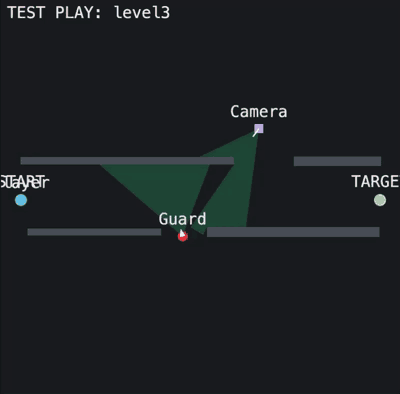
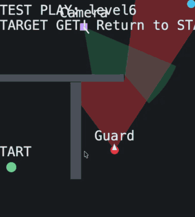

# Stealth Game PoC

`Entame/docs/win-conditions.md` の「①盗む」パターンをブラウザで素早く試すMVP。
「警備員1人の視野を避けてターゲットを取り、STARTへ戻る」体験が面白いかを検証する。

## 動作イメージ

G1（Guard: 巡回して歩く）と Pepper（Camera: その場で首を振る）をモデルにした2Dステージ「level3」のテストプレイ（約60秒）。



`Entame/docs/images/stealth2d-g1-pepper-level3.gif`（400×394、8fps、約1.4MB）。ステージエディタの ▶ テストプレイを画面録画したもの。

level6 のテストプレイ（約38秒）。壁の向こうの Camera と巡回する Guard を避けて TARGET を取り、START へ戻る。



`Entame/docs/images/stealth2d-g1-pepper-level6.gif`（400×445、8fps、約1.2MB）。
ステージデータは `stages/stage-6.json`（ID 6）。

## ベンチマーク

調整の基準にするゲームは [Infiltrator!](https://totenarctanz.itch.io/infiltrator)（itch.io、HTML5、全24ステージ）。
ページ本文を読んだだけでプレイは未実施。内容と現行との比較は `Entame/docs/research/stealth-game-benchmark.md`。

## 起動方法

ES Modules を使っているため `file://` では動かない。簡易HTTPサーバで配信する。

```bash
cd Entame/StealthGame2D
python3 devserver.py
```

`python3 -m http.server 8000` でも閲覧・プレイ自体は可能だが、エディタの
「💾 JSONを保存」がサーバーへの直接保存に対応していないため、その場合は
ブラウザへのダウンロードにフォールバックする（後述）。`devserver.py` を
使うと `stages/` フォルダへ自動保存される。

ブラウザで `http://localhost:8000` を開く。

## スケール（実世界換算）

実機G1・人の歩行速度に合わせ、1m = 80px で換算している。

| 項目 | 値 |
|---|---|
| 部屋サイズ | 5m〜25m四方の範囲でステージごとに調整可能（デフォルト10m×10m = 800px×800px） |
| プレイヤー(人)の歩行速度 | 1.5 m/s（= 120px/sec、`player.js`）。大人の自然な歩行速度は約 1.2〜1.4 m/s なので、やや速め |
| 警備員(G1)の歩行速度 | 0.4 m/s（= 32px/sec、各`stages/*.json`の`guard.moveSpeed`）。指令 0.5 m/s に対する実測 0.38 m/s（シミュレータ。`docs/safety.md`）に近い値。実機での測定は未実施 |
| 警備員(G1)の視野角 | 70°（`guard.visionAngle`。`docs/g1-detection-spec.md` のカメラ水平画角） |
| 警備員(G1)の検知継続時間 | 0.2 秒（`guard.js` の `DETECTION_DWELL_SEC`）。視野に入り続けた時間がこれ以上で即GAME OVER。視野から外れるとリセット |

| ミニロボット(任意)の速度 | 初期値 0.3 m/s（= 24px/sec、`stages/*.json` の `miniRobot.speed`）。エディタで 0.05〜1.0 m/s。LOVOT の移動速度「時速約1〜2km（0.28〜0.56 m/s）」（[ranking.net](https://ranking.net/items/bae0c6) 等の第三者サイトの掲載情報。メーカー公式は未確認）の下限に合わせた |

視野角・視認距離の初期値の根拠（水平画角70°のWebカメラ想定など）は
`Entame/docs/g1-detection-spec.md`を正とする。数値を変更する場合は両方を
更新すること。

## 操作方法

- 矢印キー（↑↓←→）のみで移動
- ターゲットに触れると自動取得
- 取得後にSTART地点へ戻るとCLEAR
- 警備員の視野（扇形）に、遮蔽物なしで 0.2 秒入り続けるとGAME OVER。セキュリティカメラ（Pepper）は視野に入った瞬間にGAME OVER
- **ミニロボット（任意・ステージごとに有効化）**: 人に同行する非常に遅い小型ロボット（橙の四角）。
  - 人が**見えている間**は、常に**人のいる方向へ最短ルートで向かう**（人が通った道はなぞらない）。見通しが通れば直線、
    壁で遮られていれば壁を回り込む最短の経路を探す（`pathfinding.js`。格子 A* で壁を避け、見通しの通る点に間引く）。
    人から離れていく挙動はしない。人の横（半径の和 = 16px）より近くには寄らない
  - **人を見失ったら探索モード（`Mini: search`）**: 壁に遮られて人が見えなくなると、見えない人の今の位置は知らない扱いになる。
    ① 人を**最後に見た場所**へ壁を避けて向かう → ② 着いても見えなければ、その周りの行ける地点を順に探す
    （半分は人が最後に向かっていた方向に偏らせる。決めるたびに探す範囲を 1m → 6m まで広げる）。
    人が見えたらすぐ追従に戻る。見える条件は「壁に遮られていない」だけ（距離の制限なし。仮置き）
  - 画面のラベルで今のモードが分かる: `Mini: follower`（追従）/ `Mini: pause`（立ち止まり）/ `Mini: wander`（動き回り）/ `Mini: search`（探索）
  - 人に追いついたとき（約 0.4m 以内）だけ、2〜4 秒ごとに「1〜3 秒立ち止まる」か
    「1〜2.5 秒、人のそば（約 0.6m 以内）を小さく動き回る」かを決める（半々）。人が歩き出したらすぐ追従に戻る。
  - LOVOT の思考（行動の決め方）は非公開で、「必ず人に付いてくる」とも書かれていない
    （[GROOVE X 技術ブログ](https://tech.groove-x.com/entry/lovot-behavior-making)、[IPbase](https://ipbase.go.jp/learn/ceo/page32.php)）。
    この挙動は公開情報からの推測で、時間・距離・確率は仮置き（`miniRobot.js` の定数。実挙動の測定値ではない）
  - 人より遅いので、人が動いている間は遅れて付いてくる
  - **人かミニロボットのどちらかが G1 / Pepper に見つかったら GAME OVER**（判定は人と同じ。0.2 秒 / カメラは即時）
  - **CLEAR には、人とミニロボットの両方が START に戻る必要がある**（人は戻ったらミニロボットを待つ）。
    ミニロボットは START から 40px（= 人の判定 24px + 人の横で止まる 16px）以内で「戻った」とみなす

## ステージデータ（stages/*.json）

ステージデータは `stages.js` ではなく、`stages/` 配下の**ステージ1つ＝JSONファイル1つ**
という構成で管理する。

```
stages/
  manifest.json    # 読み込むJSONファイル名の一覧（配列）
  stage-1.json
  stage-2.json
  stage-3.json
  stage-4.json     # level3（G1 + Pepper カメラ）
  stage-6.json     # level6（G1 + Pepper カメラ）

各ステージJSONの `miniRobot` は任意（無い / `null` = ミニロボットなし）。有効にすると `{ "speed": 16 }`（px/s）の形。
```

`main.js` / `editor.js` は起動時に `stagesLoader.js` の `loadStages()` を呼び、
`manifest.json` に載っているファイルを順にfetchして読み込む。

`devserver.py` で起動している場合、エディタから保存すると `POST /api/save-stage`
経由で `stages/stage-N.json` の作成・上書きと、`stages/manifest.json` への
ファイル名追記（新規ステージの場合のみ）が自動で行われる。
`python3 -m http.server` など保存APIを持たないサーバーで開いている場合は、
ブラウザへのJSONファイルダウンロードにフォールバックするので、手動で
`stages/` に置いて `manifest.json` を編集する必要がある。

## ステージエディタ

`editor.html` でSTART/TARGET位置、警備員の初期位置・巡回ルート、壁の配置を
GUIで調整できる。LEVEL SELECT画面の「ステージエディタを開く」リンクから開く。

- Width(m) / Height(m) でエリアサイズを5m〜25mの範囲で調整できる（範囲外の値は自動でクランプされる）
- Move Speed(m/s) / Vision Distance(m) は実世界の単位で入力する（保存されるJSONは1m=80pxでpx単位に変換される）
- モードボタンで配置対象を切り替え、Canvas上をクリック（壁はドラッグ）で配置
- 巡回ルートの各区間が壁と衝突する場合、赤線＋警告メッセージで即座に警告する
  （「警備員が壁にスタックする」バグを作った時点で気づけるようにするため）
- 既存のステージを読み込んで編集することも、「＋ 新規ステージ」で新規作成することも可能
- **▶ テストプレイ**: 保存前でも、編集中のステージ設定でその場にゲーム本体と
  同じロジック（移動・巡回・視野判定・CLEAR/GAME OVER）を動かして確認できる。
  矢印キーで操作し、「■ 編集に戻る」でエディタに戻る。
  警備員の巡回ルートが未設定でも動かせる（その場合、警備員は初期位置に立ったまま動かず、視野判定だけ行う）
- **ミニロボット同行**: チェックを入れるとこのステージにミニロボットが付く（START の右下に MINI と表示）。
  Mini Speed(m/s) で速度を決める（0.05〜1.0、初期値 0.3）。テストプレイでそのまま確認できる
- **保存先の表示**: ボタンの上に「保存すると何が起きるか」を常に表示する。
  **ID がそのまま保存ファイル名（`stage-<ID>.json`）**になる。
  緑 = 新規追加 / 編集中ステージの更新、赤 = 別ステージの上書き（保存時に確認ダイアログも出る）。
  「＋ 新規ステージ」は空いている ID（最大 ID + 1）を自動で入れる。ステージ一覧は `#ID 名前` で表示する
- **💾 JSONを保存**: 編集中のステージ1件を `stage-<ID>.json` として保存する。
  `devserver.py` 起動時は `stages/` に直接書き込まれ、`manifest.json` も
  自動更新される。保存APIがない場合はブラウザへのダウンロードにフォールバック
  し、手動で `stages/` に配置する手順をダイアログで案内する
- 「コードをテキスト表示」で同じ内容をテキストエリアにも表示する（コピー用）

## ファイル構成

- `devserver.py` — 静的ファイル配信 + ステージ保存API（`POST /api/save-stage`）を持つ簡易サーバー
- `index.html` / `style.css` — ゲーム画面とスタイル
- `main.js` — 状態遷移（LEVEL_SELECT → PLAYING → CLEAR/GAME_OVER）とゲームループ
- `stagesLoader.js` — `stages/manifest.json` 経由でステージJSON群を読み込む
- `stages/` — ステージデータ本体（JSON、1ファイル1ステージ）
- `player.js` — プレイヤーの移動・壁衝突・ターゲット取得判定
- `miniRobot.js` — ミニロボット（人へ最短で向かう同行ロボット）と、CLEAR 条件・検知対象の一覧
- `pathfinding.js` — 壁を避けた最短経路の探索（ミニロボット用）
- `guard.js` — 警備員の巡回移動と「距離＋視野角＋遮蔽物」の発見判定
- `collision.js` — 円と壁の当たり判定、レイと壁のスラブ法交差判定（player/guard/editor共通）
- `render.js` — ゲーム画面のCanvas描画
- `editor.html` / `editor.css` / `editor.js` — ステージエディタの画面・スタイル・DOM配線
- `editorState.js` / `editorValidate.js` / `editorRender.js` / `editorExport.js` / `editorPlay.js`
  — エディタの状態・検証・描画・JSON出力・テストプレイ

## MVPで未実装のもの

複数警備員、複雑なAI、攻撃・戦闘、アイテム・インベントリ、音声、
オンライン機能、ランキング、複雑なアニメーション、高品質グラフィック。
