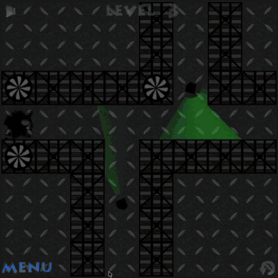

# ステルスゲームのベンチマーク: Infiltrator!

2D ステルスゲーム（`Entame/StealthGame2D`）の調整で基準にするゲーム。

- URL: https://totenarctanz.itch.io/infiltrator
- 指定者: ユーザー（2026-11-04）
- 記録日: 2026-11-04

## 確認の範囲

**itch.io のページ本文を取得して読んだだけで、実際にはプレイしていない。** 下の「ページに書かれていること」は
その本文の要約。敵の視界・速度などは、ページに記載が無いため**未確認**（推測で埋めない）。

## ページに書かれていること

| 項目 | 内容 |
|---|---|
| 作者 | TotenArctanz |
| ジャンル | パズル（タグ: 2D）。説明では「2D のトップダウン型ステルスゲーム」 |
| プラットフォーム | HTML5（ブラウザで遊べる） |
| 制作ツール | Phaser |
| 価格・状態 | 無料、リリース済み |
| 目的 | 機密文書を手に入れ、警備員に気づかれずに脱出する |
| ステージ数 | 全 24 ステージ。難易度が徐々に上がる |
| 操作 | WASD または矢印キーで移動。**R キーで即リスタート**（作者が必須に近い機能として案内） |
| スクリーンショット | 4 枚（見た目の文章説明は無い） |

## 参考映像: level3

- ファイル: `images/infiltrator-level3.gif`（400×401、8 fps、約 23 秒、約 1.5 MB）
- 元: ユーザーが録画した画面（2026-11-04 17:46、778×780、元の mov は約 16 MB。リポジトリには入れていない）。軽量化のため縮小・減色・間引きしている。
- 他社ゲームの画面なので、**社内の参考資料としてのみ使う**（配布・公開物に入れない）。
- 動画を観て分かったことは、次の「映像から見えること」に書く。

### 映像から見えること（1 枚の静止画で確認した範囲）

- 真上から見下ろす 2D。画面上部に「LEVEL 3」の表示。足場は金属のグレーチング。
- 警備員の視野が**緑色の半透明の扇形**で常に見えている（壁・通路で形が切られているかどうかは未確認）。
- 左下に MENU、右下に操作用のアイコン。

動きの速さ・警備員の巡回・見つかったときの挙動は、動画を通して観て測る必要がある（未確認）。

## ページに書かれていない（未確認）

- 警備員・カメラの視野角、視認距離、移動速度、巡回の挙動
- 見つかったときの挙動（一発アウトか、猶予があるか）
- 画面サイズ、1 ステージの長さ、ステージ内の仕掛け
- 更新履歴、作者の詳しい説明、devlog

これらは**実際にプレイして測る**必要がある（下の「次にやること」）。

## 現行ゲームとの比較（確認できた範囲）

| 項目 | Infiltrator! | 現行 StealthGame2D |
|---|---|---|
| 目的 | 文書を取って脱出 | ターゲットを取って START へ戻る |
| ステージ数 | 24 | 3（エディタで追加可能） |
| 移動操作 | WASD / 矢印 | 矢印のみ |
| 即リスタート（R キー） | あり | **なし**（「やり直す」ボタンのみ） |
| 見つかったとき | 不明 | 即ゲームオーバー（一発アウト） |
| 敵の種類 | 不明 | 警備員（G1）＋セキュリティカメラ（Pepper、1 台まで） |

## 次にやること（候補）

1. 実際にプレイして、敵の視野・速度・見つかったときの挙動を測り、この表に追記する。
2. 取り入れる候補（ユーザー判断）:
   - R キーで即リスタート（作者が重視している機能。実装は小さい）
   - WASD への対応
   - ステージ数を増やす（難易度を段階的に上げる）
