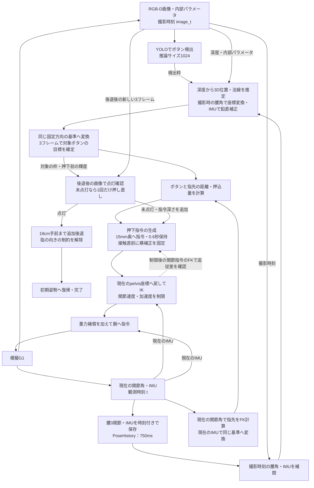
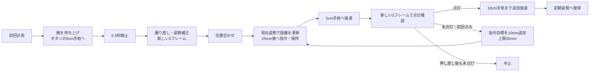

# Yada の採点環境への接続

`sim/evaluate_yada.py` は、こちらのボタン押下処理をリーダーの採点環境で動かす入口。
実機はこれまでどおり `real/align_button.py` / `real/push_button.py` を使う。
実機の接続先、RealSense取得、校正ファイル、1.5mmの既存シミュレーション設定は変更していない。

## 準備

リポジトリ直下から実行する。このPCには `_local/button_press_yada/venv` を用意済み。
別のPCでは採点専用のPython環境を作り、以下の依存を入れる（Python 3.10でも動作確認した）。

```bash
python3 -m venv _local/button_press_yada/venv
_local/button_press_yada/venv/bin/python -m pip install -r Manipulation/push_button/sim/requirements_yada.txt
python3 Manipulation/push_button/sim/prepare_yada.py
```

`prepare_yada.py` は `origin/Dev/ButtonPress_Yada` の採点コードと、そのコードが使う
J1-gen・Perceptionの共通部品を、コミットIDごとの `_local/button_press_yada/evaluation_env/` に取り出す。
公式G1モデルもその中に取得する。ブランチ変更・merge・commit・pushはしない。
取得済みの参照を使う場合は `--no-fetch`。参照を明示する場合は `--ref <コミットまたは参照>`。
準備が終わったコミットだけを `current.json` に記録する。

通常配置の `Button_Press/Yada` がある場合はそちらを使う。配置を明示するには
`--yada-root /absolute/path/to/Button_Press/Yada` を付ける。
通常配置の場合はそのリポジトリの `Button_Press/J1-gen/sim/fetch_models.sh` でモデルを用意する。

## Python APIで採点する

```bash
# 上下の2試行。YOLOを省略するとカラー画像から灰色の丸を検出する。
MUJOCO_GL=egl _local/button_press_yada/venv/bin/python Manipulation/push_button/sim/evaluate_yada.py \
  --seeds smoke --workers 2

# ノイズ、カメラ取付誤差、遅れ、揺れを加え、弱点レポートも作る。
MUJOCO_GL=egl _local/button_press_yada/venv/bin/python Manipulation/push_button/sim/evaluate_yada.py \
  --set realistic --seeds practice --workers 2 --report

# 既存のボタン用YOLO重みで検出する。仮想環境にultralytics・torchも必要。
MUJOCO_GL=egl _local/button_press_yada/venv/bin/python Manipulation/push_button/sim/evaluate_yada.py \
  --weights /absolute/path/to/best.pt --seeds smoke --workers 2
```

YOLOの推論サイズは `yada.py` の `YOLO_IMAGE_SIZE = 1024` を使う。
重みに保存された512を継承せず、入力画像の長辺を1024にして推論する。
カメラの取得解像度とは別の設定で、採用する信頼度の既定値は従来どおり0.25。

`--seed N`、`--trials N`、`--view`、`--ablation`、`--out <パス>` は採点側へ渡す。
描画が遅いPCでは `--workers 1` を使う。画面のあるPCの `--view` は `MUJOCO_GL=egl` を外す。
結果は既定で、このリポジトリの `_local/button_press_yada/results/` に保存する。
弱点レポートは採点環境の `_local/button_press_yada/reports/` にでき、評価器が保存先を表示する。
全試行成功なら終了コード0、失敗した試行があれば1、起動・引数のエラーは元の終了コードになる。

## DDS + ZMQで模擬G1につなぐ

DDS方式にはCycloneDDSと公式 `unitree_sdk2py` が必要。このPCの採点用仮想環境には用意済み。
別のPCの導入は [採点側のGUIDE.md](https://github.com/airlayout/G1_Hackason/blob/Dev/ButtonPress_Yada/Button_Press/Yada/contest/GUIDE.md)
の準備手順を参照する。
SDKは公式ソースを `pip install -e <unitree_sdk2_pythonのディレクトリ>` で導入する。
通常のwheelインストールでは、版によってCRCの `.so` が含まれない。起動前にその不足も検査する。

```bash
MUJOCO_GL=egl _local/button_press_yada/venv/bin/python Manipulation/push_button/sim/evaluate_yada.py \
  --backend dds --seeds smoke
```

試行ごとに採点側の模擬G1を起動し、`run_yada_dds.py` がタスクファイルの上下指示を読んで接続する。
接続は `lo / domain 1`、カメラは `127.0.0.1` 固定。模擬G1の目印も確認する。
採点側のDDS送信処理を利用するため、`motor_cmd.mode=1`、制御重みの上げ下げ、状態受信の途絶への対応も適用される。
カメラの撮影時刻とIMU姿勢を観測に含め、同じ画像を3回計測したことにしない。
正式な採点はサーバ側の点灯判定。クライアントの処理完了は押下成功の判定には使わない。
判定が出たらランナーが制御重みを解除して終了する。判定ファイルをエージェントの制御入力には使わない。

DDS方式は `basic` のみ。`realistic`・並列化・弱点レポートの引数は、未対応として起動前に拒否する。
この採点用エージェントは実機への接続を拒否する。実機の設定を採点用で上書きしないための分離。

## こちらのコードとの関係

- `vision.estimate_button_target()` でRGB-Dの検出枠から表面位置・パネル法線を推定する。
- 採点のパネルが鉛直であることと撮影時のIMUの重力方向から、カメラの傾きを補正する。
  法線とボタン位置をカメラ原点まわりに同じ回転で補正し、5度を超える補正は拒否する。
  画像内の追跡・深度選択には補正前の座標を使う。並進ずれや重力軸まわりの取付角は残る。
- 一般用の上下ペアを画像から求め、指示された方を選ぶ。車いす用の高さの候補や曖昧な候補は採用しない。
- 異なる新しい3フレームで安定性を確認し、接近後に1回だけ再計測する。
- カメラ変換に必要な腰3関節の角度とIMU姿勢を時刻付きで750ms分保存し、
  画像の撮影時刻へ補間する。関節角は線形補間、姿勢はクォータニオンの最短経路で補間する。
  撮影時刻の姿勢履歴がない画像や、補間区間の状態更新が100msを超えて途絶えた画像は使わない。
  3フレームの点・法線を同じ固定方向の基準にそろえてから安定性を判定する。
- 最初に、推定したボタン面から離れた右側の経由点へ腕を持ち上げ、その後ボタン前へ移動する。
  経由点は指先球の表面と面の間を18cm、右側へのずれを12cmとする。
  低いボタンでも手首を折りすぎないよう、経由点の高さはpelvis基準で24cm以上とする。
  ボタン前では従来どおり指先球の表面と面の間を5cmに保ち、再計測してから押す。
- 腕のFK/IKと頭カメラの変換には採点側と同じ公式URDF・Pinocchioを使う。
  実機・既存シミュレーションのMuJoCo運動学はそのまま残す。
  初回の持ち上げ姿勢が関節リミットで解けない場合は、肘の曲げ方が異なる種姿勢で試す。
  押下中は現在の解からだけ解き、途中で別の姿勢へ切り替えない。
- `yada_press.PressCommandController` で押下指令を作る。J1-genの採点用押下制御を参考に、
  推定したボタン面の15mm奥に指令目標を置き、弱いPDで押す力を作る。
  この15mmは指令の深さで、実際のボタンのストロークではない。指先半径は8mm。
  推定押込量が2.75mmを超えたことだけでは停止・成功としない。
  接近から押下までは5秒以上のsmoothstep、最大25mm/sとし、その後0.6秒保持する。
  横方向のFK誤差だけを積分補正し、推定面の10mm手前に達したら補正を固定する。
  `PressJointCommandFilter` は速度0.8rad/s・加速度2rad/s²を制限し、目標付近で減速する。
  ボタン面と押下指令を固定方向の基準に保持し、現在のIMU姿勢で指先を同じ基準へ変換する。
  IKへ渡す指令は毎周期、現在のpelvis座標へ戻す。撮影後のroll・pitch・yawを押込量の判定に反映する。
  この補正は機体原点の位置が一定という仮定で、機体の並進は推定しない。
  追従差は速度・加速度制限後の関節指令のFKと、現在の指先との間で測る。
  横方向1cm、法線方向は指令深さ＋1cmを超えたら中止する。画像・制御更新の時刻も検査する。
- 押下後に5cm手前へ後退し、対象の検出枠の平均輝度が押下前より25以上増えたことを
  新しい3フレームで確認する。未点灯なら指令目標を10mm深くして1回だけ押し直す。
  指令深さの上限は30mm（既定の押し直しは25mm）。再度未点灯なら中止し、成功とは扱わない。
- 点灯確認後は面の18cm手前までさらに後退し、そこから腕を初期姿勢へ戻す。
  ボタン前の5cmと復帰前の18cmは別の定数にしている。追加後退では指の向きを指定するIK制約を外す。
  肘の制限で解けない場合は手首の種姿勢を変えて再計算する。追加後退は最短1.8秒、関節速度の上限は0.8rad/s。
- 採点の弱いPDに合わせ、公式モデルの重力と公称ゲインから関節指令を補正する。
- ボタンの真の座標やseedは制御に使わず、MuJoCo / Isaacのimportもしない。

評価対象は到着後のボタン押し。骨盤が固定され、歩行・自由立位の安定性は評価できない。
既存のMuJoCo経路の自己衝突検査はこのPinocchioアダプタには移植していない。
経由点は壁への接触を避けるための改善であり、一般的な衝突回避機能ではない。
壁への接触力は採点結果に記録されるが、点灯すれば採点上は成功になる。接触力も結果と一緒に確認する。

## 処理のノード図

2026-10-08の押下指令と点灯確認を反映した、Yada採点用エージェントの構成。
各箱は処理単位で、姿勢履歴・位置推定・押下制御は `YadaButtonController` 内で実行する。
位置推定は初回と接近後の撮り直しで使い、押下中は現在の関節角とIMUで距離を更新する。



- 撮影時の腰角・IMUは画像の位置推定に、現在の関節角・IMUは指先位置と押下指令に使う。
- ボタン目標と指先を同じ基準へそろえることで、撮影後のroll・pitch・yawを距離に反映する。機体の並進は補正しない。
- 点線は送信する関節指令からのフィードバック。未送信の目標位置との差で停止しない。
- 押す力を作る指令目標と、画像による点灯確認を分ける。正式な採点はサーバ側の点灯判定。

動作の順序は次のとおり。途中の撮り直しは、新しい3フレームを使う1回の再計測。



## 検証記録

2026-10-05、採点環境 `634697e1544aa74b8f5d5869d58dbcc5dc9881d6`、
公式G1モデル `ccfc6fd`、MuJoCo 3.14.0、Pinocchio 3.9.0、Python 3.10.12で実行。
DDSはCycloneDDS 0.10.2、公式SDK `814556d15970dd2ecf1c9984e845ca02ab07e206`。
以下は接続追加時の記録（接近軌道の改善前）。77件のテストが通過（既存69件と採点接続8件）。

| 評価 | 成功 | 記録 |
| --- | --- | --- |
| API basic、カラー検出、smoke | 2 / 2 | 上14.38秒、下13.10秒。最大接触力35.58N |
| DDS basic、カラー検出、smoke | 2 / 2 | 上15.053秒、下13.304秒。最大接触力36.02N。クライアントも正常終了 |
| API basic、既存YOLO重み、smoke | 1 / 2 | 下ボタンの計測が2秒以内に安定せず中止 |
| API realistic、カラー検出、smoke | 0 / 2 | 上は再計測後の位置補正8cm超、下はFKによる押込量の上限超で中止 |

YOLO重みは既存の `/tmp/g1_elevator_yolo/models/best.pt` を使用した。
APIの時間はシミュレーション内、DDSの時間はサーバ判定の実時間。
この時点では上ボタンの移動経路で壁への接触が残っていた。
YOLO再検出、カメラ誤差や揺れへの耐性も改善が必要。
2試行だけの結果なので、未知の条件での成功率や実機動作を示すものではない。
各結果はこのリポジトリの `_local/button_press_yada/results/push_button_*smoke*.json` に保存した。

### 接近軌道の改善後（2026-10-05）

元のseed 0で接触を追跡すると、接近中の右指先が壁・柱に当たっていた。
面から離れた経由点で腕を持ち上げてからボタン前へ向かうように変更した。
実機用の処理・設定と、押下時の連続制御は変更していない。

| API basic（カラー検出） | 点灯までの時間 | 壁・盤への最大接触力 |
| --- | --- | --- |
| seed 0、上 | 16.46秒 | 0 N（改善前35.58 N） |
| seed 1、下 | 15.72秒 | 0 N |
| seed 3、下（壁が近い配置） | 15.50秒 | 0 N |
| seed 10、上（壁が遠く高いボタン） | 16.68秒 | 0 N |
| seed 11、下（壁が近く低いボタン） | 15.04秒 | 0 N |

実際に物理を動かした5試行は5/5成功、すべて壁・盤への接触力0 Nだった。
seed 0は改善前より2.08秒長くかかる。結果は
`_local/button_press_yada/results/raised_approach_basic.json`、改善後の上ボタンの動画は
`_local/button_press_yada/videos/mujoco_raised_approach_up_seed0.webm` に保存した。

DDS basicのsmokeも2/2成功、上16.600秒・下15.831秒、両方とも壁・盤への接触力0 N。
クライアントも両方正常終了した。結果は
`_local/button_press_yada/results/raised_approach_dds_smoke.json` に保存した。

97件のテストが通過（既存77件＋公式モデルを使った20配置の接近軌道の検査）。
追加した検査は画像推定を固定し、理想的な関節追従を仮定して、制御器が生成する軌道を調べる。
画像・PD追従・押下の判定を含む評価は上の5試行。20配置すべての押下成功を確認したわけではない。
経由点だけで任意の障害物を避けられる保証はなく、YOLO・realisticの改善前の結果も引き続き参照する。

```bash
MUJOCO_GL=egl _local/button_press_yada/venv/bin/python -m pytest \
  Manipulation/push_button/tests/test_yada.py Manipulation/push_button/tests/test_yada_approach.py -q
```

### YOLO推論サイズの比較後（2026-10-07）

同じ採点環境と既存のボタン用重みを使い、basic・realistic各20配置の初期画像、
計40枚で推論サイズを比較した。一般用の上下を両方検出できた枚数を示す。
検出判定は、採点側のセグメンテーションから作った正解枠とのIoUが0.5以上。
正解は診断にだけ使用し、制御入力には与えていない。信頼度の採用閾値は0.25。
時間はこのPCのCPU、Torchの2スレッド、ウォームアップ後の推論全体の平均。

| 推論サイズ | 上下とも検出 | 平均推論時間 |
| --- | --- | --- |
| 512（変更前） | 32 / 40 | 14.1 ms |
| 640 | 32 / 40 | 18.5 ms |
| 768 | 38 / 40 | 24.7 ms |
| 896 | 39 / 40 | 31.8 ms |
| 960 | 38 / 40 | 36.5 ms |
| **1024（採用）** | **40 / 40** | **40.3 ms** |
| 1280 | 40 / 40 | 64.8 ms |

比較した中で上下を全枚検出できる最小の1024を、`yada.py` で明示的に指定する。
高解像度ほど必ず検出が良くなるわけではないため、以前見落とした画像だけでなく全40枚で比較した。

センサノイズと画像遅延を動かした初回計測も各20配置で再実行し、
basic 20/20・realistic 20/20で、新しい3フレームから位置を確定できた。
確定までの最大時間はbasic 0.04秒、realistic 0.56秒（シミュレーション内）。
これは初回計測までの確認で、40試行すべての押下成功を示すものではない。

| API smoke（YOLO、1024） | 結果 |
| --- | --- |
| basic | 2/2成功。上16.44秒、下15.72秒。壁・盤への最大接触力は両方0 N |
| realistic | 上は12.22秒で成功。下は初回計測・再計測を通過後、押下中のFK押込量の上限判定で中止 |

realisticの下ボタンは、変更前の「検出不足による初回計測の停止」を解消した。
押下中の位置判定の問題は残るため、realistic全体の成功率はsmokeで1/2のまま。
関連テスト `test_yada.py`・`test_yada_approach.py` は28件通過した。
比較・初回計測・smokeの結果と再実行用スクリプトは
`_local/button_press_yada/diagnostics/resolution_20261007/` に保存した。

### パネルの鉛直性を使った位置補正（2026-10-07）

YOLOを1024にした状態でrealisticのseed 1を追跡した。
14.60秒の停止時、FKによる押込量は2.84mmだったが、実際の指先球の表面は
ボタン面まで1.16mm残っており、採点側もボタンへの接触なしと記録していた。
推定したボタン位置の誤差は法線方向で-3.62mm、面に沿って6.47mm。
FKの指先位置と実際の指先位置の差は0.38mmだった。
診断で使った真の座標は誤差測定にだけ使い、制御へ渡していない。

`yada.py` で、IMU姿勢から求めた重力方向にパネル法線が直交するよう補正した。
カメラ原点まわりにボタン位置も同じ回転で補正し、深度選択と画像追跡には
公称カメラ変換で得た補正前の座標を保持する。
補正角が5度を超える場合や、補正後の目標が作業範囲外の場合は拒否する。
押込量の停止閾値は従来どおり2.75mmで、上限を広げていない。

| API smoke（YOLO、1024） | 補正前 | 補正後 |
| --- | --- | --- |
| basic | 2/2成功 | 2/2成功。上16.52秒、下15.82秒 |
| realistic | 1/2成功。下は未接触で停止 | 2/2成功。上12.44秒、下12.38秒 |

補正後のsmokeは両セットとも壁・盤への最大接触力0 N、別のボタンへの接触なし。
同じrealisticの20配置（practice、seed 0〜19）で、補正前9/20（45%）から
補正後11/20（55%）に変わった。seed 1・14・15が失敗から成功に、seed 2が成功から失敗に変わった。
壁・盤への最大接触力は両方0 Nで、別のボタンへの接触もなかった。
残った9配置はすべて押下中の押込量の上限判定で停止した。
これは公開配置での比較であり、未知の配置や実機の成功率を示すものではない。

鉛直面の拘束で求められるのは重力方向に現れる傾きだけで、
カメラの並進ずれ・重力軸まわりの取付角や、押下中の体の揺れは残る。
たとえばrealisticのseed 2では、押下開始から停止まで法線方向の位置誤差が
約4.6mm変わり、停止時はボタン面まで約2.35mmの空隙があった。
試行途中ではボタンに触れたが、最大沈み量は1.70mmで点灯に届かなかった。
この時点の押下制御は再計測後の目標をpelvis座標に固定しており、この補正だけで全配置の成功を保証しない。

押下中にも同じ3フレーム計測を追加する診断もseed 0〜3で試した。
3/4は成功したが、seed 2で補正目標が8mmを超えて跳び、診断用の上限判定で停止した。
seed 0でも更新後の面位置誤差が約14mmに増えており、位置精度が安定しないため製品コードには追加していない。

補正の幾何、傾いた機体、追跡座標の一貫性、不正IMU・過大補正の拒否を含め、
`test_yada.py`・`test_yada_position.py`・`test_yada_approach.py` は39件通過した。
診断ログ、補正前の制御器と再実行用スクリプトは
`_local/button_press_yada/diagnostics/position_20261007/` に保存した。

### 撮影時刻と押下中の姿勢をそろえる補正（2026-10-07）

画像が40〜120ms遅れて届くrealisticでも、画像の変換に使っていたのは受信時の関節角とIMU姿勢だった。
腰の関節角とIMUの履歴から撮影時の姿勢を補間し、画像から得た位置・法線を変換するようにした。
3フレームを比較する前に同じ固定方向の基準へそろえる。再計測後は、現在のIMUと関節角によるFKから
指先を同じ基準へ変換し、ボタンまでの距離と押込量を毎周期更新する。
機体原点の並進は補正しない。カメラの取付位置の誤差も、この変更では推定しない。

姿勢の整合だけを加えた途中版では、realisticの成功が11/20から10/20に下がった。
seed 9は初回のIKが肘のリミットで停止し、seed 14は関節の速度制限で送れなかった前進量を
押下指令が積算して、実際の指先との差が1cmを超えて停止した。
初回のIKだけ別の肘姿勢からも解き、押下中の前進量を速度・加速度制限後の関節指令のFKに合わせた。
法線方向だけを合わせるため、面に沿う押下経路は保持する。
押込量2.75mm・追従誤差1cmの停止条件は維持している。

| API評価（YOLO、1024） | 改善前 | 姿勢補正だけの途中版 | 最終版 |
| --- | --- | --- | --- |
| realistic practice、seed 0〜19 | 11/20（55%） | 10/20（50%） | 12/20（60%） |
| basic smoke、上下 | 2/2 | 2/2 | 2/2。上16.64秒・下15.90秒 |

改善前の成功11配置をすべて維持し、seed 10が新たに成功した。
最終版は全試行で壁・盤への最大接触力0 N、別のボタンへの接触なし。
残るseed 2・3・5・11・12・13・16・17はすべて押込量の上限判定で停止した。
今回の変更で並進や取付位置の誤差まで解消したわけではなく、残る停止の原因は別途切り分けが必要。
これは同じ公開20配置での比較であり、未知の配置や実機の成功率を示すものではない。
改善前の結果は前回の鉛直補正後の評価から再利用し、保存した制御器のSHA256と結果の同一性を確認した。
今回の評価でも各seedの配置・取付誤差・ノイズ・遅延などの条件の一致をJSONで確認した。

遅延画像での撮影姿勢の補間、クォータニオンの符号反転、履歴不足・更新途絶の拒否、
撮影後の機体回転、制限で送れなかった前進量の蓄積を含め、関連テスト46件が通過した。

```bash
MUJOCO_GL=egl _local/button_press_yada/venv/bin/python -m pytest \
  Manipulation/push_button/tests/test_yada.py \
  Manipulation/push_button/tests/test_yada_position.py \
  Manipulation/push_button/tests/test_yada_approach.py -q
```

改善前・途中版・最終版の制御器、採点結果、診断ログ、バージョン情報と比較表は
`_local/button_press_yada/diagnostics/pose_sync_20261007/` に保存した。
診断の真の位置は誤差の計測にだけ使用し、制御器へ渡していない。

### 押下指令と点灯確認を分ける改善（2026-10-08）

参考にしたのは `origin/Dev/ButtonPress` の
`e297a4308531fa4f39c1a6afb94c8f5d3702214f` にある
`Button_Press/J1-gen/common/elevator_press.py` と `configs/elevator.yaml`。
15mm奥の指令目標、接触直前で止める横方向の積分補正、後退後の輝度確認、
未点灯時に10mm深くする1回の押し直しを採り入れた。
YOLOの解像度1024、撮影時刻の姿勢補間・鉛直面の補正、現在のIMUによる押下中の補正は維持した。
機体の並進は補正しない。

以前は推定押込量の2.75mm上限で停止し、実際に押せる深さまで届かない配置があった。
この判定をボタンの真のストロークの代わりに使うのをやめ、押すための指令目標と点灯確認を分けた。
関節の制限前の要求位置を追従差に含めると、まだ送れていない横方向の移動でも停止したため、
制限後の関節指令のFKを使って追従差を測る。
また、位置差/dtを追う関節フィルタと横方向の積分補正の組合せで振動が増えたため、
Yada専用に減衰付きのフィルタを追加した。速度・加速度の上限は維持している。

| API評価（YOLO、1024） | 改善前 | 改善後 |
| --- | --- | --- |
| realistic practice、seed 0〜19 | 12/20（60%） | 20/20（100%） |
| basic smoke、上下 | 2/2 | 2/2。上11.96秒・下11.44秒 |

以前の失敗8配置（seed 2・3・5・11・12・13・16・17）がすべて成功し、成功済みの12配置も維持した。
realisticの平均成功時間は13.37秒から11.96秒になった（改善前は成功12配置、改善後は20配置の平均）。
全20試行で点灯までの壁・扉・盤への最大接触力は0 N、別のボタンへの接触なし。
改善前の結果は前回の姿勢補正後の評価から再利用し、制御器のSHA256の一致を確認した。
各seedの対象・配置・取付誤差・ノイズ・遅延などの条件の一致も結果JSONで確認した。
これは同じ公開20配置での比較で、未知の配置・DDS・実機での成功率を示すものではない。

正式な評価器は点灯した瞬間に試行を終了するため、この20/20だけでは後退後の画像確認や押し直しを検証できない。
診断側で早期終了だけを外し、物理・画像・制御器を変えずに最後まで動かした。
basic seed 0は画像で点灯を確認し、19.86秒で復帰を完了した。
realistic seed 12は初回の画像で点灯を確認できず1回押し直し、27.34秒で画像確認と復帰を完了した。
この診断では点灯情報・真の座標は記録にだけ使い、制御器へ渡していない。
診断JSONの `gave_up` は点灯による早期終了を無効にした評価器の分類であり、
`controller_lamp_confirmed` と `controller_phase` に画像確認・完了を記録している。

この変更時点では、点灯後まで続けたbasic seed 0で壁・扉・盤への最大接触力が40.51 N、realistic seed 12で0 Nだった。
詳細な診断で、40.51 Nは押下中ではなく、5cm後退後に腕を初期姿勢へ戻す途中の指先と壁の接触と分かった。
後退を延ばした変更と結果は次の検証記録に記載する。
現在の押下には力の計測・制限がなく、指令深さの上限は押す力の上限にはならない。
この設定の実機への接続は引き続き拒否する。

偏った面の推定と接触によるたわみ、補正の固定、送信後のFKによる追従判定、
関節の減速・速度・加速度制限、画像の遅延・重複、点灯確認、1回の押し直しと中止を含め、関連68件が通過した。

```bash
MUJOCO_GL=egl _local/button_press_yada/venv/bin/python -m pytest \
  Manipulation/push_button/tests/test_yada.py \
  Manipulation/push_button/tests/test_yada_position.py \
  Manipulation/push_button/tests/test_yada_approach.py \
  Manipulation/push_button/tests/test_yada_press.py -q
```

制御器の変更前後、比較結果・診断・再実行スクリプト・バージョン情報は
`_local/button_press_yada/diagnostics/press_policy_20261008/` に保存した。

### 点灯確認後の後退を18cmに延長（2026-10-08）

basic seed 0の40.51 Nは、点灯確認後に腕を初期姿勢へ戻す際の
`right_fingertip_collision` と `hall_wall` の接触だった。
関節角を直線的に戻すと指先は弧を描くため、5cmの後退では壁に届いた。
点灯確認後にボタン面の18cm手前まで追加後退し、それから初期姿勢へ戻すように変更した。
10cmの後退では同じ配置に33.86 Nの接触が残ったため、18cmを採用した。

画像で点灯を確認する位置と押し直しの開始位置は5cm手前のまま。
追加後退だけ指の向きを指定するIK制約を外す。
肘の制限に当たる場合は手首の種姿勢を±0.3rad変えて、同じ位置へ届く解を再探索する。
これは計算の初期値であり、手首だけを動かす指令ではない。
追加後退は最短1.8秒とし、従来の0.8rad/sの関節速度上限に応じて延ばす。
腕を戻す時間は4秒。押し直しが必要だったrealistic seed 6も29.88秒で完了した。

点灯による早期終了だけを無効にし、画像確認・後退・腕の復帰まで診断した。
制御器に渡すのはAPI観測のみで、真の点灯状態や座標は制御へ渡さない。

| 診断 | 点灯 | 腕の復帰まで完了 | 追加後退・復帰中の最大接触力 |
| --- | --- | --- | --- |
| basic、seed 0・1 | 2/2 | 2/2。21.70秒・21.18秒 | 0 N。元の40.51 Nを解消 |
| realistic practice、seed 0〜19 | 20/20 | 9/20 | 後退へ進んだ9配置すべて0 N |

全20配置で18cm版を診断した後、追加後退へ進んだ9配置をIKと時間の最終調整後に再実行した。
残り11配置は追加後退の前に停止しており、そこまでの処理が同一であることを確認して診断結果を再利用した。
集計JSONは各配置の実行時のSHA256と再利用の有無を記録している。
これは正式な採点結果ではなく、点灯後まで継続した診断結果。

残る11配置（seed 0・4・5・7・8・9・10・13・15・18・19）は、
点灯後の押下・押し直し中に、既存の横方向1cmの追従差判定で停止した。
押し直し中の壁・盤への接触も残り、seed 0は17.31 N、seed 3は7.20 N、seed 6は14.87 N。
この3配置を変更前の制御器でも診断し、力と発生段階が同じであることを確認した。
今回解消した復帰中の接触とは別の、押下・点灯確認側の課題として扱う。

basic seed 0の復帰時接触と、realistic seed 14の後退時の肘制限を
MuJoCoの衝突形状で検査する回帰テストを追加し、上記コマンドの関連70件が通過した。
変更前後の制御器、診断JSON、再実行・集計スクリプト、バージョン情報は
`_local/button_press_yada/diagnostics/retreat_20261008/` に保存した。
