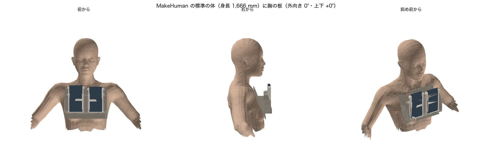
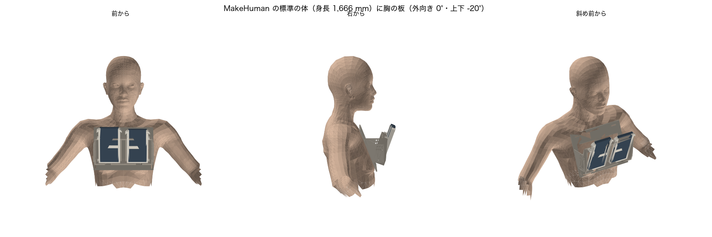

# rig — スマホ 2 台を胸に載せる板（Bambu Lab A2L で刷る）

phone_vslam の 2 台（左に iPhone 11 Pro＝cam1、右に Pixel 7a＝cam2）を、カバーを付けたまま縦に横並びで
1 つの台に入れ、胸に帯で締める。2 台が互いに動かないので、**ステレオ（README の 4 節・実寸）**にも
マルチカム（3b 節）にも使える。

- **左右の向き**: 袋ごとに外向き 0・10・20°（下の棚の穴で選ぶ）
- **上下の向き**: 台ごと −20〜+10° を 5° 刻み（+ が上向き。腕木の穴で選ぶ）。2 台は一緒に回るので、2 台の間の向きは変わらない
- **2 台の間**: 袋の壁の間 28 mm（スマホどうし 約 41 mm・カメラの間 約 11.7 cm）。前から向こうが見え、2 台の間を風が抜ける



（絵は `build.py`・`body_fit.py` を回すと `out/preview/` にできる。紺の箱がカバー付きのスマホ）

## なぜ胸か（肩のくびきから替えた理由・11-18）

| | 肩のくびき（やめた） | 胸の板 |
|---|---|---|
| 重心 | 肩に当たる台から 約 130 mm 上（梃子が長い） | 胸の肌から 約 80 mm 前（EVA 込み） |
| 支え | 34×32 mm の台 2 か所 | 背板（約 25×19 cm）を帯で胸に押さえる |
| 腕振り | 肩甲骨と一緒に台が動く | 胸郭はほぼ動かない |
| 2 台の関係 | 別々の肩で別々に揺れる → マルチカムだけ | 1 つの台 → ステレオも |
| 視点 | 目の高さ | 胸の上（目より 約 20 cm 下） |

胸は上が奥へ約 22° 傾いている（MakeHuman の体で測った）。上下 0° でカメラが水平を向くよう、スマホは縦に立て、
背板との間を楔にした。そのぶんスマホは胸の肌から下で約 3.5 cm・上で約 10 cm 離れる。

首にはかけない。肩の帯 2 本で重さを肩に載せ、胴の帯で板を胸に押さえる（GoPro の Chesty と同じ付け方）。
全部で約 0.85 kg あり、首の輪だけだと重さが首にかかり、歩くたびに振り子のように揺れて向きが変わる。

## 形（2 つの部品と 2 つの向き）

| 部品 | 中身 |
|---|---|
| 背板の部品（`back`） | 胸に当たる背板（裏に EVA）と、左右の腕木。肩へ回す帯の穴（上の左右）と胴へ回す帯の穴（下の左右の端） |
| 台（`carrier`） | 袋 2 つを載せる。下の棚・中ほどの梁・外の側板・内の側板（2 台の間の両側）。外の側板を腕木が外から挟む |
| 袋 ×2 | カバー付きのスマホを上から差し込む。台の棚と梁にボルトで留める |

**上下の向き（x 軸まわり）**: 台は、下の後ろの角にある横向きの軸（左右の M5）のまわりに回る。軸を下の後ろに
置いたので、下へ向けても台の下の角はほとんど後ろへ動かず、背板に当たらない（台の下の後ろの角と背板の間は 0° で 4 mm、−20° で 2.5 mm）。
角度は副尺の形の 2 列の穴で決める:

| 角度（+ が上向き） | −20 | −15 | −10 | −5 | 0 | +5 | +10 |
|---|---|---|---|---|---|---|---|
| 使う穴 | 内の弧 | 外の弧 | 内の弧 | 外の弧 | 内の弧 | 外の弧 | 内の弧 |

- 台の外の側板には、軸の真上に穴が 2 つ（軸から 45 mm＝内、58 mm＝外）。腕木には、内の弧に −20・−10・0・+10°、
  外の弧に −15・−5・+5° の穴（どちらも 10° おき）
- 10° の倍数は内の弧、5° 余りは外の弧の穴を通す。どちらの弧も、前の穴ほど下向き（0° は内の弧の、軸の真上の穴）
- 上下の向きを替えても 2 台の間の向きは変わらないので、ステレオの較正はそのまま使える

**左右の向き（z 軸まわり）**: 袋ごとに、袋の外の後ろの角の縦の軸のまわりに外向き 0・10・20°。下の棚の穴で選ぶ。
外へ回すと袋の内の端が前へ出る（胸や隣の袋には当たらない）。

### 2 台の間（11-18）

袋の壁の間は、最初 16 mm（くっついて見えた）→ 40 mm に空け → 上下の腕木で幅が左右 7 mm ずつ増えた分を戻すため
28 mm にした（`chest.py` の `ChestCfg.gap`）。

| | 16 mm（最初） | 40 mm | 28 mm（今） |
|---|---|---|---|
| スマホどうしの間（0°） | 約 29 mm | 約 53 mm | 約 41 mm |
| 2 台の主カメラの間（0°） | 約 10.6 cm | 約 12.9 cm | 約 11.7 cm |
| 胸の板の幅 | 228 mm | 252 mm | 253 mm（ボルトの頭を入れて 259 mm） |

- 2 台は台でつながったまま（2 つに分けると互いに動き、ステレオが使えない）
- これ以上広げると、下ろした腕に近づく。胸の高さの胴の横の面は ±140〜150 mm（MakeHuman の体）で、
  今の外の端（±126.5 mm、ボルトの頭で ±129 mm）から 10〜20 mm。腕を振ったときの当たりは確かめていない

## 寸法の出典

| 物 | 公式か | 出典 |
|---|---|---|
| iPhone 11 Pro の外形・カメラ・ボタン | 公式 | Apple Accessory Design Guidelines 2020-06-22 §39.3（今の版から 11 Pro が外されたので Wayback Machine の 2020-10-12 の写し） |
| Pixel 7a の外形（152×72.9×9.0） | 公式 | Google の Pixel 7a tech specs |
| Pixel 7a のカメラの帯・ボタンの位置 | **非公開** | Google は取引先にしか出していない → 袋はカメラの帯（上 40 mm）とボタンの帯（右の上から 15〜105 mm）を広く避ける形にして、位置に頼らない |
| Pixel 7a のカバー（156.9×77.4×11.5） | 公式（Google 純正の Pixel 7a Case の場合） | Google ストア |
| iPhone 11 Pro のカバー | **見積もり**（148.9×75.9×10.6） | 公式の数字が無い。Google 純正カバーの足し分を流用 → **試し刷りで確かめる** |
| 胸の傾き 22° | 人体モデルで測った値 | MakeHuman の標準の体（CC0）。人によって 15〜30° ほど違う（上下の向きで直せる） |

数字は `dims.py`（スマホ・カバー・締め具）と `chest.py`（背板の部品と台）に出典つきで置いてある。

## 部品表（BOM）

### 刷る物（PETG 合計 約 385 g・試しは PLA 約 11 g）

| 部品 | ファイル（`out/print/`） | 数 | 大きさ（mm） | 材料の見積もり | 刷る向き |
|---|---|---|---|---|---|
| 試し刷り | `fitslice_iphone11pro.stl`・`fitslice_pixel7a.stl` | 各 1 | 90×16×12 | 各 5 g（PLA） | **最初に刷る** |
| 背板の部品 | `back.stl` | 1 | 253×189×73 | 約 145 g | 背板の裏を下に（置いてある向きのまま。腕木が立つ） |
| 台 | `carrier.stl` | 1 | 244×110×44 | 約 135 g | 後ろの面を下に（置いてある向きのまま） |
| 袋（iPhone 11 Pro・左） | `pocket_iphone11pro_left.stl` | 1 | 103×147×29 | 50 g | 背面を下に |
| 袋（Pixel 7a・右） | `pocket_pixel7a_right.stl` | 1 | 104×155×30 | 52 g | 背面を下に |

- STL は刷る向きに置いてあり、どれも**支え無し**で刷れる（張り出しは 45° より立っているか、50 mm 以下の橋だけ。
  背板の部品と台は試験で確かめている）
- 材料: 試しは PLA、本番は **PETG**（スマホは送信中に 40℃ を超え、画面側は胸に近い）
- 設定の目安: 層 0.2 mm・壁 4 周・充填 25%。材料の量は大まかな見積もりで、正しい量と時間は Bambu Studio のスライスで出る
- 編集したいときは同じ名前の `.step`。組み立ては `out/assembly.step`

### 買う物

| 物 | 規格 | 数 | 用途 | 買える所 |
|---|---|---|---|---|
| ボルト | M5×12（六角穴付き・なべ） | 10 | 左右の向き: 袋 1 つにつき 軸 2（下・中ほど）＋向き 1 = 6。上下の向き: 左右 1 組ずつ 軸 1＋角度 1 = 4。角度のボルトだけつまみねじにすると工具無しで替えられる | ホームセンター |
| ナット | M5（二面幅 8 mm） | 12〜16 | 台の棚の下の六角の穴 6〜10（左右の向きの穴の全部に入れるなら 10）＋台の外の側板の内の面 6（軸・内の弧・外の弧 × 左右） | ホームセンター |
| 瞬間接着剤 | | 少し | 外の側板の内の面のナット 6 つを留める（角度を替えるときボルトを抜いても落ちないように） | |
| 平テープ（PP ベルト） | 25 mm 幅 | 約 3 m | 胴に回す帯 1 本・肩に回す帯 2 本 | 100 円ショップ・手芸店 |
| バックル | 25 mm・差し込み式（長さ調節付き） | 1 | 胴の帯をつなぐ | 100 円ショップ・手芸店 |
| コキ（送りカン） | 25 mm | 4 | 帯の長さを合わせる・肩の帯を胴の帯に留める | 手芸店 |
| ヘアゴム | | 2 | スマホの上の端を押さえる | 100 円ショップ |
| EVA スポンジシート | 5 mm・粘着付き | 1 枚 | 背板の裏（胸との隙間は 0〜7 mm） | 100 円ショップ |
| （任意）L 字の USB-C の線・モバイル電池 | | 2・1 | 長く撮るとき（袋の底と棚の切り欠きから線を出す） | |

## 刷る順番

1. **試し刷り（10 分ほど）**: `fitslice_*` にカバー付きのスマホを差し込む。袋の内側は「カバーの外形＋幅 1.0 mm・厚み 0.8 mm」
   - きつくて入らない → `pocket.py` の `PocketCfg.clear_w`／`clear_t` を増やすか、`dims.py` のカバーの外形を直して `build.py`
   - ゆるい → 袋の縁の内側に隙間テープを貼る。大きくずれるならカバーの外形を直す
2. **本刷り**: PETG で背板の部品・台・袋 2 つ

## 組み立て

1. 台のナットを入れる
   - 棚の下の六角の穴（袋ごとに軸 1・向き 3 のうち使う所）と、梁の下の六角の穴（袋ごとに 1）
   - 外の側板の**内の面**の六角の穴 6 つ（左右それぞれ 軸・内の弧・外の弧）。瞬間接着剤を 1 滴つけて押し込む
2. 袋を棚に載せ、下の耳（底の後ろ）を軸と向きの穴に、中ほどの耳を梁の軸の穴に合わせ、M5×12 で上から留める
3. 台を背板の部品の腕木の間に入れ、左右とも軸のボルトを**外から**通して締める（腕木と台の外の側板をナットで挟む）
4. 使う上下の角度の穴に、角度のボルトを外から通して締める（上の表。0° は内の弧の、軸の真上の穴）
5. 背板の裏に EVA スポンジを貼る
6. 帯を通す:
   - 胴の帯: 背板の下の左の端の穴 → 背中を回して → 右の端の穴。バックルでつなぎ、長さを合わせる
   - 肩の帯（左右）: 背板の上の穴 → 肩を越えて背中へ → 胴の帯にコキで留める（背中で交差させてもよい）
7. **送信を始めてから**スマホを上から袋に差し込み、ヘアゴムを片方の鉤 → スマホの上の端 → もう片方の鉤に掛ける
   （着ると画面は胸の側を向いて見えない）

### 向きを替える

- **上下**: 左右の角度のボルトを抜き、台を回して、使う角度の穴に入れ直して締める（軸のボルトは少し緩めるだけ）。
  左右の両方を同じ角度にする
- **左右**: 向きのボルトを抜き、軸のボルト 2 本を緩め、袋を回して 0・10・20° の穴に向きのボルトを入れ、3 本とも締める

## 使い方の注意

- **ステレオ**（README の 4 節）: 左右の向き 0°（平行）が基本。2 台の主カメラの間は約 11.7 cm（iPhone は公式、Pixel は見積もり）。
  左右の角度を替えたら較正し直す（上下の角度は替えても較正はそのまま）。レンズの間の距離は定規で測って `--baseline-mm` に渡す
- **マルチカム**（3b 節）: 外向きにすると広く写る。10° なら 2 台の画角（横 39°）がまだ重なるので合流しやすい。20° はほぼ重ならない
- **上下**: 胸の傾きが 22° でない人は、上下の向きでカメラを水平に直す（胸が立った人は下向きに、寝た人は上向きに）。
  床を多めに写したいときは −10〜−20°
- ボルトはしっかり締める。穴はボルトより 0.3 mm 大きいので、緩いと台や袋が 1° ほどがたつく
- 胸の板は帯で強めに締める。ゆるいと歩くたびに板が胸の上で揺れる

## 胸に沿うか（人体の形で確かめた）

`body_fit.py` は、MakeHuman の標準の体（CC0・身長 1,666 mm・腕を少し開いた A ポーズ）の胸に、背板の上の端を
胸骨の上の切り欠きの 2 cm 下に合わせて押し当て、隙間・食い込み・写り込みを測る。

| 背板と胸の隙間（mm） | 左 | 真ん中 | 右 |
|---|---|---|---|
| 上 | 5.1 | 6.9 | 4.9 |
| 中 | 3.3 | 6.7 | 3.2 |
| 下 | 0.0 | 4.5 | 0.0 |

- 隙間は 0〜7 mm で、5 mm の EVA でほぼ埋まる（胸の傾き 22° に背板が合っている）
- 外向き 0°・20°、上下 −20°・+10° のどれでも、背板の部品・台・袋・スマホは体（頭・腕）に食い込まない
  （決まった種の 3,000 点で数える。背板の下の左右の角は隙間 0 で胸に触れるので、触れる線の上の点が中と出ることがあり、そのときは深さも出す）
- カメラの画角（縦向きの 720x1280。主カメラ・超広角とも）に体は写り込まない（どの組でも光線 2,501 本中 0 本。上下 −20° の超広角も）
- カメラの高さは胸骨の上の切り欠きの 1.5〜3.5 cm 下
- 限界: 体は 1 つで、止まった形。**下を向いたときのあご**（スマホの上の端に近づく）、**お腹の出**（下向きの超広角に写るかもしれない）、
  胸の大きさ、服の厚みは入っていない



## 作り直す・確かめる

```bash
cd G1_Hackason/SLAM/phone_vslam/rig
uv venv --python 3.12 .venv && uv pip install --python .venv/bin/python -r requirements.txt   # 1 度だけ
.venv/bin/python build.py                 # out/print/ に STL・STEP、out/preview/ に絵
.venv/bin/python -m pytest -q tests/       # 図面の確かめ（93 項目・30 秒ほど）
.venv/bin/python body_fit.py               # 人体に載せた確かめ（初回に MakeHuman の体 1.7 MB を落とす）
```

確かめ（`tests/test_rig.py`）は公式の寸法と図面を突き合わせる:

- カバー付きのスマホが上から入り、前後左右に 1 mm 弱・下に 0.5 mm 動くと袋に当たる（＝保たれる）
- iPhone 11 Pro の側面のボタン（公式の位置・カバーの出っ張り 1 mm）を、スマホが寄った最悪の場合も押さない
- iPhone 11 Pro の 3 つのレンズの写り込みの円錐（公式）に、袋・背板の部品・台・隣の袋とスマホが入らない
  （左右 0・10・20° × 上下 −20・0・+10°）。Pixel 7a はカメラの帯の前が空いている
- 左右の向き: 回す軸の穴（下・中ほど）と、その角度の向きの穴が、袋と台で一直線（0・10・20°）。袋の底は棚に載る
- 上下の向き: 軸と、その角度で使う穴が、腕木と台の外の側板で一直線（−20〜+10° の 7 通り・左右とも）。
  腕木の穴どうしの間に肉が残る
- 左右の角度の組 5 通り × 上下の両端、と、上下の 7 通りで、どの部品もぶつからず、2 台の間（棚から梁まで）が空いている
- 背板の裏より後ろに出る所が無い（台に平らに載り、胸に出っ張りが当たらない）
- 刷る向きの背板の部品と台で、下を向いた面は台の面か、長さ 52 mm 以下の橋だけ（支え無しで刷れる）
- どの部品も A2L（330×320×325）に収まり、1 つの立体

確かめの道具の確かめとして、わざと外した条件で当たりを見つけることを見た:
用意していない左右 15° の向き・45° 以上の回しすぎ・ボタンの逃げ無し・用意していない上下 −12°（穴が合わない）・
台と背板の間を 0 にした形（上下 −20° で当たる）・台と腕木の間を −0.5 mm にした形。背板の裏・支えの 2 つは、
前の版の不具合（梁の腕の角が背板の裏へ 2.4 mm 出て刷ると板が 2.2 mm 浮く・側板の窓の縁が 76 mm の橋）で落ちることを見た。

## ファイル

| ファイル | 中身 |
|---|---|
| `dims.py` | スマホ・カバー・締め具・A2L の寸法と出典 |
| `pocket.py` | 袋（溝・ボタンとカメラの逃げ・ゴムの鉤・台に留める耳）と試し刷りの輪切り |
| `chest.py` | 背板の部品（背板・腕木・帯の穴・上下の穴）と台（棚・梁・外と内の側板・左右の穴） |
| `assembly.py` | 2 台を載せた形（左右の角度・上下の角度） |
| `build.py`・`render.py` | 書き出しと絵 |
| `body_fit.py` | 人体（MakeHuman・CC0）に載せた確かめ（隙間・食い込み・写り込み） |
| `tests/test_rig.py` | 確かめ |
